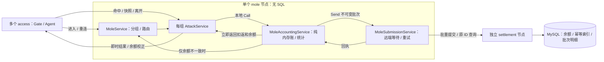

# 目标与逐节点计划

## 1. 目标和当前边界

首个 demo 完成持续运行的多人同组打地鼠：用户名密码登录 → 分组与座位 → 共享地鼠 → 每锤扣银子及返还 → 批量入账确认 → 按原 ID 查询已入账结果。用户始终只连接 access。游戏没有固定局长、满员开局或局末结算；旧的“60 秒一局、命中加 1 分”建议已废弃。首版只使用示例银子，不涉及真钱。

2026-10-26 收敛：多个 access、先单个 mole、独立 settlement 节点；组命名为 AttackService，mole 内保留业务记账 Service。settlement 以通用银子变化为主线，后续供斗地主复用，不计算地鼠回报。共享池子先用固定概率表实现 99% 的期望返还，仅统计已入账扣除和返还，不做实时余额控奖。mole 方案与节点内首版实现见第 8 节，settlement 预案见第 9 节；独立钱包结算和客户端仍未实现。

2026-10-27 补充确认：AttackService 本地 Call MoleAccountingService，同步返回内存扣返和余额；独立 MoleSubmissionService 等待远端结算，结果不一致时只校正余额。mole 整个节点不处理 SQL，所有持久化归 settlement；未提交的内存操作不承诺崩溃恢复，替代此前源端待提交表方案。最终银子入账合法性仍由 settlement 裁决。

2026-10-24 用户明确：实际同时在线目标约 12,000 人，100,000 人用于系统容量余量，约为实际目标的 8.3 倍。两档分别验证，容量估算不作为已完成验收；Online 的后续测试计划见第 6 节。

三人斗地主后续单独确认，优先参考 nbgameserver 的 gameofhlddz/；多人分组和共享目标可参考 GoServerActorFsm。参考代码提供知识，不作为兼容目标。

当前 access 已具备 MAC Gate/Agent 连接基础，login 已实现内部用户名密码认证与管理命令，online 已实现内部位置目录；mole 已完成节点内玩法和记账/提交边界，settlement 和 TypeScript 保持骨架。尚无客户端登录协议、access 到 Online 的业务接入或真实钱包闭环。旧实现和旧方案已移除，不能当作已确认设计继续扩展。

每个节点角色一个独立 Go module，源码默认放该项目根目录；common 仅包含共享配置代码。没有调用者的通用框架、协议目录和业务包不提前建立。

## 2. 推进顺序

| 顺序 | 节点 | 先审查并确认的范围 |
| --- | --- | --- |
| 1 | access | Gate/Agent 的职责和生命周期、连接拥有的数据、最少状态、客户端协议准入及 GSR 接入方式 |
| 2 | login | 最小认证能力、账号来源、输入输出、认证 Service 的职责与调用边界 |
| 3 | online | 是否需要独立节点，位置数据由谁拥有，哪些协调和状态确有必要 |
| 4 | mole | AttackService 分组、共享时间线、每锤扣返、业务记账、统计池及批量提交边界 |
| 5 | settlement | 通用银子变化、余额校验、幂等、批量事务和结果查询，预留斗地主原子结算 |

每次只推进一个节点：

1. 只读核对现有骨架、实际依赖版本和 GSR 文档/示例。
2. 展示简短方案：职责、数据 owner、最少状态、必要协议与调用链、失败与生命周期边界、修改范围和验证方式。
3. 用户确认后实现当前节点。common、协议和 TypeScript 只配套加入该节点必需的内容；其他节点的依赖问题先列出，不自动扩展实现。
4. 展示改动和实际验证，等待用户决定是否提交及推进下一节点。

access 连接基础、login 内部认证、online 目录和 mole/settlement 方案已提交；本轮按确认继续实现 mole，settlement 仍只记录预案。业务状态尽量少，行为相同的状态优先合并；不为调用、重试和存储步骤增加状态。业务契约见 [PROTOCOL.md](PROTOCOL.md)，按使用范围决定是否需要 .proto。

完成五个节点后再联调打地鼠全流程。三人斗地主、access 多实例和第三方登录分别先确认方案，不提前开工。

## 3. access 第一步（已确认）

- MainService 通过 self.Node().OpenCluster/CreateGate 组装 Cluster 和独立 GateService；每条连接由 Gate 创建一个 Agent。采用 SecurityModeMAC，本机仍使用 WS；先完成 33 字节 X25519 握手，上行使用 seq/Envelope/MAC，下行使用 Envelope，不接受 Plain 降级。监听地址及连接数、帧大小、出站队列上限放在 access 的私有 YAML 配置中，握手等待沿用 GSR 默认 5 秒。
- Gate 拥有连接和 I/O；Agent 只持有 ClientSession 与具名协议 Dispatcher，不接触 socket 或连接表，不持有业务状态，也不增加状态机。
- 调用链为客户端 → Gate → Agent.HandleClientMessage → protocol.Dispatcher。只使用 GSR 通用目录和空业务 Handler 表，错误处理沿用框架规则；没有本项目的协议编号、.proto、生成工具或跨节点业务调用。
- Gate 的断线通知进入 Agent.Handle，Agent 调用 self.Exit 后立即返回；OnStop 调用幂等的 ClientSession.Close。MainService 完成组装后退出，Gate 和 Agent 继续由 Runtime 管理；进程停机由 gsr.Run 收尾。任一步启动失败都向宿主返回错误。
- 修改范围是 access 的入口、MainService、根目录 agent.go 和相关测试/配置；common 仅拆出已有的 YAML 读取和宿主配置解析，角色私有字段留在节点中。其他节点和 TypeScript 保持骨架。
- 验证配置边界、断线清理、真实 MAC 握手与递增序号的消息往返、未握手客户端拒绝、单连接故障隔离、停机关闭连接/监听，以及 Gate 启动失败后的 Cluster 释放；对 access 运行 race。密码学和完整攻击向量沿用 GSR 的验证，不在业务项目复制整套测试。

## 4. GSR 与参考边界

- 节点固定 GSR v1.0.2，tag commit 为 6710a766ca40c06a068e52c52456b39f8b3fe78e；节点仅对本仓库 common 使用本地 replace。
- 本轮只读源码与文档 revision 同该 tag；公开 API 以实际依赖版本为准。升级依据为 [v1.0.2 发布说明](https://github.com/cnooljaw/gsr/releases/tag/v1.0.2)、[ADR 0012](https://github.com/cnooljaw/gsr/blob/v1.0.2/docs/adr/0012-node-capabilities-and-service-logging.md)、[ADR 0013](https://github.com/cnooljaw/gsr/blob/v1.0.2/docs/adr/0013-client-protocol-boundaries.md)和业务 AGENTS 模板。
- 接入参考 [独立业务项目开发指南](https://github.com/cnooljaw/gsr/blob/v1.0.2/docs/APPLICATION-DEVELOPMENT.md)；Cluster 调用优先看 [CLUSTER-CALL-TUTORIAL.md](https://github.com/cnooljaw/gsr/blob/v1.0.2/docs/CLUSTER-CALL-TUTORIAL.md)，直接使用框架已有的参数与调用能力。
- Service、状态所有权、消息快照和资源关闭的工作约束见 [AGENTS.md](../AGENTS.md)，编码规则见 [GO-CODE-STYLE.md](GO-CODE-STYLE.md)。
- ../gsr、../../skynet_bt/nbgameserver 和 ../GoServerActorFsm 均只读，不在其中生成、安装、格式化或验证。

### v1.0.2 接入知识

- Gate 的 Protocol/ProtocolMAC/ProtocolPlain 及配置字段 Protocol 改名为 SecurityMode/SecurityModeMAC/SecurityModePlain 与 SecurityMode，不提供旧名别名；握手、seq/MAC、TLS、wire 和生命周期不变。
- 安全模式与业务协议独立，Agent 选择具体 Dispatcher。本项目继续使用 Protobuf `protocol` 包和原 Envelope；新增的 `protocol/sproto` 保留自己的协议与每连接会话，不在此次升级中接入，也不增加统一 Codec。
- `self.Node()` 借用当前 Run 的唯一节点对象，仅在当前回调内使用。名称发布用 RegisterService，监听用 OpenCluster/OpenHTTP，Gate 创建用 CreateGate，ClusterListenAddress 只用于观测；Node 不提供 Close、业务通信或内部资源 getter。
- `self.Cluster()` 仅提供来源绑定的 Send/Call。应用配置使用 `gsr.RuntimeConfig` / `gsr.ClusterConfig`；`self.Logger()` 返回只有 Info/Error 的 `ServiceLogger`，共享 Logger 由 Run 关闭。
- MainService 完成组装后可以 Exit；节点监听和已创建的 Service 继续运行。CreateGate 创建独立 GateService，由 Runtime 管理；CreateService/CreateGate 的 ctx 仅用于启动，不是所创建 Service 的长期生命周期。名称归目标 Service，注册者退出不撤销。
- MainService 启动失败由 Run 统一收尾；普通 Service 启动失败只清理自身，不自动停止已经创建的其他 Service。消息、Source、wire、ValueCodec 与关闭顺序没有变化。
- 远程 Handler 使用 `int64` / `uint64` / `float64` / `[]any` / `map[string]any` 等规范参数；Dispatcher 不做隐式类型转换，集合的 nil/空状态不作为远程业务语义。本地 Args 浅拷贝不隔离内部集合，参数和结果仍须独立快照。
- 节点表 host 为访问地址，OpenCluster 取 port 绑定 `0.0.0.0`，访问限制归部署网络；端口零仅用于动态监听测试，不作为出站路由。本项目集中维护 YAML 节点表，不额外拆分监听配置。

框架升级只更新五个节点的依赖、启动/测试接线及文档，不保留旧入口兼容包装；login 的业务增量单独记录在下节。

2026-10-14 验证：`./scripts/dev.sh check`、`./scripts/dev.sh build` 和 access 的 `go test -race ./... -timeout=2m` 通过，包含真实 WebSocket 接入、停机及启动失败清理。其余节点只验证骨架编译/静态检查，未验收跨节点业务或 MySQL。

2026-10-23 升级 v1.0.2：五个节点的 go.mod/go.sum 已更新，access 迁移为 `SecurityMode: gate.SecurityModeMAC`。统一 check/build 与 access race 通过，覆盖真实 MAC WebSocket、连接隔离、启动失败清理及 login 的 TCP Cluster 认证；五个构建产物均确认依赖正式 v1.0.2。此轮未重跑真实 MySQL 验收。

## 5. login 第一步（已确认）

- 单个 LoginService 负责用户名密码验证，MySQL `gsrdemo_login.accounts` 保存稳定 UserID、唯一用户名和密码摘要；没有账号缓存、Token、LoginID、在线状态或额外状态机。
- 按用户确认采用标准库无盐 SHA-256，仅用于示例；不引入 Argon2id。账号由本节点 `-create-user` 管理命令创建，密码从标准输入读取；不增加远程注册接口。
- 宿主通过 GSR mysqlclient.Open 创建原生数据库池，Run 返回后关闭。MainService 创建并命名 LoginService、打开 Cluster 后退出；Service 仅借用数据库池，每次 SQL 最多等待 2 秒。
- Cluster 命令接收两个 string，返回 uint64；命令、名称及错误定义与 LoginService 放在 loginservice.go，文档契约集中在 PROTOCOL.md。当前没有其他节点消费者，不提前抽共享包。MySQL 驱动沿用 GSR 示例的 v1.10.1；sqlmock v1.5.2 仅用于测试，标准库没有对应模拟驱动。
- YAML 的 mysql_dsn 为 login 私有字段，公开模板不含凭据；本机凭据保存在被忽略的 login-01.local.yaml。schema.sql 只初始化本项目专用库，不修改 GSR 示例库，节点启动不自动建表。
- 默认测试使用 SQL mock 和两个真实 Runtime 的 TCP Cluster 链路，覆盖正确/错误凭据、重复认证、非法输入、数据库错误与账号损坏。真实 MySQL 验收显式开启，使用独占测试账号并清理；未运行时不声称数据库验收完成。
- 本轮不修改 access 或 TypeScript 的业务逻辑，不推进 online；下一节点或客户端登录接入另行确认。

2026-10-14：统一 check（Go test/vet、TS 类型检查）、login race 与 login 构建通过。GSR 的本机 MySQL 凭据已只读复用到本项目私密 YAML；管理员已初始化专用库。`GSRDEMO_MYSQL_INTEGRATION=1 go test -run '^TestLoginLiveMySQL$' -timeout=30s -v` 通过：真实 MySQL 创建账号、拒绝重复覆盖，通过 TCP Cluster 两次认证返回同一 UserID，错误密码/不存在账号均拒绝，测试账号清理成功。此验收不包含 access 客户端登录或跨进程业务联调。

## 6. Online 容量估算与待测计划

- 客户端连接、握手与重连由多个 access 承担；Online 保存位置目录，承受节点间 Bind/Lookup/Unbind 等调用压力。游戏操作直接到房间，不逐次查询 Online，也不把客户端心跳转发给 Online。
- 按单 Online 节点、单 OnlineService 起步，是否分片依据真实业务压测决定。以下是估算与测试目标，不直接代表容量已验收，实际测试证据在本节末尾记录。
- 常态估算假设平均在线 30 分钟，每次上线/下线各一次目录调用，另按平均每 10 分钟一次房间位置更新预留：`人数 ÷ 1800 × 2 + 人数 ÷ 600`。额外查询另计；房间更新接口尚未实现。
- 集中重连估算按每人一次 Bind 加一次 Lookup，即 `人数 ÷ 重连秒数 × 2`。这是 Online 的业务 RPC/s，不是客户端连接数；全用 Call 时请求和回复报文数约为其两倍，不等同于 TCP 包数。

| 档位 | 目录记录数 | 常态估算 | 全量用户 60 秒重连 | 全量用户 10 秒重连 |
| --- | ---: | ---: | ---: | ---: |
| 实际在线目标 | 12,000 | 约 33 RPC/s | 400 RPC/s | 2,400 RPC/s |
| 系统容量余量 | 100,000 | 约 278 RPC/s | 约 3,333 RPC/s | 20,000 RPC/s |

Online 实现后，先验证 12,000 条记录下的持续混合调用和上述两档重连峰值；再验证 100,000 条记录、1,000 RPC/s 持续负载，以及约 3,333～5,000 RPC/s 的重连峰值。100,000 人十秒重连的 20,000 RPC/s 作为边界探索，不预先承诺通过。测试使用多个调用方经真实 TCP 汇聚到同一个 OnlineService，覆盖 Bind/Lookup/Unbind 的真实状态变化与 LoginID 竞争；测量前明确持续时长、延迟和拒绝率门槛，记录实际输入/完成速率、P99/最大延迟、MailboxFull、超时、CPU、GC、堆/RSS、排空时间及最终目录正确性。节点调用压测与 access 长连接压测分别报告。

参考证据：[GSR 性能基线](../../gsr/docs/PERFORMANCE-BASELINE.md)、[混合负载](../../gsr/docs/MIXED-LOAD-VALIDATION.md)。历史测试为单热点 Service 本地 Send 约 9,861/s，以及三分钟总量约 9,800/s（含跨节点 Send 约 1,960/s）；均非吞吐上限，也不直接证明当前版本的单热点跨节点 Call 容量。2026-10-24 独立内存估算程序在 Go 1.24.13/arm64 下使用 `map[uint64]location`，location 含 36 字节 LoginID、9 字节 AccessNode、40 字节 AgentName，字符串分别分配；100,000 条记录 GC 后堆增量约 18.7 MiB。此结果不包含完整节点、队列和网络缓冲，不替代业务实现后的内存测量。

2026-10-24 首轮 Online 容量样本通过（GSR v1.0.2、Go 1.24.13、darwin/arm64）；命令与负载构成见第 7 节，非 race 采样，总耗时约 125 秒。

| 预装记录 | 目标 RPC/s | 实际完成 RPC/s | 60 秒完成数 | P50 | P99 | 最大调用延迟 | 发生器最大迟到 |
| ---: | ---: | ---: | ---: | ---: | ---: | ---: | ---: |
| 12,000 | 2,400 | 2,399.92 | 144,000 | 40.334 μs | 219.458 μs | 84.578 ms | 187.764 ms |
| 100,000 | 5,000 | 4,999.83 | 300,000 | 38.291 μs | 163.750 μs | 40.962 ms | 38.626 ms |

两档调用无错误，所有期望结果、最终逐条位置与清理核对通过，未观察到 Call 返回 MailboxFull 或超时。发生器按绝对时间追赶批次，平均速率达标不表示均匀输入；延迟包括调用端结果核对开销。开发机未做 CPU 隔离，首档采样期间还执行了一次局部 check/build；保留原始尾延迟，不据此归因或宣称生产 SLA。此结果支持单节点方案的初步容量选择，不代表多个真实 access 进程、客户端重连、实际业务流量比例或长期稳定性已验收；第 6 节的完整联调计划仍待执行。

## 7. online 第一步（已确认）

- 一个 OnlineService 独占 `map[uint64]onlineLocation`，按 UserID 保存 LoginID、AccessNode、AgentName。仅提供 Bind/Lookup/Unbind，不保存额外在线布尔值、房间状态、历史登录或墓碑，不访问 MySQL/Redis，不启动业务 goroutine。
- AccessNode 与 AgentName 共同定位连接，支持多个 access 使用相同 Agent 名称。未来各 access 使用独立 Cluster 路由名；当前 access 的多实例配置、客户端认证与路由接线仍是后续范围，不在本轮修改 common、access 或 TypeScript。
- 新 LoginID 替换当前绑定，返回旧位置；相同当前 LoginID 只接受完全相同的地址。Unbind 仅匹配 LoginID，不按接入节点批量清理。命令使用规范标量参数，结果为独立快照或 nil，具体错误与超时/重试约束见 [PROTOCOL.md](PROTOCOL.md#online-位置目录)。
- 沿用 GSR v1.0.2 的 Cluster 教程和双节点示例：MainService 创建并命名 OnlineService，OpenCluster 后退出；Runtime 管理 Service，Run 管理节点。Online 不同步调用其他节点；重启清空目录，后续接入重新绑定，不承诺异常时目录实时准确。
- 代码与命令定义放 onlineservice.go；没有真实业务消费者时不提前提取 common 契约。普通测试覆盖跨节点替换、同 ID 冲突、独立快照、非法输入、两接入节点竞争、旧连接迟到清理、真实 TCP 及重启空目录。
- 容量测试使用 `GSRDEMO_ONLINE_LOAD=1 go test -run '^TestOnlineClusterLoad$' -v -timeout=3m` 显式开启；四个测试接入节点在同一测试进程内各运行一个 Runtime/Cluster，经 TCP 汇聚到实际 Online MainService。两档分别预装 12,000/100,000 条记录，定速 60 秒，目标 2,400/5,000 RPC/s。等量混合 Bind 替换、Lookup、旧 LoginID Unbind；计时后逐条核对最终位置、成功解绑与重复解绑。它是有界四路并发的目录压力样本，不是客户端重连或跨进程部署验收。
- 容量样本不增大队列、不重试失败调用；任何调用/结果错误失败，并检查实际完成速率达到目标的 98%。P99、最大延迟和发生器最大迟到如实报告，不预设生产 SLA；堆/GC 是同进程客户端、服务端与夹具聚合采样，后采样还包含最终核对和清理，不等于 Online 独占 RSS 或精确稳态内存。CPU/RSS、长时间稳定性、实际 access 多实例和全量重连恢复仍需后续联调验收。

2026-10-24 实现验证：`./scripts/dev.sh check online`（common/online test 与 vet）、`./scripts/dev.sh build online`、online 的 `go test -race ./... -timeout=2m` 及上述容量样本均通过。真实 TCP 用例运行多个独立 Runtime/Cluster，并未启动多个 OS 进程；重启测试为有序停止节点后创建新的空目录，不等于强杀恢复演练。没有新增依赖或修改其他节点业务。

## 8. mole 方案与首版实现

### 8.1 已确认边界与参考

- 首版单个 mole、多个 access、独立 settlement；一个进程一个 Runtime/Cluster。mole 全节点不连接数据库，不含 SQL、建表或源端持久化。
- 一个 AttackService 管一个组，最多 3 人、9 洞，有人即可玩、空位可补、随时退出，无固定局长。每秒产生一个目标、有效 2 秒；每锤扣 100，返 0 或 198 各 50%，规则版本 demo-99-v1。期望返还 99，长期收益期望 1%，不动态控奖。
- 不引入通用 FSM、PlayerService、技能、资金冻结或任务框架。只读参考 GoServerActorFsm 的分组、共享时间线、SpawnSeq/命中窗口和快照，不复制其 Actor/FSM 层次。GSR 接线依据 v1.0.2 的 Service owner、Call/Send/Timer 约定。

### 8.2 Service 和状态所有权

| 类型/角色 | 唯一拥有的数据 | 职责 |
| --- | --- | --- |
| MainService | 启动参数 | 创建并命名 Service、OpenCluster 后退出，资源由 Run 管理 |
| MoleService（mole） | UserID → AttackName/登录/成员实例路由、组人数 | 冷路径分组/重连、条件清理、将余额校正转给当前连接 |
| AttackService（每组一个） | 成员/座位/连接地址、地鼠时间线、有限请求记录 | 校验命中、固定扣返、本地 Call 内存记账、立即完成目标、快照与推送 |
| MoleAccountingService（唯一） | 确认余额/版本、内存修订号、待确认扣返、跨组缓冲/在途批次、统计池 | 纯内存预检查与接纳、同步返回结果、归批、应用结算回执；不执行 SQL 或远端 Call |
| MoleSubmissionService（唯一） | 单个不可变批次及待交付回执 | 唯一远端结算调用者，查询初始余额/统计、按原批次幂等提交与重试；不处理 SQL |

统计池只是记账 Service 的私有值对象，累计唯一已入账锤数、扣除、返还及净留存。等待中或被拒绝的操作不计入；它不是可支出的资金账户，也不决定回报。

### 8.3 命中、余额与 UI

1. Enter 冷路径核对 Online 当前绑定，先由 Accounting 复用本地余额视图并取消延迟回收，仅缓存缺失时才经 Submission 查询确认余额进行初始化。错误不当作缓存缺失，未知余额不放行。查询结果实际应用时再次检查该用户的待确认操作：有 pending 就保留确认基线，只有带明确操作结果的回执可推进，防止已入账但回执未到的命中被重复计算。Join 前保留路由，超时重试仍进入同一组；热点直达 AttackName，不逐锤查询 Online。
2. 优先补足人数较多的未满组，分配真实空座位；同用户重连保留组/座位、替换连接。旧 LoginID 不得操作新成员；退出还匹配成员实例，隔离同 LoginID 离开后重进的迟到清理。空组退出，异常组在下次 Enter 时清理目录。
3. Timer 使用一次性 After，处理后再登记；命中和快照按服务端截止时间校验，Timer 迟到不延长窗口。注册失败明确报错。客户端只传 ActionID、SpawnSeq 和洞位，不决定成本/奖励。
4. AttackService 校验登录、目标实例、窗口和占用，生成 HitID（随机组实例 + 单调候选序号），固定抽样一次，然后有限本地 Call Accounting。Accounting 只做内存计算，返回 accepted、Debit、Credit、显示余额、可用额和修订号。命中流程始终处理同一条请求记录，事件只保存在该记录的结果中，不按 HitID 再遍历查找。目标当即完成，客户端直接展示结果，不等待远端回执。
5. 相同 LoginID/ActionID 和内容返回原结果，冲突拒绝；同目标只允许一锤。明确的内存拒绝可释放仍有效的原目标；Call 超时表示未知，保留 HitID/占用，按原请求重试，不重抽样、不当作失败撤销。重试缓存缺失返回 operation_unknown，查询原操作而不重新扣款。
6. 显示余额 = 确认余额 + 全部待确认操作的净变化；可用银子 = 确认余额 − 全部待确认 Debit。待确认返还可显示但不可支付下一锤，按完整 Debit 检查，不只检查净额。金额使用 int64，校验非负成本/返还及溢出。
7. 回执在同一 Accounting 回调中更新较新确认版本、移除已处理待扣、重算显示余额。后续尚未结算的操作继续保留，不能盲目用确认余额覆盖预测，也不能把已包含的扣款再减一次。结果一致不再推一次奖励；不一致只向当前连接推送余额校正，不复活目标、不改变已完成命中，不提交反向财务操作。
8. UI 使用绝对余额和本地 revision 收敛，重复响应不重复加减；accepted 表示内存接纳，committed/rejected 是财务终局状态。修订号仅在当前节点缓存生命周期内有效，重进/重启从新快照建立基线。客户端协议尚未实现，具体前端接线后再验收。

### 8.4 跨组归批、退出与恢复边界

- Accounting 每 100ms 归批，500 操作或约 256KiB 提前封存；实际批次不超上限。一次只保留一个在途批次，确认后立即推进后续积压。全节点待确认最多 4,096 项，确认结果缓存最多 4,096 项，用户目录/账户缓存最多 100,000 条，每组请求最多 1,024 条；达到上限返回忙，不建无界队列。
- Accounting 用一张账户表保存每个用户的确认余额、修订号和退出标记，一次遍历待确认操作计算显示余额与可用额。归批后只保存在途 BatchID，完整提交副本由 Submission 持有。Accounting 只 Send 不可变批次给 Submission。发送未接纳时保留原缓冲和待扣，继续按周期尝试；不会撤销已返回的内存结果。Submission 以有限 Cluster.Call 直接 SubmitBatch，依赖 settlement 的同 ID/同内容幂等契约；超时保留原 BatchID 和内容，100ms 后直接重提，不做 GetBatch 前置查询、不重新抽奖。回执发送未接纳则保留回执重试。
- hitEvent 只含 HitID/UserID/ActionID/AttackName/Sequence/Hole/Debit/Credit/Rule；LoginID 仅用于请求键和成员身份，接入地址只在成员表。不在每锤上复制连接信息。OperationID=HitID；BatchID 封存后内容与顺序不变。
- 退出释放成员而不取消已接纳操作；无待扣即可回收余额缓存，有待扣则等回执后回收。校正按当前 UserID 路由和 LoginID 投递，旧 Agent 不接收新连接结果。组退出不停止独立记账/提交 Service。
- 启动从 settlement 查询历史汇总重建统计池；首次进入或缓存已回收时查询余额，重连优先使用本地账，初始化未完成拒绝计费进入。进程内按原批次重试，重复/旧回执不重复记账或累计统计，旧余额不覆盖新版本。
- **可靠性边界：mole 没有持久化。进程崩溃会丢失未提交的内存操作和批次，已返回的即时结果也可能需要校正；只可重新查询 settlement 已保存的余额、汇总和原操作。** 不承诺恢复丢失的源端批次或地鼠/座位。若将来要求每个即时响应都可靠，需另行确认持久接纳方案，不能仅靠异步内存提交达成。

### 8.5 文件与实施范围

源码按职责命名：moleservice.go、attackservice.go、attackservice_game.go、moleaccountingservice.go、molesubmissionservice.go、moleaccountingservice_wire.go、molepool.go 及对应测试，沿用 main.go/main_service.go。mole 不含数据库适配、schema.sql、MySQL 配置或驱动依赖；此前初始化的源端库不自动删除。

仅本节点使用的命令和 DTO 留在具体 Service 文件中；本地值对象不走远程 ValueCodec，远程契约使用规范 uint64/int64/map/列表，见 PROTOCOL.md。不新增通用 FSM、公共 GameService 或内部 Protobuf。下一步独立 settlement 先展示方案再实施，最后接 access 多实例与 TypeScript。

### 8.6 验证与后续验收

规则和节点用例覆盖目标实例/时间窗口、同目标争抢、请求重复/冲突、完整 Debit 预检查、待确认返还不可消费、同 ID 重试不重复扣返、批次/载荷上限和队列拒绝保留内存操作。

多 Runtime 在同一测试进程中经真实 TCP 验证分组补位、跨接入地址重连、旧登录/成员清理隔离、Join 超时沿用原路由、退出继续提交、Online 不可用及单组 panic 隔离。结算测试 Service 覆盖丢回复后原批次幂等重提、mole 重启重新加载已处理结果、慢提交不阻塞其他组的内存结果、一致时不重复奖励、拒绝时向当前连接校正余额且不复活目标。另覆盖已入账但回执缺失时重连不再查询或重复计算；查询发出后新增命中不被普通快照重设基线，旧批次回执保留后续命中。这里没有真实 MySQL，也不代表多个独立 OS 节点或客户端闭环。

2026-10-27：旧源端 SQL 方案已移除。`./scripts/dev.sh check`（全部 Go test/vet 和 TS 类型检查）、`./scripts/dev.sh build mole`、mole 的 `GOWORK=off go test -race ./... -timeout=2m` 通过。实际 bin/mole 使用公开 YAML、无数据库配置启动监听，经 SIGTERM 正常退出，只回收本次子进程。settlement 仍仅有骨架和下节预案。慢客户端出站积压、Timer admission 丢失、12,000/100,000 在线业务负载、真实结算吞吐与约 0.5～1 秒入账目标仍待后续实测。

## 9. settlement 节点预案（只记录，尚未实现）

### 9.1 以银子变化为主线

- 独立 settlement 进程，先一个 SettlementService；它唯一修改用户持久银子余额和记账记录。mole 和未来 landlord 都通过同一通用契约提交，不导入彼此实现。
- 输入是 Business、BusinessRef、OperationID 和一组用户银子变化；业务规则决定输赢/扣返，settlement 不认识地鼠洞位、地鼠 Timer、斗地主牌型或概率算法，也不维护 mole 的玩法池。
- 一锤是一项原子业务操作，单用户 Debit=成本、Credit=返还；斗地主一局的多个输赢用户是一项原子业务操作，不能因传输分片把它拆成互不关联的扣款和加款。斗地主何时确保输家付得起及收益规则留到该节点设计，不在这里提前建设资金冻结框架。
- 一个传输批次可携带多个互不相关的业务操作。原子性以 OperationID 为单位；银子不足拒绝整个业务操作，不把一个斗地主操作只执行一半，也不连带拒绝批次里无关的地鼠操作。

### 9.2 校验、批量事务和幂等

1. 校验固定版本契约、数量/字节上限、非零用户、非负 Debit/Credit、int64 范围、重复 OperationID 与内容摘要；业务细节只归档，不触发游戏回调。
2. 在同一 MySQL 事务中读取并锁定本批涉及的余额/必要去重记录，按稳定用户顺序访问。同一操作先检查每个付款用户的可用余额能覆盖 Debit，再应用 Credit；不能仅用净额检查。不同操作按封存顺序使用事务内工作副本推进。
3. 余额不足是终局业务结果：该操作所有用户都不变，保存拒绝结果。其他操作仍可处理。SQL/连接/提交失败则整笔数据库事务回滚或结果未知，不能当作终局业务拒绝。
4. 只汇总本次新成功操作的每用户 Debit/Credit，批量更新余额及版本；保存去重索引和完整批次结果。提交后才返回入账确认。所有集合化 SQL 保留有限批次，不在 Go 中逐用户发一条 SQL。
5. 同 OperationID、同内容返回已有终局结果；同 ID 不同内容拒绝。BatchID 同样绑定不可变内容，重试不再次扣返。不能只按 BatchID 去重而容许同一操作换批次重记；重复操作的历史变动不能再次加入本批汇总。

### 9.3 最小存储与明细策略

| 数据 | 首版用途 |
| --- | --- |
| 银子余额表 | UserID、余额、版本；只由 settlement 写入 |
| 紧凑操作索引 | OperationID、请求摘要、所属批次/结果定位；保留必要去重，不复制全部游戏明细或建设分析索引 |
| 结算批次表 | BatchID、请求摘要、来源、顺序、逐操作终局结果和完整原始明细 JSON，以及扣返/成功拒绝汇总 |

银子记账 SQL 都放在 settlement；mole 无数据库连接或待提交表。完整逐锤明细先随批次 JSON 保存在同一事务中，不建独立逐锤分析表、明细节点或外部导出链。它仍写入完整事实和必要的逐操作去重索引，并非消除了每锤的存储成本。按 OperationID 查询可经索引定位批次结果；mole 启动可查询其已入账操作汇总来恢复统计池，汇总以唯一成功操作为准，不能将重复批次返回的历史结果再次计入流水。首版不为此另造缓存体系。

若未来确有必要将完整明细外移，再以同事务 Outbox 或等价可恢复记录保证余额与待导出内容原子提交，消费方去重后可靠保存再清理；本版 settlement 不提前实现导出 Outbox。扣除、返还、数量、业务引用、批次摘要和余额变化需可对账，不能只核对全局净额。批次 JSON 和去重索引不自动过期，保留/归档策略另行确定。

### 9.4 复用与未来验收

mole 调用侧与结算测试 Service 已固定 SubmitBatch、GetBatch、GetOperation、GetBalance、Summary 的 v1 契约，命令编号和字段见 PROTOCOL.md；独立 settlement 实现时遵守同一契约，冻结规范化摘要与财务事务规则。真正由两个节点消费后，再提取最小 common 契约，不搭万能结算框架。

未来需验证：地鼠扣返与斗地主多用户原子变动走同一入口；扣款能力按 Debit 而非净额校验；余额不足不部分执行操作；OperationID/BatchID 重试不重复，内容冲突拒绝；重复操作混入新批次不再累计；数据库回滚/超时/提交成功但回复丢失；重启后终局结果一致；明细与余额可对账。真实吞吐以 SQL/事务测试为准，目标正常约 0.5～1 秒确认，故障时允许延迟但不假报成功。

演示玩法参数与 mole 初始批次/积压/超时上限已随首版固定，见第 8 节；真实结算容量与正常约 0.5～1 秒确认仍需独立 settlement 和客户端闭环实测，不能用候选阈值当作容量承诺。
