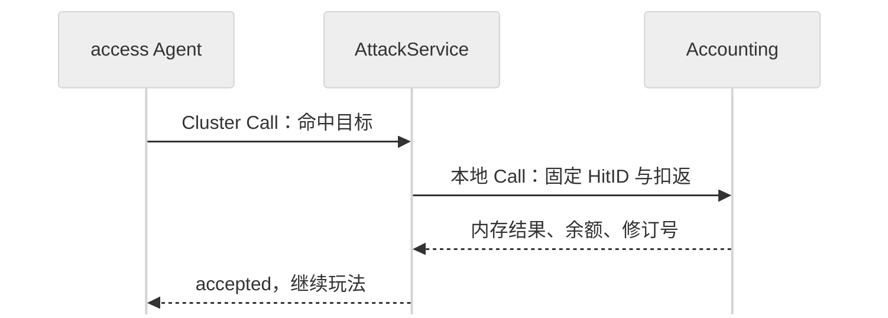
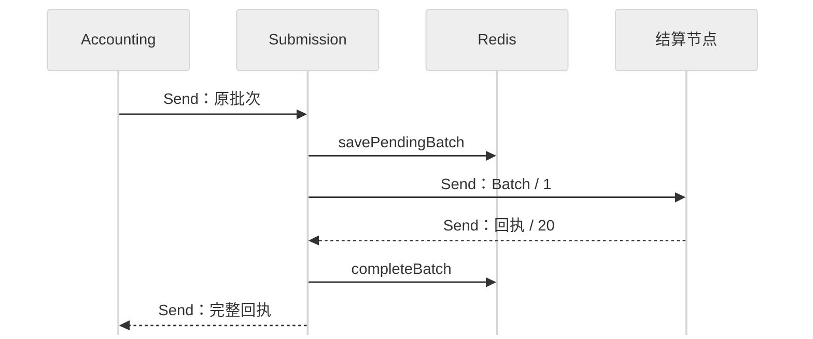

# GSR Demo 系统设计

本文描述当前代码已经实现的职责、调用链、数据归属和故障边界，不记录开发过程、提交历史或逐轮测试成绩。未实现及待确认的工作统一放在[最后一节](#10-后续工作)。协议字段见 [PROTOCOL.md](PROTOCOL.md)，运行与验证命令见 [README.md](../README.md)，编码规则见 [GO-CODE-STYLE.md](GO-CODE-STYLE.md)。

## 1. 系统范围与节点职责

Demo 包含持续运行的多人打地鼠和三人随机房斗地主，使用示例银子。用户只连接 access；账号认证、在线位置、游戏状态和权威账务分别由对应节点管理。

| 节点 | 当前职责 | 主要状态或存储 |
| --- | --- | --- |
| access | MAC WebSocket 接入、每连接 Agent、Token 登录、游戏协议转发与推送 | 当前 UserID/LoginID、连接地址、各游戏路由；无权威钱包或玩法状态 |
| login | 密码认证、平台 AccessToken 的签发/校验/撤销 | MySQL 账号；Redis Token 摘要、UserID 和过期时间 |
| online | Bind/Lookup/Unbind 在线位置目录 | 内存 `UserID → LoginID / AccessNode / AgentName` |
| mole | 分组、共享地鼠、即时内存记账、批量提交及余额校正 | 组状态和余额投影；Redis 源批次与确认统计 |
| landlord | 凑桌、叫抢出牌、局末三人结算与待请求恢复 | 本桌内存状态；Redis 待结算请求 |
| settlement | 通用银子变更、事务、幂等和查询 | MySQL 钱包、操作索引、批次明细与回执 |

当前部署模板为两个 access 实例和其余各一个节点。两个游戏共享 settlement，路由显式配置；Online 不保存房间位置，游戏热点操作不逐次经过 Online。节点之间不导入对方实现，按服务名、命令和参数契约通信。

## 2. 工程与运行模型

### 2.1 GSR 与参考边界

- 各节点使用独立 Go module，固定 `github.com/cnooljaw/gsr v1.0.3`；源码位于节点根目录。`common` 只保留共享配置能力，`typeclient` 是独立 TypeScript 项目；本地 replace 仅指向本仓库 common。
- 节点由 `gsr.Run + MainService` 启动。MainService 创建、命名 Service 并打开 Cluster，组装完成后退出；已创建的 Service 和监听继续运行。外部 MySQL/Redis 客户端由宿主创建，Run 返回后关闭。
- 每份可变状态归一个 Service，普通组件由其 owner 串行调用。独立 Service 提供独立 Mailbox 和等待边界；组件拆分不提供并行能力。业务使用 GSR `Call/Send/After`，不保存回调上下文或启动业务 goroutine。
- 客户端使用 Protobuf Registry/Envelope，Cluster 使用 GSR 的规范 Go 参数。节点地址集中在 [nodes.yaml](../configs/nodes.yaml)，实例 YAML 通过 `nodes_file` 引用；相对路径基于配置文件目录。
- GSR 接入依据为 v1.0.3 的[开发指南](https://github.com/cnooljaw/gsr/blob/v1.0.3/docs/guides/APPLICATION.md)、[Cluster 教程](https://github.com/cnooljaw/gsr/blob/v1.0.3/docs/guides/CLUSTER.md)及 ADR [0012](https://github.com/cnooljaw/gsr/blob/v1.0.3/docs/adr/0012-node-capabilities-and-service-logging.md)、[0013](https://github.com/cnooljaw/gsr/blob/v1.0.3/docs/adr/0013-client-protocol-boundaries.md)。

GSR、nbgameserver、ServerLogic/hlddz 和 GoServerActorFsm 的相邻仓库只读。斗地主的普通牌型与叫抢流程参考 nbgameserver/gameofhlddz、ServerLogic/hlddz；地鼠分组与时间线参考 GoServerActorFsm。参考实现不构成兼容目标，也不引入 C/Lua 运行依赖；修改边界见 [AGENTS.md](../AGENTS.md)。

### 2.2 身份与操作标识

| 标识 | 含义与作用域 |
| --- | --- |
| UserID | MySQL 账号的稳定身份；与钱包主键对应 |
| AccessToken | 认证后签发的平台凭据，用于建立登录，不代表某条在线连接 |
| LoginID | 每次成功登录生成的随机身份，用于隔离旧连接、旧操作和迟到解绑 |
| AccessNode + AgentName | 跨节点推送地址；不使用临时 ServiceID 作为远程业务地址 |
| Membership | 游戏成员实例，隔离离开后重进的迟到清理 |
| ActionID / Turn | 地鼠客户端请求身份 / 斗地主轮次，用于检查重复或迟到操作 |
| OperationID / BatchID | 财务原子操作身份 / 结算请求批次身份，重试不得改 ID 或内容 |

## 3. 接入、认证与登录

### 3.1 连接与协议入口

[access MainService](../nodes/access/main_service.go) 打开 Cluster 并创建 `SecurityModeMAC` Gate。Gate 拥有连接和 I/O，每条连接创建一个 [Agent](../nodes/access/agent.go)。当前模板监听本机 WS；MAC 提供传输认证，不提供加密。

一条连接使用一个 protocolDispatcher 和一个 commandDispatcher：客户端帧进入 `HandleClientMessage`，内部命令进入显式 `Handle`。Agent 只保存会话身份、连接能力和组件路由，不保存手牌、地鼠目标或权威余额。连接与出站队列上限由 access YAML 配置。

客户端协议集中在 [game.proto](../nodes/access/proto/demo/v1/game.proto)，由现有 `generate access` 入口生成 Go/TS 产物。客户端 MsgID 和内部 CommandID 是两个编号空间；注册与冲突检查见[编码规范](GO-CODE-STYLE.md#33-消息注册与分发)。

### 3.2 密码认证与 Token 登录

认证和登录是两个独立步骤：

1. `PasswordAuth`：Agent 调用 `login/auth`。AuthService 查询 MySQL 账号、验证密码，再本地 Call TokenService 签发凭据，返回 UserID、AccessToken、过期时间；此时不填写 Agent 登录身份，也不绑定 Online。
2. `Login`：Agent 调用 `login/token` 校验平台 Token，生成新 LoginID，向 Online 绑定服务端填写的连接地址。成功后保存会话身份；若替换了旧位置，Send 通知旧 Agent 按原 LoginID 退出。

[AuthService](../nodes/login/authservice.go) 和 [TokenService](../nodes/login/tokenservice.go) 使用独立 Mailbox，调用方向仅为 Auth → Token，密码 SQL 等待不会占用 TokenService。账号由 `-create-user` 管理入口显式创建；当前示例使用无盐 SHA-256 密码摘要。

[Token 存储](../nodes/login/token_redis.go) 使用 32 字节安全随机数并作 Base64URL 编码。Redis key 包含 Token 的 SHA-256 摘要，value 只保存 UserID 和过期时间，记录与 TTL 原子写入；不保存明文 Token 或内存凭据副本。默认有效期 24 小时，可配置 1 秒至 7 天；校验不续期。

重复认证可以产生多个有效 Token。普通断线不撤销 Token；显式 Revoke 只影响后续登录，不代替踢线。已登录连接不逐消息访问 Redis，也不会在 Token 过期时自动退出。Redis 不可用时拒绝新认证凭据或新 Token 登录；Redis 数据丢失后需要重新认证。

### 3.3 失败、替换与断线

- 一条连接只允许成功登录一次。客户端的 UserID、LoginID 和后端路由由服务端决定，游戏入口要求已经登录。
- 认证或登录失败时，协议层尝试排队返回错误，Agent 标记 `closing`，停止处理后续客户端业务；私有 `loginFailureCloser` 使用 GSR `After(200ms)` 留出发送窗口，随后关闭会话。创建该 Service 失败时 Agent 立即退出；发送窗口不保证客户端已经收到错误。
- Bind 失败或超时不开放游戏，不自动重发 Bind；按候选 LoginID 尽力清理。普通断线依次调用游戏组件 Disconnect，再条件 Unbind，清空身份；OnStop 关闭连接。
- 进程骤停不能执行清理，Online 或游戏目录可能暂留旧位置，由后续显式登录/进入覆盖。旧 LoginID 的替换通知、操作和解绑不能作用于新登录。

实现入口：[agent_login.go](../nodes/access/agent_login.go)、[agentSession](../nodes/access/agentsession.go)。

### 3.4 多游戏组合与客户端行为

Agent 通过唯一 `games` 清单组装 [Mole](../nodes/access/gameagent/mole.go) 和 [Landlord](../nodes/access/gameagent/landlord.go) 组件。组件实现 `Name / ProtocolHandlers / CommandHandlers / Entered / Disconnect`，从同一清单完成注册、进入互斥和断线清理。一个连接不能同时进入两种游戏，`Entered` 从路由推导，不另存 activeGame。

组件通过 [Dependencies](../nodes/access/gameagent/component.go) 读取当前身份快照、请求进入准入、有界 Call 和客户端 Push；不持有父 Agent 或保存 self。[组装器](../nodes/access/agent_handlers.go) 拒绝空白/重复游戏名、重复编号及占用 Gate 断线命令。推送直接绑定具体方法：地鼠快照 100、余额校正 102、斗地主快照 110；101 用于旧登录替换，不使用 kind 字符串二次分发。

TypeScript CLI 完成密码认证再 Token 登录，也可显式保存 0600 Token 文件，后续直接 Token 登录。银子和身份使用 bigint；地鼠按绝对余额与 revision 接受更新。只有明确的 `target_unavailable` 拒绝会触发重新选目标；超时、繁忙、断线等未知结果停止操作并保留 ActionID，不自动重发命中。地鼠客户端收到 accepted 即继续玩法，斗地主等待终态快照；两者都不追加逐笔查账。

## 4. Online 位置目录

单个 [OnlineService](../nodes/online/onlineservice.go) 独占内存 map，只保存当前 UserID 对应的 LoginID、AccessNode 和 AgentName，不访问数据库或同步调用其他节点。

- **Bind**：新 LoginID 替换当前位置并返回旧位置；当前 LoginID 的相同地址重复提交返回 nil，不把自身作为待踢连接；相同 LoginID 的不同地址报冲突。
- **Lookup**：返回当前独立位置快照，无记录返回 nil。
- **Unbind**：只有 LoginID 匹配才删除，旧连接迟到清理返回 false。

Online 不保存额外在线布尔值、房间状态、历史或墓碑。重启目录为空，需要显式重新登录建立绑定；已进入游戏的命中和出牌直接访问房间，不依赖持续 Lookup。

## 5. 地鼠：即时玩法与后台入账

### 5.1 规则与状态归属

一个组最多 3 人、9 个洞，有人即可玩、空位可补、随时退出，没有固定局长。每秒生成一个目标，有效 2 秒；每锤扣 100，返 0 或 198 的概率各为 50%，规则版本 `demo-99-v1`，期望返还为 99%。目标是否可命中以服务端截止时间为准，Timer 迟到不延长有效期。

| Service | 独占状态与职责 |
| --- | --- |
| MoleService（`mole`） | 用户到组的路由、成员实例及组人数；预留分组、条件清理和转发余额校正 |
| MoleEntryService（`mole-entry`） | 协调 Online 检查、余额初始化及 Join；无权威房间或钱包状态 |
| AttackService（每组一个） | 成员、座位、连接路由、目标时间线和有限请求记录；调用私有 attackGame 处理规则 |
| MoleAccountingService（`mole-accounting`） | 确认余额/版本、待确认扣返、显示修订号、归批缓冲及一个在途批次；只做内存记账 |
| MoleSubmissionService（`mole-submission`） | Redis 检查点、原批次及回执；持久化、提交、恢复与重试，不访问 SQL |

组装见 [MainService](../nodes/mole/main_service.go)，规则见 [attackGame](../nodes/mole/attackgame.go) 和 [molePool](../nodes/mole/molepool.go)。统计池累计唯一已入账的锤数、扣除、返还与净留存，不计等待或拒绝操作，不影响概率，也不是可支出钱包。

### 5.2 进入与即时命中

进入走低频协调：Agent 向 `mole / 1` 获取进入地址，再调用 Entry。Entry 核对 Online 当前绑定，优先复用 Accounting 的余额缓存；仅缓存缺失才查询 `settlement-read` 初始化。错误不视为缓存缺失，有待确认操作时普通余额查询不能改写确认基线。

目录优先补足未满组，Join 前保留路由；Join 超时可能已经成功，保留原路由，不能另开组。确认原组已停止后才清理重选。相同用户重进保留组/座位、更新连接。Entry 在余额初始化前生成本次 Membership，同一身份贯穿 Accounting 缓存与组目录；离开清理同时检查 LoginID 和 Membership，Accounting 也只接受当前 Membership 的回收通知。

即时命中只经过三个参与者，不等待 Redis 或 MySQL：



AttackService 检查 LoginID、ActionID、SpawnSeq、洞位、有效期及占用，生成 HitID 并固定抽奖一次；同目标只接纳一锤。相同身份和内容返回原记录，改目标或洞位报冲突。明确的内存拒绝可释放仍有效的目标；本地 Call 超时按未知处理，保留原 HitID 和占用，不能换 ID 或重抽。重试缓存缺失返回 `operation_unknown`。

[Accounting](../nodes/mole/moleaccountingservice.go) 按完整 Debit 检查可用额，接纳后立即返回结果：

- 显示余额 = 确认余额 + 所有待确认操作的净变化。
- 可用额 = max（确认余额 − 所有待确认 Debit，0）；未确认奖励可显示，但不能支付下一锤。

### 5.3 批次提交与余额校正

Accounting 每 100ms 归批，达到数量或字节阈值时提前提交；每批最多 500 项、256KiB，全局最多 4,096 项待确认操作。只有一个在途批次，缓冲发送未接纳时保留操作，不撤销已经返回的内存奖励。

后台链路按原批次完成持久化、入账和交付：



[Submission](../nodes/mole/molesubmissionservice.go) 的三个动作是 `restoreCheckpoint`、`submitBatch`、`completeBatch`。保存原批次成功后才请求结算；收到有效回执后，先更新 Redis 确认统计、序号并清除待批次，再通知 Accounting，通知未接纳时保留内存回执重试。恢复批次只交付已确认统计，完成初始化后才开放新记账。

Accounting 的 `handleSettlementReceipt → applyReceipt` 更新较新确认余额、释放本批待扣并保留后续操作，重算显示余额；不能把已入账扣款再减一次。确认基线降低而后续批次仍待确认时，显示余额最低为 0，后续待操作继续按原 ID 等待回执，不因显示封底而取消。显示有差异时经 `MoleService → AttackService → 当前 Agent` 推送绝对余额校正，一致时不重复奖励。校正不复活目标、不修改已完成命中、不反向冲账。

### 5.4 检查点与故障边界

[Redis 检查点](../nodes/mole/molesubmissionservice_redis.go) 用一个版本 2 的值保存确认统计、最后序号/批次及至多一个 pending。Lua CAS 整体替换，不在 Lua 中计算金额；已完成的原批次重复处理不累计统计，跨批旧操作按 `origin_batch` 排除重复累计。检查点无 TTL，缺失时必须显式 `-init-accounting`，损坏或旧格式拒绝开放记账；不支持两个活跃 mole 共用同一个 key。

- 未保存 Redis 的内存命中可能在崩溃时丢失；已保存批次按原 ID、顺序和金额恢复，不查询后再抽奖或重新生成请求。
- Send 后约 5～5.5 秒未获有效回执，按原请求重提；临时错误按 100ms～2s 退避。确定性错误保留批次并暂停新记账，非法回执忽略，继续等待原请求的有效结果。
- Leave 不取消已接纳账务；有待扣时保留账户缓存，结清且已离开后才回收。目录/账户上限为 100,000，每组请求记录上限 1,024，已完成记账记录上限 4,096。
- 私有 [molePulse](../nodes/mole/molepulse.go) 用 GSR After 唤醒 owner，目标邮箱满只跳过本次，不切断后续周期。Submission 退出暂停新记账；Accounting 或目录退出使宿主返回失败；单个组退出不停止其他组。

## 6. 斗地主：牌桌与局末结算

### 6.1 凑桌、规则与可见性

[LandlordService](../nodes/landlord/landlordservice.go) 只管理桌预留、人数和用户路由，优先填充可加入的桌；客户端不指定桌号。每桌一个 [AttackService](../nodes/landlord/attackservice.go)，具名组合私有 `attackGame` 和 `roundSettlement`，由本桌串行修改，不增加规则 Service 或共享游戏基类。

[attackGame](../nodes/landlord/attackgame.go) 用一个 phase 表示 `waiting → calling → robbing → playing → finished`，规则如下：

1. 三人入座且全部准备后洗牌，每人 17 张，另留 3 张底牌；随机选择首叫者。首个叫地主者成为候选，不叫者本次不再参与抢地主；有资格玩家依次抢，有人抢后首叫者可最终抢回。无其他候选时可直接确定地主，跳过后续询问。
2. 三人都不叫最多重发两次；第三次仍不叫，清空手牌并回到 waiting，不产生资金变化。重发不重置 Turn。
3. 确定地主后公开底牌并加入地主手牌，由地主领出。叫/抢各 10 秒，超时默认否；出牌 15 秒，跟牌超时不出，领出超时出最小单张。两家不出后，上一出牌者重新领出。
4. 校验当前 LoginID、阶段、Turn、截止时间、持有的具体牌及牌型大小。普通牌型包括顺子、连对、飞机及带牌、四带二、炸弹和王炸等，见 [cards.go](../nodes/landlord/cards.go)。快照只返回本人手牌、他人余牌数及公开牌面；底牌在确定地主后才公开。
5. 等待时离开释放座位；进行中离开/断线只断开推送路由，保留手牌并按超时继续。新登录 Join 更新路由、取得当前快照，旧登录不能操作新成员。

### 6.2 银子规则与结算时机

底分为 10，初次叫地主不翻倍，每次抢地主、炸弹/王炸各翻倍。当前不计算春天、明牌、个人加倍或手续费。设统一倍率为 M：地主胜时地主 Credit=20M、两农民各 Debit=10M；地主负时反向。规则校验倍率和金额上限，三人净变化合计为零。

准备时查询钱包，至少 20 银子才可准备；这是准入预判，不冻结账户。局末使用一个 SettleGroup 原子结算，任一钱包不足时整笔 rejected，余额不变，牌局胜负仍保留；当前不会自动扣光或调整赢家奖励。

确定胜负的当前回调按以下顺序执行：

```text
prepareOperation：固定本局 OperationID 与三人金额
  → submit：保存 Redis 待请求，再 Send settlement-submit / 7
  → 当前回调返回，继续处理快照和其他消息

handleSettlementReceipt：核对原 ID、终态和三人余额
  → applyReceipt：确认本桌财务终态
  → pushSnapshots：向三人的当前连接发起推送
  → deletePendingSettlement：删除 Redis 待记录
```

[roundSettlement](../nodes/landlord/roundsettlement.go) 用 `operation *landlordOperation` 保存固定请求及确认结果，`snapshotFor` 组装本人扣返、状态、余额与版本；[landlordJournal](../nodes/landlord/landlordjournal.go) 只持久化请求字段。正常局末不先广播 finished + pending；客户端以终态快照为结算结果，不再追加查账。主动查快照仍可能看到未确认状态。

### 6.3 重试、清理与恢复

- 每桌注册私有回执地址。请求未知时约 5～5.5 秒后按原操作重提，保存或本地发送失败至少间隔 1 秒；非临时远端错误保留请求并停止自动提交。原始 OperationID 和金额不变。
- 有效回执只应用一次，过滤其他牌局、重复回执和迟到错误。发起推送后就清理 Redis，不等待客户端确认收到；推送失败不撤销入账。删除失败只保留清理标记，从本次等待结束后至少退避 1 秒再清理；等待期间的 Tick 不访问 Redis，也不重新调用结算。
- 每桌私有 [landlordPulse](../nodes/landlord/landlordpulse.go) 通过 GSR After 每 250ms 唤醒本桌，处理超时、重提和清理。结算确认后或全不叫回到 waiting 时，桌通过本地 Call 请求目录释放已离开成员；目录确认无同桌新预留才移除座位。空桌在待记录清理完成后退出；刚创建等待首次 Join 的桌不提前退出。
- 启动时加载 Redis 待请求，为各请求创建恢复专用 AttackService；不发布可加入桌名，也不向旧连接广播，确认并清理后退出。只恢复已保存的局末账务，不恢复进行中手牌。清理前崩溃会再次按原 ID 幂等补交。

## 7. Settlement：并行执行与权威账务

### 7.1 入口与执行边界

[MainService](../nodes/settlement/main_service.go) 组装三个公开 Service：

| 入口 | 调用方式与用途 |
| --- | --- |
| `settlement-submit` | 游戏 Send 写入，1=Batch、6=Single、7=Group；参数带回执节点与服务名 |
| `settlement-read` | Call 查询批次、参与者操作或钱包；余额初始化及受控核查使用 |
| `settlement-write` | 保留相同写规则的 Call 接口，供管理/验收工具使用 |

[异步入口](../nodes/settlement/settlementsubmitservice.go) 解码校验后，从轮转起点向独立执行 Service 投递任务；目标邮箱满或不可用时尝试其他执行者，全部拒绝则尝试回传 busy。入口不做 SQL、不等待结果、不维护回执关联表。各执行者独立执行事务，再直接 Send Command 20 的 `(id, receipt, code)` 给游戏 owner。

默认配置为 8 个执行者、10 个 MySQL 连接、Mailbox 容量 64，见 [settlement YAML](../configs/settlement-01.yaml)。任务在入口生成后到执行前最多等待 2 秒，超期返回 busy、不启动 SQL；SQL 使用独立的 2 秒上下文预算。入口自身 Mailbox 的等待不计入该任务期限。执行者共享连接池，不共享事务或镜像钱包；连接池、热点锁和数据库能力共同限制实际并行。

各游戏及 access 通过 `settlement_node` 选择配置中的目标。可配置其他结算节点共用同一个权威库，行锁与唯一键保护跨节点并发；没有自动发现或切换。执行者退出后不自动重建，余下执行者继续接纳。

### 7.2 财务原子性与幂等

- **Single**：一笔单用户操作；**Batch**：多笔按顺序判定的单用户操作；**Group**：一笔多用户整体操作。地鼠使用 Batch，斗地主每局立即提交 Group。
- OperationID 定义财务原子性，BatchID 定义结算请求身份。多人操作不能拆成分别付款和收款；单/多人入口会派生稳定 BatchID。回执地址只用于投递，不参与财务摘要。
- 请求规范化后作 SHA-256 摘要；同 BatchID 同内容返回原回执，不同内容报冲突。同 OperationID 跨批次出现时核对内容，沿用原终态及 origin_batch，不重复入账。幂等记录不自动过期。
- settlement 只解释非负 Debit/Credit 和金额边界，不解释地鼠概率、牌型、输赢或 Reason 的业务含义。业务明细随批次保存；统计池归 mole，不由结算服计算。

[事务实现](../nodes/settlement/settlementservice_mysql.go) 为一个批次开启一个 MySQL 事务：

1. 核对已有批次和操作，再按 UserID 稳定顺序 `FOR UPDATE NOWAIT` 锁定钱包；行锁冲突回滚并返回可重试的 store_unavailable。
2. 按请求顺序处理操作；先汇总每名用户的完整 Debit/Credit，再检查扣款能力、余额与版本溢出，全部参与者通过后一起修改。每用户每笔成功 Operation 只递增一次版本。
3. 余额不足等业务拒绝保存为 rejected，同批其他操作仍可成功；Group 不产生部分资金变化。
4. 将钱包、操作索引、批次明细及完整回执同事务提交，Commit 成功才返回。SQL/连接/提交错误不伪装成业务拒绝；回复未知时调用方保留原 ID 重试。

需要 MySQL 8.0+ / InnoDB。NOWAIT 处理行锁冲突，不能代替所有 I/O 的等待预算。Send 只表示接纳，丢请求或丢回执由游戏 owner 的原 ID 重试恢复；结算服没有持久队列、Outbox 或回执确认机制。

### 7.3 持久化表与初始化

| 表 | 当前用途 |
| --- | --- |
| `silver_balances` | UserID、amount、version，唯一持久钱包 |
| `settlement_operations` | 全局 OperationID、摘要、原批次及位置、business/status、扣返汇总 |
| `settlement_batches` | BatchID、摘要、规范请求 JSON 和完整回执 JSON |

[schema.sql](../nodes/settlement/schema.sql) 由管理员初始化专用库，节点启动不自动迁移。普通结算不创建钱包，缺失时报 wallet_not_found。`-init-wallet UserID -silver Amount` 是独立管理入口，以固定 `wallet-init-{UserID}` 操作完成初始化；同金额重复执行返回原结果，不同金额或缺失初始化凭据时拒绝覆盖。账号创建不自动创建钱包。

## 8. 持久化与故障边界汇总

| 数据 | owner 与持久化 | 故障后的实际行为 |
| --- | --- | --- |
| 账号 | login / MySQL | Token 校验不查询账号 SQL；密码认证受账号库可用性影响 |
| Token | login / Redis 摘要记录与 TTL | Redis 保留时可跨 login 重启校验；丢失后重新认证 |
| 在线位置 | online / 内存 | 重启清空，通过显式登录重建 |
| 地鼠目标、座位与未保存命中 | mole / 内存 | 进程崩溃不恢复；已保存账务另行补交 |
| 地鼠检查点 | Submission / Redis | 恢复原批次与确认统计，不恢复原游戏房间 |
| 斗地主手牌与进行中阶段 | 本桌 AttackService / 内存 | 节点重启不恢复牌局 |
| 斗地主待结算请求 | 本桌 / Redis Hash | 原 ID 补交，确认后删除；不积累成功历史 |
| 钱包与幂等终态 | settlement / MySQL | 跨执行者、节点和重试复用原财务结果 |

Redis 与 MySQL 之间没有跨库事务。恢复依赖 Redis 中已经保存的请求，不能弥补尚未保存的内存数据或存储丢失；游戏 Redis 需按部署要求持久化、备份并避免驱逐待请求。业务进程的重启由外部管理，当前代码没有自动拉起或全局恢复协调器。

## 9. 验证依据与设计取舍

### 9.1 行为覆盖入口

下表是当前测试代码的职责索引，不是本次文档整理重新运行的验收报告。执行条件与命令统一见 [README 开发与验证](../README.md#开发与验证)。

| 设计边界 | 对应测试 |
| --- | --- |
| 认证不等于登录、失败回包后关闭 | [agent_auth_test.go](../nodes/access/agent_auth_test.go)、[tokenservice_test.go](../nodes/login/tokenservice_test.go)、[token_redis_test.go](../nodes/login/token_redis_test.go) |
| Online 条件替换/解绑、TCP 与重启空目录 | [onlineservice_test.go](../nodes/online/onlineservice_test.go)、[Cluster 用例](../nodes/online/onlineservice_cluster_test.go) |
| 地鼠内存余额、回执、重试与检查点恢复 | [Accounting 用例](../nodes/mole/moleaccountingservice_test.go)、[检查点用例](../nodes/mole/molesubmissionservice_redis_test.go)、[余额协作用例](../nodes/mole/moleaccountingservice_cluster_test.go)、[提交恢复用例](../nodes/mole/molesubmissionservice_cluster_test.go) |
| 斗地主规则、终态一次应用、删除失败继续清理 | [attackgame_test.go](../nodes/landlord/attackgame_test.go)、[roundsettlement_test.go](../nodes/landlord/roundsettlement_test.go)、[回执集成用例](../nodes/landlord/roundsettlement_cluster_test.go) |
| 事务、全局幂等、锁冲突与异步并行 | [SQL 用例](../nodes/settlement/settlementservice_mysql_test.go)、[真实并发用例](../nodes/settlement/settlementservice_concurrency_live_test.go)、[异步用例](../nodes/settlement/settlementsubmitservice_test.go) |
| 真实客户端、跨接入、结算中断和已保存请求恢复 | [地鼠进程用例](../nodes/access/access_process_test.go)、[跨接入用例](../nodes/access/access_reconnect_test.go)、[地主恢复用例](../nodes/access/access_landlord_recovery_test.go)、[结算恢复用例](../nodes/access/access_settlement_test.go) |

### 9.2 并行与容量取舍

地鼠采用一个在途批次，减少提交顺序和检查点协调；单个 mole 来源不会同时占满所有结算执行者。结算并行用于不同来源和牌局，执行者与数据库连接数需要配套；单批越大，吞吐和等待延迟的取舍也越明显，因此地鼠按周期/阈值提交，不为凑满 500 项额外等待。

现有 [Online 混合调用测试](../nodes/online/onlineservice_load_test.go) 和[结算并行/批次测试](../nodes/settlement/settlementsubmitservice_load_test.go) 提供可复现的短程样本。结算默认 8 个执行者、10 个连接、Mailbox 64 是当前配置选择，不表示生产最优值。测试包含本机、多 Runtime、分散钱包等条件，不能外推为生产在线人数、热点吞吐、长期稳定性或客户端重连能力。

## 10. 后续工作

以下内容尚未实现，或仍需业务方案/部署验收；不属于前文的当前能力。

| 方向 | 待完成内容与边界 |
| --- | --- |
| 游戏期间扣款限制 | 本局及未确认结算期间禁止其他业务扣同一钱包。需在权威扣款入口执行，并定义断线、重启和完成后的释放规则；access 的游戏互斥不能代替资金约束。 |
| 斗地主输光封顶 | 当前余额不足整笔拒绝。后续实扣不超过可结算余额，账户最低为 0，赢家收益按实扣同步调整；多人分配、取整和限制生命周期仍需确认。 |
| 第三方认证 | 微信、苹果及渠道尚未接入；接入时再定义身份映射与认证校验，成功后复用平台 Token 登录。不预建空 Provider 或新节点。 |
| 历史存储 | 短 ID、按日表、冷热归档和清理策略尚未实施；不能在破坏原 ID 幂等约束的情况下直接删除去重记录。 |
| 容量与部署 | 12,000 在线是业务目标，100,000 是容量余量目标。持续负载、真实慢客户端积压、全量重连、热点钱包、认证峰值及生产 WSS 仍需专门验收；当前 Gate 模板上限不是这些容量承诺。 |
| 客户端与自动恢复 | 当前是 CLI，没有图形 UI 或自动重连；自动故障切换、监督拉起、Online 自动重建和进行中牌局恢复均未实现，是否增加需另行确认。 |
