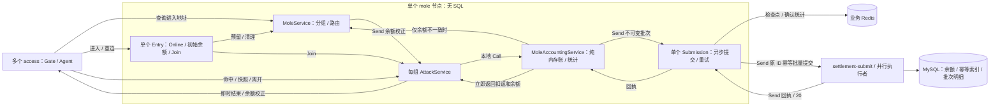

# 目标与逐节点计划

## 1. 目标和当前边界

首个 demo 完成持续运行的多人同组打地鼠：密码认证换 AccessToken → Token 登录并绑定 Online → 分组与座位 → 共享地鼠 → 每锤扣银子及返还 → 后台批量入账 → 有差异时主动余额校正。原 ID 账务查询仅用于受控验收/管理。用户始终只连接 access。游戏没有固定局长、满员开局或局末结算；旧的“60 秒一局、命中加 1 分”建议已废弃。首版只使用示例银子，不涉及真钱。

2026-10-26 收敛：多个 access、先单个 mole、独立 settlement 节点；组命名为 AttackService，mole 内保留业务记账 Service。settlement 以通用银子变化为主线，后续供斗地主复用，不计算地鼠回报。共享池子先用固定概率表实现 99% 的期望返还，仅统计已入账扣除和返还，不做实时余额控奖。mole 方案与节点内首版实现见第 8 节，通用 settlement 实现见第 9 节；当时客户端尚未接入，最新接入状态见第 3 节。

2026-10-27 补充确认：AttackService 本地 Call MoleAccountingService，同步返回内存扣返和余额；独立 MoleSubmissionService 提交批次并接收异步回执，结果不一致时只校正余额。mole 整个节点不处理 SQL，权威银子账务持久化归 settlement，替代此前源端待提交表方案；内存操作与后续 Redis 检查点的恢复边界见第 8 节。最终银子入账合法性仍由 settlement 裁决。

2026-10-24 用户明确：实际同时在线目标约 12,000 人，100,000 人用于系统容量余量，约为实际目标的 8.3 倍。两档分别验证，容量估算不作为已完成验收；Online 的后续测试计划见第 6 节。

三人斗地主已确认并实施第 10 节最小随机房方案，参考 nbgameserver/gameofhlddz 和 ServerLogic/hlddz；多人分组和共享目标可参考 GoServerActorFsm。参考代码提供知识，不作为兼容目标。

当前已完成 MAC Gate/Agent、密码认证与 Redis AccessToken 登录、Online 位置目录、地鼠玩法与业务记账、通用 Settlement/MySQL 持久化，以及 TypeScript CLI 闭环。三个客户端和双 access 已真实联调，接入进程骤停后的局部隔离与跨接入重新登录见第 3 节；未实现的目标不作为已验收能力。

每个节点角色一个独立 Go module，源码默认放该项目根目录；common 仅保留实际共享的配置代码；跨节点业务直接使用 GSR Call/Send。没有调用者的通用框架、协议目录和业务包不提前建立。

## 2. 推进顺序

| 顺序 | 节点 | 先审查并确认的范围 |
| --- | --- | --- |
| 1 | access | Gate/Agent 的职责和生命周期、连接拥有的数据、最少状态、客户端协议准入及 GSR 接入方式 |
| 2 | login | 最小认证能力、账号来源、输入输出、认证 Service 的职责与调用边界 |
| 3 | online | 是否需要独立节点，位置数据由谁拥有，哪些协调和状态确有必要 |
| 4 | mole | AttackService 分组、共享时间线、每锤扣返、业务记账、统计池及批量提交边界 |
| 5 | settlement | 通用银子变化、余额校验、幂等、批量事务和结果查询，预留斗地主原子结算 |

每次只推进一个节点：

1. 只读核对现有骨架、实际依赖版本和 GSR 文档/示例。
2. 展示简短方案：职责、数据 owner、最少状态、必要协议与调用链、失败与生命周期边界、修改范围和验证方式。
3. 用户确认后实现当前节点。common、协议和 TypeScript 只配套加入该节点必需的内容；其他节点的依赖问题先列出，不自动扩展实现。
4. 展示改动和实际验证，等待用户决定是否提交及推进下一节点。

access、login、online、mole/settlement 内部实现已完成；2026-10-30 已确认并实施 access/TS 最小业务接入，见第 3 节。业务状态尽量少，行为相同的状态优先合并；不为调用、重试和存储步骤增加状态。业务契约见 [PROTOCOL.md](PROTOCOL.md)，按使用范围决定是否需要 .proto。

打地鼠全流程、三客户端和 access 双实例接入已完成联调，见第 3 节。三人斗地主已进入第 10 节确认范围；第三方登录仍需选择真实提供商并确认方案。

2026-10-30 优先级调整：Demo 先保持简单，下一阶段优先完成 TypeScript 客户端 → access 登录 → Online 绑定 → 进入地鼠 → 即时命中反馈与结算确认的业务闭环，具体接入方案已随后确认并实施，见第 3 节。Login 保持单个认证 Service，多认证入口、小队列背压及实例监督恢复暂缓，仅作为后续优化备忘；其他非必要的隔离扩展也不抢在闭环之前实施。当前 Mole/Settlement 的简化与故障边界以第 8、9 节为准。

2026-11-02 业务优先：暂缓慢客户端真实积压及持续负载验收，先推进未完成业务。打地鼠闭环已完成；已确认下一节点为三人斗地主，具体范围与实施结果见第 10 节。第三方登录尚未选择真实提供商；结算短 ID、日表和冷热归档保持第 9.8 节的后续存储改造计划。

## 3. access 接入

### 3.1 初始连接基础（历史基线）

- MainService 通过 self.Node().OpenCluster/CreateGate 组装 Cluster 和独立 GateService；每条连接由 Gate 创建一个 Agent。采用 SecurityModeMAC，本机仍使用 WS；先完成 33 字节 X25519 握手，上行使用 seq/Envelope/MAC，下行使用 Envelope，不接受 Plain 降级。监听地址及连接数、帧大小、出站队列上限放在 access 的私有 YAML 配置中，握手等待沿用 GSR 默认 5 秒。
- Gate 拥有连接和 I/O；Agent 只持有 ClientSession 与具名协议 Dispatcher，不接触 socket 或连接表，不持有业务状态，也不增加状态机。
- 调用链为客户端 → Gate → Agent.HandleClientMessage → protocol.Dispatcher。只使用 GSR 通用目录和空业务 Handler 表，错误处理沿用框架规则；没有本项目的协议编号、.proto、生成工具或跨节点业务调用。
- Gate 的断线通知进入 Agent.Handle，Agent 调用 self.Exit 后立即返回；OnStop 调用幂等的 ClientSession.Close。MainService 完成组装后退出，Gate 和 Agent 继续由 Runtime 管理；进程停机由 gsr.Run 收尾。任一步启动失败都向宿主返回错误。
- 修改范围是 access 的入口、MainService、根目录 agent.go 和相关测试/配置；common 仅拆出已有的 YAML 读取和宿主配置解析，角色私有字段留在节点中。其他节点和 TypeScript 保持骨架。
- 验证配置边界、断线清理、真实 MAC 握手与递增序号的消息往返、未握手客户端拒绝、单连接故障隔离、停机关闭连接/监听，以及 Gate 启动失败后的 Cluster 释放；对 access 运行 race。密码学和完整攻击向量沿用 GSR 的验证，不在业务项目复制整套测试。

### 3.2 最小业务接入（2026-10-30 已确认并实施）

- 初版 Agent 只保存 ClientSession、两个具名 Dispatcher、接入 Node/私有 AgentName、当前 UserID/LoginID 和 entry/attack 路由；没有余额缓存、游戏状态、副本钱包或额外状态机。当前按第 3.5 节采用具名组件组合。
- 客户端先经 PasswordAuth 认证取 Token，再经 Cluster.Call(login/token/2) 校验 Token 并绑定 Online；每次成功登录使用随机 LoginID，每条连接只成功登录一次。具名 Agent 地址在 OnStart 发布，由 GSR 自动退役清理。绑定失败不开放游戏，不盲目重发 Bind，尽力清理候选身份后退出。
- Enter 通过 Mole.ResolveEntry 得到地址，再调用进入通道；之后 Hit/Snapshot/Leave 直接到 AttackName。2026-11-04 移除客户端 Operation Handler 和 Entry / 3 的查账转发；1051/1052 的旧定义及编号保留、不复用。所有 Cluster Call 最多 3 秒；不逐锤查询 Online，不自动重试命中，不改 ActionID 或重抽奖励。
- 普通断线尽力 Leave 和条件 Unbind；OnStop 只关闭连接。重复登录用 Online 返回的旧地址发送 Command 101，旧 Agent 按 LoginID 核对后退出。异常退出/超时可能残留目录或成员；Join 已执行但回执丢失时接入可能尚不知道 AttackName，无法保证当次断线立即释放，后续登录/进入覆盖。没有增加全局撤权或恢复协调器。
- Command 100 接收地鼠快照，102 接收余额校正，分别由组件的独立 Handler 处理；先核对 LoginID，快照另核对当前组，再经 protocolDispatcher.Push 写回。客户端请求与推送使用 nodes/access/proto/demo/v1/game.proto，内部 Cluster 继续传规范 Go 参数；节点不导入彼此实现。客户端身份/节点/路由均不接受外部指定。
- 协议生成器使用发布 GSR v1.0.2 的 schema/目录插件、protobuf Go v1.36.1；TS 使用与该示例一致的 protobuf/protoc-gen-es 2.15.0、Buf 1.73.0、Node 类型 22.20.3。标准库不提供 Protobuf；WebSocket、X25519/MAC 和 CLI I/O 使用 Node 内建功能。Go/TS 生成产物入库，生成操作合并进 scripts/dev.sh generate access，仅写本仓库。
- TS CLI 从 stdin 读取密码，完成 MAC 握手、登录、进入、选目标、命中即时显示并继续玩法、离开；一次演示 1～100 锤。地鼠 CLI 不轮询或等待财务终局，回执由服务端消化、有差异时推送余额校正；退出不保证入账，验收程序在玩法结束后按已知操作 ID 集中核对数据库。64 位值保持 bigint，显示余额采用绝对值及 revision 收敛，缺省确认余额/版本不覆盖已知值，重入以新快照重建基线。超时保留 ActionID 日志并停止，不自动重发；没有自动重连或图形 UI。
- 未修改 Login/Online/Mole/Settlement 的业务实现、表结构或配置；账号与钱包仍走显式管理入口。多 access 部署随后在第 3.4 节实施，其它节点恢复后的重新绑定另行确认；不扩展 Login 隔离或通用监督机制。

本轮验证：新增默认用例通过真实 MAC WebSocket + Cluster TCP 验证错误密码不绑定、Online 绑定失败关闭连接、同连接重复登录拒绝、未登录禁止操作、服务端身份转发、原 ActionID 不改写、拒绝重试无伪造余额、旧 LoginID 推送被忽略、旧连接退出不误删新绑定。TS 单测覆盖固定 MAC 向量、64 位精度、推送/响应交错、旧修订与确认版本、超时迟到和关闭等待。五个独立节点进程 + TS CLI + MySQL + 临时 AOF Redis 已完成 3 次命中/3 次入账：本次扣 300、返 198、初始 10000 → 余额 9898、版本 4；样本数据和进程均由用例独占并清理。统一 check（Go test/vet、TS 编译）通过，TS 检查入口现包含 7 项单测；access 最终全量 race（启用五节点真实 MySQL/TS 用例）和 vet 通过，全部节点与 TS 构建通过。该结果不作为容量或入账延迟目标验收。

2026-11-04 客户端查账收敛：地鼠客户端收到 accepted 即继续下一次玩法，不调用 C2S_OPERATION，也不等待财务终局。access 移除该 Handler 及游戏组件的 Entry 地址缓存，Mole Entry 移除 CommandID=3；旧编号及生成类型保留、不复用。Accounting 收到回执后直接更新确认余额与待扣，有差异通过 102/1062 推送绝对余额校正。Settlement 内部 GetOperation/GetBatch 保留供受控核查；真实闭环测试在客户端完成后按本次已知 ID 集中核对 SQL，不把逐客户端轮询作为入账前置步骤。本段记录地鼠收敛；斗地主后续调整见第 10.3 节。下列历史采样不作为本轮重新验收的结果。

2026-11-04 本轮验证：统一 check/build 通过；Access 全量 race 启用真实 MySQL、临时 Redis、独立节点及 TS 客户端通过（约 33 秒），Mole 全量 race 通过（约 17.7 秒）。验收由测试程序按已知操作 ID 集中核对 SQL，覆盖连续命中、旧查账入口拒绝、余额校正、双接入重连和已保存批次原 ID 恢复。子节点使用普通构建；未重跑容量或持续负载。

### 3.3 三客户端演示（2026-10-30 已确认）

只在 access 将 Domain 错误 mole.target_unavailable 映射为 HitResponse.rejection=target_unavailable，无 HitID、奖励或余额；该错误由 Mole 在接纳记账前返回。CLI 对此输出 miss、刷新快照、稍作随机间隔后继续选目标，只有成功命中才计入 --hits；每次成功前等待/争抢最多 max(15 秒, --timeout-ms)，拒绝不重置预算。超时、断线、繁忙及其它错误仍停止并保留原 ActionID，不将未知结果当成未扣款，不增加通用重试器、Service 或权威状态。

真实五节点 + MySQL/AOF Redis 验证：三个不同账号的独立 CLI 同时运行，进入同一个组，快照出现三名成员；各完成 3 次命中/3 次入账，共 9 个唯一 HitID，逐人余额与版本（均为 4）一致。该次自然并发未出现目标失效，不把它视为拒绝分支验证。额外确定性用例运行真实 CLI，通过 TCP 测试替身返回一次目标失效后成功：只输出一次 miss，刷新到新目标、使用新 ActionID 后入账；超时和繁忙各仅发一次命中后退出。默认接入用例另保护错误类别不匹配时不转换为明确拒绝。统一 check（全部 Go test/vet、TS 7 项单测）及 access 全量 race（启用单/三客户端真实进程、真实 MySQL 和 CLI 失败边界用例）通过。未修改其它节点业务或表结构，保留原账号/钱包初始化流程。

### 3.4 双 access 与故障验收（2026-11-02）

两个 access 共用二进制与 Agent/LoginID/Online 协议，不增加 Service 或业务状态。配置文件、instance、listen 统一按 access-01、access-02、access-03 编号；listen 必须为正整数编号（不足两位补零），且有对应地址表项，不保留 access 别名。每实例使用独立端口和日志目录，路由集中在 configs/nodes.yaml：access-01 为 Cluster 19001 / WS 7888，access-02 为 19006 / 7889。推送仍按 GSR v1.0.2 的 Node + AgentName 定位连接。

真实进程验收由 access 包的 TestAccessClientProcessesLiveMySQL、TestAccessThreeClientsLiveMySQL 和 TestAccessTwoNodesReconnectLiveMySQL 承载；单/三客户端使用五节点，双接入使用六节点。用例创建并清理自己的随机账号、钱包、账务和临时 AOF always Redis，只回收自己启动的进程，不使用 demo1～3。

本次阶段收尾：重新 build 全部节点和 TS 客户端，统一 check（全部 Go test/vet、TS 编译及 7 项单测）通过；启用 GSRDEMO_ACCESS_PROCESSES=1 的 access 全量 race 通过，耗时约 29.1 秒，包含真实 MySQL、Redis 和客户端进程链路。运行命令见 README 的开发与验证部分。

| 场景 | 已验证行为 |
| --- | --- |
| 三个 TS CLI 并发 | 不同账号跨两个 access 进入同组，各完成 3 次命中和入账，共 9 个唯一 HitID；逐人余额、版本一致。错误密码不能进入游戏。 |
| 同账号跨接入重登 | access-01 → access-02 → access-01，UserID 不变、LoginID 更新、旧连接关闭；旧身份迟到解绑返回 false，新接入收到快照；验收核对原 HitID 仅一笔入账。 |
| access-01 骤停 | 收到内存命中后 SIGKILL，Online 暂留旧位置；另一玩家在 access-02 原连接继续命中并入账。受影响账号重新登录 access-02，回到原组和座位，实际再次命中并入账；骤停前后账务各一笔。 |
| 旧客户端查询关闭 | 1051/1052 仅保留定义，access 不接线；已登录玩家的旧查询请求也明确拒绝。Settlement 内部仍限定参与用户可查询，由其原有用例保护。 |
| Online 中断及重启 | 中断时拒绝新绑定并关闭该连接，已进入的游戏继续快照、命中和离开；按原配置重启后目录为空，显式重新登录建立新绑定，旧 LoginID 不能删除它，重新进入可继续推送和唯一入账。 |
| 单 Agent 推送失败 | 同一 Runtime 的两个真实 Agent，向其中一个 ClientSession 注入队列满/连接关闭错误，该 Agent 的 Call 返回 runtime.handler_failed，另一 Agent 仍收到正确余额和修订号；旧 LoginID 不触发写回。 |
| Settlement 中断 | hit 仍即时返回 accepted，验收直接核对 SQL 余额/版本不变且无该 HitID；重启后不重发 hit，原 ID 自动补齐一次，无重复扣款。 |
| 待确认时退出重进 | Settlement 仍停止时主动 Leave，退出后不能读取组快照；重新 Enter 保留待确认扣返、可用余额、确认版本和修订号。退出不取消已接纳账务，恢复后仍只入账一次。 |
| Mole 恢复已保存批次 | 确认原 HitID/扣返已写入 Redis 后强停 Mole，再恢复节点；SQL 的 origin_batch 与原批次一致、操作仅一条，Redis 序号推进、清除 pending，命中和扣返统计仅累计一次。 |
| SQL 已入账但 Mole 未确认 | Mole 停止期间经真实 Settlement 接口提交 Redis 原批次，先核对 SQL 已提交而 Redis 仍为原 pending、统计未变，再启动 Mole；原批次/HitID 不变，钱包版本及业务统计均只增加一次。 |
| 同请求重提及冲突 | 同一连接、LoginID、组和缓存有效期内重提相同 ActionID/目标/洞位，HitID、奖励和余额视图不变；改目标或洞位报错，原请求仍返回原结果。 |
| 缓存预判与最终拒绝 | 通过 Settlement 模拟其他业务扣空钱包，Mole 仍按缓存即时返回内存奖励；最终 insufficient_silver，当前客户端收到较新修订号的余额零值及确认版本。拒绝记录唯一、不增加钱包版本、不计奖池。 |
| 零余额拒绝局限于本人 | 校正后再敲击被内存拒绝，快照中为 rejected 且目标未占用，该 HitID 无账务；同组有余额玩家能命中同一个目标实例并入账。 |

测试保留等待响应期间交错到达的推送，避免漏掉早于响应的余额校正。Redis 检查点通过 redis-cli 只读验收，不新增 Go 依赖；持久化事件字段 HitID 与客户端字段 hit_id 不混用。SQL 已提交未确认场景由真实接口构造，不注入网络丢包或手工改账。

边界：CLI 不自动重连，Online 不自动重建全量目录；未保存的内存命中、原房间及存储丢失不承诺恢复。上述故障测试仅扩展 access 测试，未修改其他节点业务或表结构。单 Agent 故障注入不等于真实慢客户端压测；持续业务负载、出站积压、Redis/MySQL 同时故障及容量/入账延迟目标仍待验收。access 的 race 检查覆盖测试进程，子节点使用普通构建，不宣称全部子进程通过 race。

### 3.5 多游戏与通用协议的组合（2026-11-03 已实施）

access 将持续接入不同游戏，并提供与游戏无关的通用协议。2026-11-03 按确认方案完成组合重构：agent.go 只组装连接与组件，agentsession.go 保存唯一身份并返回值快照，agent_login.go 承载现有通用登录，gameagent/mole.go / gameagent/landlord.go 分别处理各游戏。文件命名不代替职责边界，通用规则见 [Go 编码规范](GO-CODE-STYLE.md#27-接口struct-与构造)。

| 组成 | 职责与数据归属 |
| --- | --- |
| Agent | 连接生命周期、唯一的 UserID/LoginID 与自身地址、统一协议入口和组件组装；协调游戏进入互斥及断线清理。 |
| 通用协议处理 | 按实际职责处理登录等跨游戏能力，不依赖某个游戏的房间路由；新增账号或钱包查询等协议时再增加相应处理，不预建空组件或万能 commonAgent。少量内聚的连接/登录逻辑可以留在 Agent。 |
| gameagent.Mole、gameagent.Landlord 等游戏组件 | 各自持有游戏路由，处理本游戏请求、响应和推送，不持有权威玩法状态或钱包。统一实现 gameagent.Component，根 Agent 只保存 games 清单。Agent 专指每连接的 GSR Service，Component 表示其内部游戏接入组件。 |

接线与扩展：

- 每条连接仍只有一个 Agent、一个 protocolDispatcher 和一个 commandDispatcher，共用现有 Protobuf Registry/Envelope。GSR v1.0.2 的 Dispatcher 接收绑定函数，普通组件的方法可以直接注册，无需组件实现 gsr.Service。
- 通用协议独立注册；各游戏提供 Name、ProtocolHandlers、CommandHandlers、Entered、Disconnect 五个方法。根 Agent 从同一份 games 清单收集注册表、判断进入互斥和执行断线清理。空白游戏名、重复游戏名、重复消息/命令 ID，以及占用 Gate 断线命令，均在组装时拒绝，不静默覆盖。
- 客户端 MsgID 在整个 access 协议目录内唯一，内部 CommandID 在 Agent 的命令表内唯一；两者是不同编号空间。新协议按通用/游戏归属组织和分配编号，不能因组件不同而复用同一目录内的 ID。客户端现有编号和 payload 类型保持兼容，本轮不拆分 .proto 或修改生成流程。
- 游戏推送直接按 CommandID 绑定具体方法：地鼠快照 100、余额校正 102，斗地主快照 110；101 继续用于旧登录替换。推送参数为 LoginID 和快照/余额 map，不传 kind 字符串二次分发。地鼠内部推送签名已调整，access 与 mole 需配套构建、重启，不保留旧 kind 入口。
- Agent 是登录身份的唯一写入处。组件每次回调通过 Dependencies.Identity 取得当前 Identity 值快照，不各自缓存一份 UserID/LoginID；一次注入身份读取、进入准入、有界 Call 和客户端 Push 四种能力，以及只读的 SettlementNode 配置，不保存父 Agent、self 或 Node 上下文。登录和已进入游戏的准入规则集中定义，由需要的入口调用；通用协议不因用户正在某游戏而被要求先进入该游戏。
- 保留同一连接不能同时进入两种游戏的规则，进入互斥由 Agent 协调；各游戏负责自己的离开和路由清理，Agent 按清单顺序尽力清理，单个组件返回错误时记录游戏名并继续清理其他组件和解绑 Online，最后清空身份；OnStop 关闭连接。组件不直接关闭连接或退出 Agent，不自动重试结果未知的业务操作。推送仍校验当前登录及游戏路由。
- 组合不增加并发与故障隔离：组件在同一 Agent 回调中串行执行，远程 Call 必须有限等待；某组件 panic 仍可能终止该连接所属 Agent，不能据此声称游戏组件已独立隔离。不同 Agent 的隔离沿用 GSR 机制，业务错误按当前请求返回。

新增游戏的接入改动只有两类：在 gameagent/ 实现该游戏组件；在 agent.go 的唯一清单追加一项。注册、互斥和清理循环不再逐个增加游戏分支。需要新增协议时，仍须正常维护 .proto、生成代码和客户端，不承诺整个项目只改一个文件。

```go
deps := gameagent.Dependencies{
	Identity:       agent.session.snapshot,
	AllowEnter:     agent.allowEnter,
	Call:           callBackend,
	SettlementNode: settlementNode,
	Push:           agent.push,
}

agent.games = []gameagent.Component{
	gameagent.NewMole(deps),
	gameagent.NewLandlord(deps),
}
```

deps 为每条连接构造，组件持有的是这些能力的函数绑定。SettlementNode 是节点配置中的结算目标；结算只读查询通过有界 Call 访问 settlement-read；客户端逐局查账已停用。Identity 调用时才读取当前 session 并返回值快照，不冻结构造时的身份；Call 的 self 由当前回调临时传入，不保存在依赖中。组件构造仅保存依赖，待 Dispatcher 组装完成后才处理请求或调用 Push。

这是固定组件的显式组装，不新增多层 Dispatcher、动态插件或全局注册机制。Entered 从组件现有路由推导，不另存 activeGame。

复用现有登录、替换、推送、断线、双接入和两游戏闭环用例；补充第三个游戏仅加入清单即可注册与互斥、名称/编号冲突拒绝、清理错误后继续解绑，以及组件读取当前身份的用例。同一类型方法重名由 Go 编译器拒绝，签名/消息类型由 Dispatcher 校验，注册到语义错误的方法仍须通过行为测试发现。

本轮验证：统一 `./scripts/dev.sh check`、`./scripts/dev.sh build` 通过；拆分推送命令后，启用 `GSRDEMO_ACCESS_PROCESSES=1` 的 access/gameagent 全量 race 通过，Access 约 34.1 秒，覆盖真实 MySQL、临时 AOF Redis、双接入重连、三客户端地鼠/斗地主及恢复流程。定向用例验证命令 100/102/110 的直接注册、旧登录/路由过滤和结算差异仅校正当前登录。子节点使用正常构建，不宣称子进程已运行 race。

## 4. GSR 与参考边界

- 节点固定 GSR v1.0.2，tag commit 为 6710a766ca40c06a068e52c52456b39f8b3fe78e；节点仅对本仓库 common 使用本地 replace。
- 本轮只读源码与文档 revision 同该 tag；公开 API 以实际依赖版本为准。升级依据为 [v1.0.2 发布说明](https://github.com/cnooljaw/gsr/releases/tag/v1.0.2)、[ADR 0012](https://github.com/cnooljaw/gsr/blob/v1.0.2/docs/adr/0012-node-capabilities-and-service-logging.md)、[ADR 0013](https://github.com/cnooljaw/gsr/blob/v1.0.2/docs/adr/0013-client-protocol-boundaries.md)和业务 AGENTS 模板。
- 接入参考 [独立业务项目开发指南](https://github.com/cnooljaw/gsr/blob/v1.0.2/docs/APPLICATION-DEVELOPMENT.md)；Cluster 调用优先看 [CLUSTER-CALL-TUTORIAL.md](https://github.com/cnooljaw/gsr/blob/v1.0.2/docs/CLUSTER-CALL-TUTORIAL.md)，直接使用框架已有的参数与调用能力。
- Service、状态所有权、消息快照和资源关闭的工作约束见 [AGENTS.md](../AGENTS.md)，编码规则见 [GO-CODE-STYLE.md](GO-CODE-STYLE.md)。
- ../gsr、../../skynet_bt/nbgameserver 和 ../GoServerActorFsm 均只读，不在其中生成、安装、格式化或验证。

### v1.0.2 接入知识

- Gate 的 Protocol/ProtocolMAC/ProtocolPlain 及配置字段 Protocol 改名为 SecurityMode/SecurityModeMAC/SecurityModePlain 与 SecurityMode，不提供旧名别名；握手、seq/MAC、TLS、wire 和生命周期不变。
- 安全模式与业务协议独立，Agent 选择具体 Dispatcher。本项目继续使用 Protobuf `protocol` 包和原 Envelope；新增的 `protocol/sproto` 保留自己的协议与每连接会话，不在此次升级中接入，也不增加统一 Codec。
- `self.Node()` 借用当前 Run 的唯一节点对象，仅在当前回调内使用。名称发布用 RegisterService，监听用 OpenCluster/OpenHTTP，Gate 创建用 CreateGate，ClusterListenAddress 只用于观测；Node 不提供 Close、业务通信或内部资源 getter。
- `self.Cluster()` 仅提供来源绑定的 Send/Call。应用配置使用 `gsr.RuntimeConfig` / `gsr.ClusterConfig`；`self.Logger()` 返回只有 Info/Error 的 `ServiceLogger`，共享 Logger 由 Run 关闭。
- MainService 完成组装后可以 Exit；节点监听和已创建的 Service 继续运行。CreateGate 创建独立 GateService，由 Runtime 管理；CreateService/CreateGate 的 ctx 仅用于启动，不是所创建 Service 的长期生命周期。名称归目标 Service，注册者退出不撤销。
- MainService 启动失败由 Run 统一收尾；普通 Service 启动失败只清理自身，不自动停止已经创建的其他 Service。消息、Source、wire、ValueCodec 与关闭顺序没有变化。
- 远程 Handler 使用 `int64` / `uint64` / `float64` / `[]any` / `map[string]any` 等规范参数；Dispatcher 不做隐式类型转换，集合的 nil/空状态不作为远程业务语义。本地 Args 浅拷贝不隔离内部集合，参数和结果仍须独立快照。
- 节点表 host 为访问地址，OpenCluster 取 port 绑定 `0.0.0.0`，访问限制归部署网络；端口零仅用于动态监听测试，不作为出站路由。本项目集中维护 YAML 节点表，不额外拆分监听配置。

框架升级只更新五个节点的依赖、启动/测试接线及文档，不保留旧入口兼容包装；login 的业务增量单独记录在下节。

2026-10-14 验证：`./scripts/dev.sh check`、`./scripts/dev.sh build` 和 access 的 `go test -race ./... -timeout=2m` 通过，包含真实 WebSocket 接入、停机及启动失败清理。其余节点只验证骨架编译/静态检查，未验收跨节点业务或 MySQL。

2026-10-23 升级 v1.0.2：五个节点的 go.mod/go.sum 已更新，access 迁移为 `SecurityMode: gate.SecurityModeMAC`。统一 check/build 与 access race 通过，覆盖真实 MAC WebSocket、连接隔离、启动失败清理及 login 的 TCP Cluster 认证；五个构建产物均确认依赖正式 v1.0.2。此轮未重跑真实 MySQL 验收。

## 5. login 认证节点

### 5.1 初版密码验证（历史基线）

- 单个 LoginService 负责用户名密码验证，MySQL `gsrdemo_login.accounts` 保存稳定 UserID、唯一用户名和密码摘要；没有账号缓存、Token、LoginID、在线状态或额外状态机。
- 按用户确认采用标准库无盐 SHA-256，仅用于示例；不引入 Argon2id。账号由本节点 `-create-user` 管理命令创建，密码从标准输入读取；不增加远程注册接口。
- 宿主通过 GSR mysqlclient.Open 创建原生数据库池，Run 返回后关闭。MainService 创建并命名 LoginService、打开 Cluster 后退出；Service 仅借用数据库池，每次 SQL 最多等待 2 秒。
- Cluster 命令接收两个 string，返回 uint64；命令、名称及错误定义与 LoginService 放在 loginservice.go，文档契约集中在 PROTOCOL.md。当前 access 按文档契约调用，不为少量常量单独抽共享包。MySQL 驱动沿用 GSR 示例的 v1.10.1；sqlmock v1.5.2 仅用于测试，标准库没有对应模拟驱动。
- YAML 的 mysql_dsn 为 login 私有字段，公开模板不含凭据；本机凭据保存在被忽略的 login-01.local.yaml。schema.sql 只初始化本项目专用库，不修改 GSR 示例库，节点启动不自动建表。
- 默认测试使用 SQL mock 和两个真实 Runtime 的 TCP Cluster 链路，覆盖正确/错误凭据、重复认证、非法输入、数据库错误与账号损坏。真实 MySQL 验收显式开启，使用独占测试账号并清理；未运行时不声称数据库验收完成。
- 本轮不修改 access 或 TypeScript 的业务逻辑，不推进 online；下一节点或客户端登录接入另行确认。

2026-10-14：统一 check（Go test/vet、TS 类型检查）、login race 与 login 构建通过。GSR 的本机 MySQL 凭据已只读复用到本项目私密 YAML；管理员已初始化专用库。`GSRDEMO_MYSQL_INTEGRATION=1 go test -run '^TestLoginLiveMySQL$' -timeout=30s -v` 通过：真实 MySQL 创建账号、拒绝重复覆盖，通过 TCP Cluster 两次认证返回同一 UserID，错误密码/不存在账号均拒绝，测试账号清理成功。此验收不包含 access 客户端登录或跨进程业务联调。

### 5.2 密码认证与 Redis Token（2026-11-04 首期）

- 节点目录与路由名仍为 login，只组装 AuthService（auth）与 TokenService（token），没有三方实现、渠道空接口或额外节点。AuthService 借用宿主 MySQL 池，负责密码验证与完成认证；TokenService 借用宿主 Redis 客户端，负责 Issue/Verify/Revoke。AuthService 单向本地 Call TokenService，不形成反向等待；密码 SQL 不占用 TokenService 的 Mailbox。内部传规范 Go 参数和独立结果快照，不额外做 Protobuf 编解码。
- 客户端 PasswordAuth(1003/1004) 成功只下发 user_id/access_token/expires_at_ms，不修改 Agent 会话或 Online；随后 Login(1001/1002) 只接受平台 Token，验证后新建 LoginID、绑定 Online，并按原 LoginID 通知旧连接退出。账号创建、稳定 UserID、钱包、游戏和 Online 契约保持原职责。
- Token 用 32 字节安全随机数、Base64URL 编码；Redis 仅存摘要 key、UserID、到期时间，与 TTL 一起原子写入。默认有效期 24 小时，YAML 可设 1 秒到 7 天。校验不续期，普通断线不撤销；重复认证生成新凭据，旧凭据到期或显式撤销前仍有效。多个有效 Token 与只保留一个在线连接是不同规则。
- Token 校验只访问 Redis，不依赖账号 SQL，不持有内存凭据缓存。Redis 不可用拒绝新 Token 登录；数据丢失需重新认证。认证节点重建而 Redis 保留时旧 Token 可校验；已登录连接不逐消息访问 Redis，也不因 Token 过期自动中断。受信任内部 Revoke 影响后续登录，不代替踢线。
- 认证/登录失败先排队返回 ErrorResponse，并把 Agent 标记 closing，不再执行后续客户端业务；仅失败时创建私有 loginFailureCloser，After 200ms 后退出并关闭会话。该 Service 只持有 Gate 的线程安全 ClientSession，不持有借出的 Handler 上下文，也不启动业务 goroutine。Agent 的断线消息仍按当前 LoginID 清理游戏和 Online。错误回包只有有限发送窗口，不声称队列接纳等于客户端收到；CreateService 失败立即退出兜底，不修改只读 GSR。
- 复用固定 go-redis v9.18.0；标准库不提供 Redis 客户端，依赖版本与仓库其他节点一致。宿主创建/关闭外部客户端，有限 Redis I/O 500ms、无透明重试；账号管理 -create-user 仍只连接 MySQL。Login 私密 YAML 若未加 Redis 字段，使用公开默认地址/key/TTL；自定义 Redis 需显式配置。
- TS CLI 默认读取 stdin 密码完成两步，日志只输出 authenticated 的 UserID/到期时间和 login 的 UserID；可通过 --save-token-file 显式保存 0600 文件（不覆盖已有文件），后续 --token-file 直接 Token 登录、不读密码。MAC 不提供加密，生产凭据传输使用 WSS。协议和具体错误见 PROTOCOL.md；本轮没有三方账号映射、刷新 Token、自动重连、钱包冻结或输光封顶。

首期实际验证：统一 build/check（全部 Go test/vet、TS 构建与 8 项测试）通过。Login 全量 race 启用真实 MySQL（约 2.7 秒），覆盖账号认证、Token 摘要/TTL/到期/撤销、Redis 故障安全拒绝、关闭旧 Runtime 后保留 Redis 重建校验，以及慢密码 SQL 不阻塞 TokenService。Access 全量 race 启用独立进程/TS/MySQL/临时 AOF Redis（约 34.2 秒），地鼠、斗地主、双接入和结算恢复通过；补充定向 race 验证认证不等于登录、错误回包后关闭、失败连接不影响旧在线用户，以及真实 CLI 新建 0600 Token 文件后跳过密码认证复用。子节点为普通构建，不宣称子进程运行 race。21 页 HTML 教程更新并通过浏览器布局/交互/打印检查；未做认证峰值容量、Redis 数据丢失后的部署恢复或生产 WSS 验收。

## 6. Online 容量估算与待测计划

- 客户端连接、握手与重连由多个 access 承担；Online 保存位置目录，承受节点间 Bind/Lookup/Unbind 等调用压力。游戏操作直接到房间，不逐次查询 Online，也不把客户端心跳转发给 Online。
- 按单 Online 节点、单 OnlineService 起步，是否分片依据真实业务压测决定。以下是估算与测试目标，不直接代表容量已验收，实际测试证据在本节末尾记录。
- 常态估算假设平均在线 30 分钟，每次上线/下线各一次目录调用，另按平均每 10 分钟一次房间位置更新预留：`人数 ÷ 1800 × 2 + 人数 ÷ 600`。额外查询另计；房间更新接口尚未实现。
- 集中重连估算按每人一次 Bind 加一次 Lookup，即 `人数 ÷ 重连秒数 × 2`。这是 Online 的业务 RPC/s，不是客户端连接数；全用 Call 时请求和回复报文数约为其两倍，不等同于 TCP 包数。

| 档位 | 目录记录数 | 常态估算 | 全量用户 60 秒重连 | 全量用户 10 秒重连 |
| --- | ---: | ---: | ---: | ---: |
| 实际在线目标 | 12,000 | 约 33 RPC/s | 400 RPC/s | 2,400 RPC/s |
| 系统容量余量 | 100,000 | 约 278 RPC/s | 约 3,333 RPC/s | 20,000 RPC/s |

Online 实现后，先验证 12,000 条记录下的持续混合调用和上述两档重连峰值；再验证 100,000 条记录、1,000 RPC/s 持续负载，以及约 3,333～5,000 RPC/s 的重连峰值。100,000 人十秒重连的 20,000 RPC/s 作为边界探索，不预先承诺通过。测试使用多个调用方经真实 TCP 汇聚到同一个 OnlineService，覆盖 Bind/Lookup/Unbind 的真实状态变化与 LoginID 竞争；测量前明确持续时长、延迟和拒绝率门槛，记录实际输入/完成速率、P99/最大延迟、MailboxFull、超时、CPU、GC、堆/RSS、排空时间及最终目录正确性。节点调用压测与 access 长连接压测分别报告。

参考证据：[GSR 性能基线](../../gsr/docs/PERFORMANCE-BASELINE.md)、[混合负载](../../gsr/docs/MIXED-LOAD-VALIDATION.md)。历史测试为单热点 Service 本地 Send 约 9,861/s，以及三分钟总量约 9,800/s（含跨节点 Send 约 1,960/s）；均非吞吐上限，也不直接证明当前版本的单热点跨节点 Call 容量。2026-10-24 独立内存估算程序在 Go 1.24.13/arm64 下使用 `map[uint64]location`，location 含 36 字节 LoginID、9 字节 AccessNode、40 字节 AgentName，字符串分别分配；100,000 条记录 GC 后堆增量约 18.7 MiB。此结果不包含完整节点、队列和网络缓冲，不替代业务实现后的内存测量。

2026-10-24 首轮 Online 容量样本通过（GSR v1.0.2、Go 1.24.13、darwin/arm64）；命令与负载构成见第 7 节，非 race 采样，总耗时约 125 秒。

| 预装记录 | 目标 RPC/s | 实际完成 RPC/s | 60 秒完成数 | P50 | P99 | 最大调用延迟 | 发生器最大迟到 |
| ---: | ---: | ---: | ---: | ---: | ---: | ---: | ---: |
| 12,000 | 2,400 | 2,399.92 | 144,000 | 40.334 μs | 219.458 μs | 84.578 ms | 187.764 ms |
| 100,000 | 5,000 | 4,999.83 | 300,000 | 38.291 μs | 163.750 μs | 40.962 ms | 38.626 ms |

两档调用无错误，所有期望结果、最终逐条位置与清理核对通过，未观察到 Call 返回 MailboxFull 或超时。发生器按绝对时间追赶批次，平均速率达标不表示均匀输入；延迟包括调用端结果核对开销。开发机未做 CPU 隔离，首档采样期间还执行了一次局部 check/build；保留原始尾延迟，不据此归因或宣称生产 SLA。此结果支持单节点方案的初步容量选择，不代表多个真实 access 进程、客户端重连、实际业务流量比例或长期稳定性已验收；第 6 节的完整联调计划仍待执行。

## 7. online 第一步（已确认）

- 一个 OnlineService 独占 `map[uint64]onlineLocation`，按 UserID 保存 LoginID、AccessNode、AgentName。仅提供 Bind/Lookup/Unbind，不保存额外在线布尔值、房间状态、历史登录或墓碑，不访问 MySQL/Redis，不启动业务 goroutine。
- AccessNode 与 AgentName 共同定位连接，支持多个 access 使用相同 Agent 名称。LoginID 是不可复用的字符串业务登录标识，只作相等校验，不是 Core Session 或 Runtime epoch；跨节点业务路由不保存临时 ServiceID。各 access 使用独立 Cluster 路由名；双实例配置、客户端认证和路由接线的当前结果见第 3.4 节，此处保留 Online 自身的边界。
- 新 LoginID 替换当前绑定，返回旧位置；相同当前 LoginID 只接受完全相同的地址。Unbind 仅匹配 LoginID，不按接入节点批量清理。命令使用规范标量参数，结果为独立快照或 nil，具体错误与超时/重试约束见 [PROTOCOL.md](PROTOCOL.md#online-位置目录)。
- 沿用 GSR v1.0.2 的 Cluster 教程和双节点示例：MainService 创建并命名 OnlineService，OpenCluster 后退出；Runtime 管理 Service，Run 管理节点。Online 不同步调用其他节点；重启清空目录，后续接入重新绑定，不承诺异常时目录实时准确。
- 代码与命令定义放 onlineservice.go；没有真实业务消费者时不提前提取 common 契约。普通测试覆盖跨节点替换、同 ID 冲突、独立快照、非法输入、两接入节点竞争、旧连接迟到清理、真实 TCP 及重启空目录。
- 容量测试使用 `GSRDEMO_ONLINE_LOAD=1 go test -run '^TestOnlineClusterLoad$' -v -timeout=3m` 显式开启；四个测试接入节点在同一测试进程内各运行一个 Runtime/Cluster，经 TCP 汇聚到实际 Online MainService。两档分别预装 12,000/100,000 条记录，定速 60 秒，目标 2,400/5,000 RPC/s。等量混合 Bind 替换、Lookup、旧 LoginID Unbind；计时后逐条核对最终位置、成功解绑与重复解绑。它是有界四路并发的目录压力样本，不是客户端重连或跨进程部署验收。
- 容量样本不增大队列、不重试失败调用；任何调用/结果错误失败，并检查实际完成速率达到目标的 98%。P99、最大延迟和发生器最大迟到如实报告，不预设生产 SLA；堆/GC 是同进程客户端、服务端与夹具聚合采样，后采样还包含最终核对和清理，不等于 Online 独占 RSS 或精确稳态内存。CPU/RSS、长时间稳定性、实际 access 多实例和全量重连恢复仍需后续联调验收。

2026-10-24 实现验证：`./scripts/dev.sh check online`（common/online test 与 vet）、`./scripts/dev.sh build online`、online 的 `go test -race ./... -timeout=2m` 及上述容量样本均通过。真实 TCP 用例运行多个独立 Runtime/Cluster，并未启动多个 OS 进程；重启测试为有序停止节点后创建新的空目录，不等于强杀恢复演练。没有新增依赖或修改其他节点业务。

## 8. mole 方案与首版实现

### 8.1 已确认边界与参考

- 首版单个 mole、多个 access、独立 settlement；一个进程一个 Runtime/Cluster。mole 不访问 SQL；源批次和确认统计持久化到业务 Redis，权威余额和账务归 Settlement。
- 一个 AttackService 管一个组，最多 3 人、9 洞，有人即可玩、空位可补、随时退出，无固定局长。每秒产生一个目标、有效 2 秒；每锤扣 100，返 0 或 198 各 50%，规则版本 demo-99-v1。期望返还 99，长期收益期望 1%，不动态控奖。
- 不引入通用 FSM、PlayerService、技能、资金冻结或任务框架。只读参考 GoServerActorFsm 的分组、共享时间线、SpawnSeq/命中窗口和快照，不复制其 Actor/FSM 层次。GSR 接线依据 v1.0.2 的 Service owner、Call/Send/Timer 约定。

### 8.2 Service 和状态所有权

| 类型/角色 | 唯一拥有的数据 | 职责 |
| --- | --- | --- |
| MainService | 启动参数 | 创建并命名 Service、OpenCluster 后退出，资源由 Run 管理 |
| MoleService（mole） | UserID → AttackName/登录/成员实例路由、组人数 | 返回进入地址、短回调预留分组、条件清理、转发余额校正；不等待 Online/SQL/Join |
| MoleEntryService（唯一） | 无权威业务状态 | 核对 Online、加载缓存缺失的余额、请求目录预留并 Join；进入是低频操作，有限等待 |
| AttackService（每组一个） | 成员/座位/连接地址、地鼠时间线、有限请求记录 | 校验命中、固定扣返、本地 Call 内存记账、立即完成目标、快照与推送 |
| MoleAccountingService（唯一） | 确认余额/版本、内存修订号、待确认扣返、一份缓冲/在途批次/序号/统计 | 纯内存预检查与接纳、同步返回结果、归批、应用结算回执；不执行 SQL 或远端 Call |
| MoleSubmissionService（唯一） | 一个 Redis 检查点、一个不可变批次及回执 | 保存源批次、结算重试、持久统计；不处理 SQL |
| MolePulse（私有） | 目标 ServiceID、周期、失败边界 | 只接收自身 Timer；非阻塞唤醒 owner，满队列跳过一次而不停止后续推进 |

统计池是 mole 的业务值对象：Redis 保存确认统计，Accounting 持有本地视图，累计唯一已入账锤数、扣除、返还及净留存。等待中或被拒绝的操作不计入；它不是可支出的资金账户，也不决定回报。



### 8.3 命中、余额与 UI

1. 调用方先向 mole / 1 获取 entry_name，再向该进入通道 / 1 调用 Enter；进入通道核对 Online 当前绑定，先由 Accounting 复用本地余额视图并取消延迟回收，仅缓存缺失时才直接向 Settlement 查询确认余额进行初始化，不与 Submission 排队。错误不当作缓存缺失，未知余额不放行。查询结果实际应用时再次检查该用户的待确认操作：有 pending 就保留确认基线，只有带明确操作结果的回执可推进，防止已入账但回执未到的命中被重复计算。Join 前保留路由，超时重试仍进入同一组；热点直达 AttackName，不逐锤查询 Online。
2. 优先补足人数较多的未满组，分配真实空座位；同用户重连保留组/座位、替换连接。旧 LoginID 不得操作新成员；退出还匹配成员实例，隔离同 LoginID 离开后重进的迟到清理。空组退出，异常组在下次 Enter 时清理目录。
3. 每个需要周期推进的 owner 配一个未命名 MolePulse，只有它自己向自己的 Mailbox 投递 Timer，无业务请求争用。唤醒 owner 失败仍继续下一周期，owner 不再自续约。命中和快照按服务端截止时间校验，Timer 迟到不延长窗口。客户端只传 ActionID、SpawnSeq 和洞位，不决定成本/奖励。
4. AttackService 校验登录、目标实例、窗口和占用，生成 HitID（随机组实例 + 单调候选序号），固定抽样一次，然后有限本地 Call Accounting。Accounting 只做内存计算，返回 accepted、Debit、Credit、显示余额、可用额和修订号。命中流程始终处理同一条请求记录，事件只保存在该记录的结果中，不按 HitID 再遍历查找。目标当即完成，客户端直接展示结果，不等待远端回执。
5. 相同 LoginID/ActionID 和内容返回原结果，冲突拒绝；同目标只允许一锤。明确的内存拒绝可释放仍有效的原目标；Call 超时表示未知，保留 HitID/占用，按原请求重试，不重抽样、不当作失败撤销。重试缓存缺失返回 operation_unknown，由受控验收/管理工具核查原操作；客户端不换 ID 重新扣款，重入刷新余额。
6. 显示余额 = 确认余额 + 全部待确认操作的净变化；可用银子 = 确认余额 − 全部待确认 Debit。待确认返还可显示但不可支付下一锤，按完整 Debit 检查，不只检查净额。金额使用 int64，校验非负成本/返还及溢出。
7. 回执在同一 Accounting 回调中更新较新确认版本、移除已处理待扣、重算显示余额。后续尚未结算的操作继续保留，不能盲目用确认余额覆盖预测，也不能把已包含的扣款再减一次。结果一致不再推一次奖励；不一致只向当前连接推送余额校正，不复活目标、不改变已完成命中，不提交反向财务操作。
8. UI 使用绝对余额和本地 revision 收敛，重复响应不重复加减；accepted 表示内存接纳，committed/rejected 是财务终局状态。修订号仅在当前节点缓存生命周期内有效，重进/重启从新快照建立基线。当前 TS CLI 接入与验收见第 3 节，不据此承诺图形客户端或持续负载目标。

### 8.4 跨组归批、退出与恢复边界

- 一个缓冲、一个在途批次，全局最多 4,096 项待确认操作。每 100ms 归批，500 操作或约 256KiB 提前封存；积压满时明确拒绝新命中。确认结果缓存最多 4,096 项，目录/账户缓存最多 100,000 条，每组请求最多 1,024 条，不建无界队列。
- Accounting 是纯内存 owner，余额计算只遍历本用户的待确认 HitID 索引，不扫描全局 pending；索引在接纳/回执同一回调内更新。只 Send 不可变批次给唯一 Submission，不等待外部 I/O。Send 未接纳保留缓冲，未知结果不撤销已返回的内存奖励。
- Submission 先保存原 BatchID、内容与顺序，再 Send SettleBatch；不做 GetBatch 前置查询、不重新抽奖。约 5～5.5 秒未确认按原请求重发；明确临时错误按 100ms～2s 有界退避重试。身份冲突或损坏检查点等确定性错误保留原批次、暂停新记账；非法回执忽略并继续等待原请求的有效结果。State 可查询 blocked/batch_id，修复后重启恢复。统计保存成功才向 Accounting 交付，未被接纳时保留重发。
- hitEvent 只含 HitID/UserID/ActionID/AttackName/Sequence/Hole/Debit/Credit/Rule；LoginID 和接入地址仅归成员/连接状态。OperationID=HitID；封存后不再改变身份、内容或操作顺序。
- 退出释放成员而不取消已接纳操作；无待扣即可回收余额缓存，有待扣则等回执。校正按当前路由和 LoginID 投递。Join 超时保留预留组；只有明确房间已退出才清理并重新分配。慢 Join 会使后续进入排队，但不阻塞目录和已有房间的命中/快照。
- Submission 恢复一个 Redis 检查点中的统计和原批次，完成后开放 Accounting。统计池直接使用唯一已确认视图，初始化未完成时报不可用，不再分通道汇总。
- 旧版多通道 Redis 演示数据按用户确认不迁移。停止旧 mole 后，将 `redis_key` 改为新 key（默认 `gsrdemo:mole:accounting:v2`），执行一次 `-init-accounting` 创建版本 2 检查点；重复初始化不覆盖有效的新统计/序号。旧格式会明确拒绝。不支持两个活跃 mole 共用该 key。
- **尚未保存到 Redis 的内存命中可丢失；已保存批次按原 ID、内容与序号恢复。** 检查点的统计/最后序号/待处理批次由 Lua CAS 整体替换，Lua 不做数值运算。统计保存成功才交付回执；旧跨批操作和拒绝不重复累计。Redis 故障不越过检查点调用 SQL。键无 TTL，需部署持久化、备份及 noeviction；严重数据丢失由业务离线重建，不承诺 Redis/MySQL 跨库事务。
- 私有 Pulse 在 owner 满队列时继续推进；提交 owner 退出暂停整个 Accounting 的新记账，已有房间仍可查询快照/离开；房间退出只影响当前组。全局 Accounting 或目录退出则宿主返回失败，由外部进程管理器重启。进程资源耗尽或共享 Redis/MySQL 不可用仍是共同故障。单提交链路的吞吐和实际等待后续测量，有证据再增加并行度。

### 8.5 文件与实施范围

源码按职责命名：moleservice.go、moleentryservice.go、molepulse.go、attackservice.go、attackgame.go、moleaccountingservice.go、molesubmissionservice.go、moleaccountingservice_wire.go、molesubmissionservice_redis.go、molepool.go 及对应测试，沿用 main.go/main_service.go。mole 不含 SQL 适配、schema.sql、MySQL 配置或驱动依赖；此前初始化的源端库不自动删除。

AttackService 负责消息、成员、Call/Send 与生命周期；attackGame 私有值对象负责目标、请求记录、接纳结果和独立快照，不为对称新增组件。仅本节点使用的命令和 DTO 留在具体 Service 文件中；本地值对象不走远程 ValueCodec，远程契约使用规范 uint64/int64/map/列表，见 PROTOCOL.md。不新增通用 FSM、公共 GameService 或内部 Protobuf。TypeScript 最小接入和 access 双实例已完成；短 ID、日期表和归档仍作为后续阶段。

### 8.6 当前验证与边界

规则和节点用例覆盖目标实例/时间窗口、同目标争抢、请求重复/冲突、完整 Debit 预检查、待确认返还不可消费、批次/载荷上限、总积压额度和回执释放容量。

多 Runtime 经真实 TCP 与临时 Redis 验证分组补位、跨接入重连、旧登录/成员隔离、Join 超时沿用原路由、退出继续提交、慢进入不阻塞目录和已有房间、周期 owner 满邮箱后继续推进。结算替身覆盖原批次丢回执重提、检查点恢复、慢结算不阻塞即时命中、拒绝时只向当前连接校正余额、迟到结果不覆盖后续命中。永久错误或 Submission 退出暂停新记账，Accounting/目录退出使宿主明确失败；损坏及旧格式检查点拒绝开放业务。

真实 MySQL、独立进程、客户端和异步结算验证入口见 9.4；当前并行/批次成绩见 9.5。内存命中尚未保存到 Redis 时仍可丢失，不承诺 Redis 数据丢失、生产进程自动拉起或持续业务容量。

## 9. settlement 节点与结算实现

### 9.1 职责与接口

游戏写入使用 `Cluster.Send(settlementNode, "settlement-submit", 1/6/7, request, replyNode, replyService)`。一个轻量入口校验规范参数，轮转起点把任务投递到固定数量的 SettlementExecutor，正常路径一次 Send；目标邮箱满时尝试其余执行者，全部拒绝则尝试回传 settlement.busy。入口不做 SQL、不等待执行者、不保存等待结果表。各执行 Service 独立执行 MySQL 事务，Command 20 将 id string、receipt map[string]any、code string 直接 Send 回游戏。SQL 等待只占用对应执行 Service。

默认 worker_count=8、mysql_connections=10、mailbox_capacity=64，均为 YAML 可配置。MySQL 池由宿主创建/关闭，执行者共用池但不共享事务或内存钱包；连接池不足会限制实际并行。所有邮箱有界，任务从入口接纳起排队超过 2 秒即返回 busy，不再启动 SQL；SQL 仍有限 2 秒。保留 settlement-read（2/3/4）和 settlement-write（1/6/7）的受控 Call 接口供已有管理与验收工具；游戏写入不再走该路径。旧 Call 工具不参与本次异步吞吐结论。

游戏只保存原待结算请求和重试时间，不增加 AttemptID 或接收确认。OperationID/BatchID 与内容始终不变；回执地址是投递元数据，不参与账务摘要。每个 owner 注册不可复用的私有回执名称，重启用新地址补交原请求。5 秒加 0～500ms 抖动未确认时，由现有 GSR Pulse 原 ID 重提；Send nil 只表示本地接纳，路由、远端邮箱或回执丢失仍由此恢复。结果 Handler 校验当前业务 ID 与完整回执，终态只应用一次；迟到错误和其他批次回执不能覆盖终态。busy/store_unavailable 限频重试；非法参数、身份冲突或钱包缺失保留请求并暂停自动重试。结算节点不增加持久队列、通用 Outbox、回执确认或业务 goroutine。

Mole 保持一个在途批次，100ms/数量/字节阈值归批，最多 500 项/256KiB；Submission 先存 Redis 再异步提交，回执到达后先完成检查点/确认统计，再通知 Accounting。Landlord 每桌局末存 Redis 后立即 Send，当前回调返回，仍可处理重连/快照；有效终态到达后向三人推送，再清理 Redis。Redis 删除失败只重试清理，不能重新发起已确认结算。

Mole、Landlord、Access 的 settlement_node 显式选择地址表中的目标，默认 settlement；需要时另配 settlement-02，各节点共用权威 MySQL。数据库行锁、唯一键和事务保护跨执行者、跨节点并发；三人一局仍是一个事务，不按用户拆分。没有自动发现或切换。某执行者退出后不自动重建，其余执行者可继续接纳；全部不可用时降载并由外部重启恢复。

按场景分三个入口：SettleSingle 单用户一笔，SettleBatch 多笔独立单人操作，SettleGroup 多用户整体操作。接口共享金额校验、幂等和事务实现，调用方不必统一组装多用户结构。地鼠调用批量入口；棋牌一局可立即调用多人入口，批量周期由调用方决定。GetBatch/GetOperation/GetBalance 提供查询，具体字段和编号见 PROTOCOL.md。

OperationID 定义业务原子性，BatchID 定义传输身份：地鼠一锤是一项单人操作，棋牌一局是一项多人操作；一项多人操作不能拆成独立付款和收款。单人使用 UserID + Items，组操作使用 Changes；每项包含 Reason、非负 Debit/Credit，同用户可有手续费、输赢等多条变化。Reason 只校验格式，不解释含义。Business/BusinessRef/Detail 只用于归档与追溯，settlement 不解析地鼠/牌型/概率/输赢规则。Settlement 不提供业务统计或 Summary；地鼠在业务 Redis 中维护确认统计。

### 9.2 事务、幂等和最少状态

1. 校验规范参数、数量/字节上限、全局操作身份、参与用户/明细数量、非负金额和整数范围；规范化 JSON 后取 SHA-256。批次内操作保持顺序，所有变化按 UserID、Reason、Debit、Credit 排序，保留重复明细。分类或拆分改变即为内容变更。
2. 同 BatchID 已存在时核对摘要，返回原历史回执。同 OperationID 跨入口/跨批次存在时核对内容，沿用原终局结果和 origin_batch，不重新写操作索引或累计金额；冲突拒绝整次请求。
3. 一个批次一个 MySQL 事务，按稳定用户顺序使用 FOR UPDATE NOWAIT 锁定钱包；行锁冲突即回滚并返回可重试的 store_unavailable，不跳过锁定用户，不保存部分多人结果。要求 MySQL 8.0+ / InnoDB；参见 [官方锁定读说明](https://dev.mysql.com/doc/refman/8.0/en/innodb-locking-reads.html)。NOWAIT 只处理行锁，元数据锁、归档读写和磁盘等待仍受 2 秒 SQL 预算限制；复制使用行格式，当前验收环境为 ROW。使用事务内普通 map 工作副本，按操作顺序先汇总每名用户的多条分类明细，再检查完整 Debit 能力、余额/版本溢出，最后应用 Credit。每名用户每笔成功 Operation 只递增一次版本。多人先全部检查再一起修改；批量单人每笔分别判定。
4. 余额不足等业务拒绝保存为终局结果，同批其他操作可成功。只对新成功操作涉及用户批量更新余额/版本，再批量插入新操作索引和完整批次/回执，Commit 成功才返回。
5. SQL/连接/提交错误是未知或失败，不保存成余额不足、不假报入账；事务回滚或调用方用原 ID 重试，已提交但丢回复时返回已有结果。数据库唯一键与余额行锁同时保护重复写入；竞争导致 SQL 失败时按原身份重试。

写/读执行 Service 没有进度状态机、额外后台队列、Timer、监督 Service 或镜像余额缓存。事务临时数据归当前回调；持久终局状态归 MySQL。全局 OperationID 和 BatchID 的去重记录不自动过期。

### 9.3 三张表及初始化

| 表 | 用途 |
| --- | --- |
| silver_balances | UserID、amount、version；银子唯一持久余额 |
| settlement_operations | 全局 OperationID、请求摘要、原批次及位置、业务/终局状态、扣返汇总；支持幂等、定位及离线验收 |
| settlement_batches | BatchID、摘要、规范原始业务明细 JSON、完整回执 JSON；余额和记录同事务提交 |

完整 Reason 明细随批次归档，不丢失同用户的分类构成，不建独立逐锤分析表或明细节点。当前表仍保留金额和业务字段用于离线核对，下一阶段日表再精简；线上 Summary 已移除。保留记录便于按用户变化、操作和批次对账，不只比较净额。需要外移明细或优化大规模历史汇总时再单独确认，本版不做通用 Outbox、MQ 或分布式事务。

用户中心决定钱包创建和初始银子；Settlement 仅执行账务。Demo 的 -init-wallet UserID -silver Amount 模拟用户中心管理入口，不自动接入账号注册。普通 settle(ctx, batch) 不含创建分支；initialize(ctx, userID, amount) 单独开启事务，先查固定初始化凭据，再创建零余额钱包、执行 wallet_init/initial_balance 操作、保存索引/明细/回执并提交。OperationID=wallet-init-{UserID}，BatchID=derived(init, OperationID)。同金额重试返回历史结果，改金额或已有钱包缺少初始化凭据返回冲突。数据库唯一键保证不重复，业务核对摘要并定义返回语义；竞争导致 SQL 失败时回滚，调用方用原身份重试。GetBalance/普通结算遇到缺失钱包报 wallet_not_found；普通 RPC 禁用 wallet_init。

配置为 settlement 私有 YAML mysql_dsn；公开模板留空，私密配置权限 0600。专用库 gsrdemo_settlement，由管理员执行 schema.sql 初始化，应用不自动迁移。驱动与 SQL mock 沿用 login 固定版本（MySQL v1.10.1、go-sqlmock v1.5.2），分别用于真实驱动和可重复失败注入，标准库没有对应实现。mole 不增加 SQL，配套迁移为批量单人参数及通用汇总字段；access/login/online/TS 业务不变。

### 9.4 当前测试与验证边界

| 测试层 | 当前保护的行为 |
| --- | --- |
| 规则与 SQL 单元测试 | 规范参数、金额/版本溢出、完整 Debit、分类摘要、多人原子性、事务回滚、初始化边界、BatchID/OperationID 幂等与内容冲突 |
| Cluster 契约测试 | 规范类型与安全错误码、查询和受控 Call 写接口的命令边界；受控写入口仍供管理/验收工具使用 |
| 异步链路测试 | 慢 SQL 时调用方与其他执行者继续工作、非法请求错误回执、过期排队任务不启动 SQL、不同回执地址并发重提仅入账一次 |
| 真实 MySQL 与独立进程 | 热点钱包锁冲突快速回滚、跨节点幂等和金额守恒、多人事务整体接受/拒绝、地鼠原批次与检查点恢复 |
| Access 端到端 | 真实客户端完成两个游戏，结算服中断、地主重启、已提交未确认恢复、当前登录余额校正及终态只交付一次 |

普通检查使用 `./scripts/dev.sh check settlement`。真实 MySQL 测试显式使用 `GSRDEMO_SETTLEMENT_MYSQL=1 go -C nodes/settlement test -count=1 -race ./... -timeout=3m`，要求已初始化本机专用 gsrdemo_settlement 库和私密配置；独立进程测试还需先构建对应节点。用例只创建/清理自身随机钱包与操作，只回收自身进程。默认测试不代替真实通信、数据库或客户端验收。

当前并行与批次对比见 9.5；钱包、操作幂等记录及回执仍属于权威 MySQL。未保存 Redis 的内存命中、进行中手牌、Redis 数据丢失、自动故障切换、生产长期容量不在当前恢复或性能承诺内。短 ID、按日归档、游戏期间禁止局外扣款及输光封顶尚未实施，具体业务约束见 10.3。

### 9.5 异步并行结算对比

同进程两个独立 GSR Runtime，经真实双向 TCP 与本机 MySQL 验证；每个来源仅一个在途批次，来源间钱包分散。每档核对全部钱包余额、版本、Operation/Batch 唯一记录数量；仅清理本次随机身份。没有修改 MySQL 服务配置、持久化策略或钱包规则，不将这些短程样本当成生产容量。

首轮 16 来源、每批 64 项：1/2/4/8/16 执行者分别约 1.21/2.60/4.29/3.14/4.06 万 Operation/s。4 执行者的池缩至 2 时产生 247 次连接等待。邮箱 4 出现 6 次重试、P99 约 5 秒；邮箱 16/64 该档无重试。

64 来源、每批 64 项、邮箱 64，2/4/8/16 执行者各重复三轮：吞吐中位数约 3.99/6.00/6.69/6.10 万 Operation/s；P99 中位数约 170/80/92/205ms，均无重试且逐档对账通过。选择 8 执行者、10 个连接作为本机吞吐与尾延迟的折中；更少来源可按需降低。邮箱 16/32 在这组突发下出现 24/7 次重试，P99 约 5 秒，故默认 64；128 无额外稳定收益。

批次也存在取舍：64 来源、4 执行者、邮箱 64，批大小 32/128/500 分别约 4.94/5.98/6.71 万 Operation/s，P99 约 43/140/514ms。单批越大吞吐可提高，但尾延迟随之增加；地鼠继续按 100ms/阈值归批，最多 500 项，不逐锤调用，也不为凑满大批额外等待。单个 Mole 的单在途批次不会同时占满全部执行者，池并行用于多个来源和牌局。

复现：`./scripts/dev.sh load settlement`；64 来源三轮确认使用 `GSRDEMO_SETTLEMENT_ASYNC_CONFIRM=1 ./scripts/dev.sh load settlement`。原始结果在本地 `.cache/settlement-async-load.json` 与 `.cache/settlement-async-confirm.json`。未覆盖长时持续负载、任意热点分布或生产机器容量。

2026-11-04 异步改造验收：统一 build/check（全部 Go test/vet 与 TypeScript 8 项测试）通过。Settlement 全量 race 启用真实 MySQL 与独立进程用例通过，最终异步定向 race 复核通过；Mole 全量 race 约 38.2 秒、Landlord 约 14.2 秒。Access 全量 race 启用真实独立节点、三 TS 客户端、MySQL/临时 AOF Redis 约 39.4 秒通过，覆盖结算节点恢复、地主重启及已提交未确认补交。新增实际双向 TCP 验证慢 SQL 下调用方/另一执行者继续工作、非法请求错误回执、过期排队任务不启动 SQL；真实 MySQL 验证不同回执地址并发提交相同批次只入账一次。既有故障用例继续保护 Redis 完成/清理失败、当前登录余额校正、原批次丢回执重提、旧结果过滤和三人终态仅广播一次。HTML 教程同步改为 Send/20 回执，21 页布局/交互/打印与 72 个本地源码链接检查通过。本轮不更改游戏银子封顶/局外扣款限制，也不修改只读 GSR。

## 10. 三人斗地主最小业务闭环（已确认并实施）

本节按用户确认的随机房、AttackService 及完整叫抢流程实施。目标是三个独立 TS CLI 经多个 access 随机入桌，完成一局及多人银子结算。nodes/landlord 为独立 Go module，固定 GSR v1.0.2；access、协议、TS、构建和配置负责必要接线，结算使用第 9 节的异步公共协议。慢客户端积压及持续负载暂缓。

### 10.1 参考与职责

- 只读参考 ../../skynet_bt/nbgameserver/gameofhlddz/roomd1.lua 的随机入座与准备开局；baseattackd.lua 的 asklander/calllanderresult/askrob/roblanderresult 及 gamescene；attackd1.lua 的随机房结束流程。不搬入约局、癞子、赛事、任务、排行及高级托管。
- 算法只读参考 ../../ServerLogic/hlddz/Hlddz_GameLogic.c/.h 的普通无癞子分支和 CompareCard，改写为 Go 纯函数，保留花色牌编码与 3..A、2、小王、大王的大小顺序；不引入 C/Lua 运行依赖，不将参考实现中的非必要兼容行为视为目标。
- LandlordService 只拥有随机凑桌目录、座位预留和用户到桌的路由；优先填满可入座的桌，没有空位再建桌，不等待游戏或结算。当前版本不让客户端指定房间号。
- 每桌一个 AttackService，职责与地鼠 AttackService 类似。它独占座位、准备、手牌、叫抢记录、地主、轮次、上一手牌、截止时间、胜负及本桌局末结果。拆分文件不拆分状态 owner，不新增 BidService、RuleService、通用 FSM 或游戏基类。
- MainService 沿用 gsr.Run、RegisterService、OpenCluster 和 Runtime 生命周期。Agent 只保存当前游戏和具名桌路由，推送仍用 AccessNode + AgentName，并核对 LoginID。依据发布模块 APPLICATION-DEVELOPMENT.md、CLUSTER-CALL-TUTORIAL.md，不保存回调上下文或业务启动 goroutine。

### 10.2 经典叫抢与出牌

业务阶段为等待、叫地主、抢地主、出牌、结束，直接用一个 phase 表示。

1. 三人入座并准备后洗牌，每人 17 张，另留 3 张底牌；服务端随机选择首叫座位，底牌此时不向玩家公开。
2. 按座位顺序询问叫/不叫。不叫者本次发牌不再参与抢地主；首个叫地主者成为候选，若其他两人已经不叫，则直接确定地主。
3. 其余有资格玩家依次选择抢/不抢，每人一次机会。如果没人抢，首叫者成为地主；有人抢后，首叫者还有一次最终抢回机会，最后一次选择抢的人为地主，不抢者不会重新参与。
4. 三人都不叫时重新洗牌、发牌、随机选择首叫者，最多重发两次；第三次仍无人叫，结束本局，不产生资金变化，回到等待准备。不强行指定地主。轮次号在重发牌时不归零。
5. 确定地主后公布 3 张底牌并加入地主手牌，形成 20/17/17 张，由地主领出。叫/抢默认各等待 10 秒，超时按不叫/不抢处理；出牌默认 15 秒，跟牌超时不出，领出超时出最小单张。
6. 出牌校验当前 LoginID、阶段、轮次、持有的具体牌及牌型大小；首出不能不出，两家不出后由上一出牌者重新领出。非法操作不修改手牌、轮次、倍率或截止时间。超时结果未知时用快照核实，不自动重复操作。
7. 实现普通单张、对子、三张、三带一/对、顺子、连对、三连、飞机及带翅膀、四带二、炸弹和王炸。纯函数用例固定飞机带牌、四带二及连牌长度边界，不因演示机器人只出简单牌而省略规则。
8. 游戏中仅本人可见手牌，其他玩家只见余牌数；快照包含阶段、当前操作者、轮次、候选/确定地主、公开叫抢记录、倍率和截止时间。叫抢前底牌隐藏，确定地主后公开；已打出的牌公开。
9. 等待时离开释放座位；叫抢及出牌中断线保留牌位，按上述超时规则继续。重登更新本人的连接地址并恢复当前阶段快照；旧 LoginID 的离开或迟到操作不能影响新成员。

验收至少覆盖：叫→不抢→不抢；叫→抢→不抢→首叫者抢回/放弃；不叫→叫→抢；不叫→不叫→叫；三人都不叫；非当前玩家、旧轮次、重发牌后的迟到请求；叫抢期间断线重连。

### 10.3 银子、倍率与恢复

- 底分 10；保留与叫抢直接相关的倍率：初次叫地主不翻倍，每次抢地主翻倍，包括首叫者最终抢回。炸弹/王炸也各翻倍一次；暂不引入明牌、个人加倍、底牌花色倍率、春天或手续费。不扩展通用倍率框架。
- 设当前统一倍率为 M：地主胜时地主 Credit=20M，两农民各 Debit=10M；地主负时反向，始终保留非负 Debit/Credit、合计净变化为零。所有倍率及金额计算检查溢出，Settlement 只接收最终通用资金变化，不解释叫抢或牌型。
- 准备时检查钱包存在及最低参与余额，仅作准入预判，不能承诺覆盖后续倍率或其他业务扣款。最终使用现有 SettleGroup，任一钱包不足整笔拒绝；不部分入账、不假报财务成功，不改变已确定的牌局胜负。本版不引入钱包冻结。
- 正常局末不广播 finished + pending；在确定胜负的当前回调中保存并异步提交结算，收到有效回执后只向三位玩家各广播一次最终结果。pending 仅保留为服务端未确认状态，结算异常时主动查询快照仍可看到 pending，不假报成功。
- 一局一个唯一 OperationID，确定胜负的当前回调先把完整局末请求保存到本游戏独立 Redis key，保存成功后 Send settlement-submit / 7，回执由本桌 Command 20 处理。结算服中断或回执未知时，本桌按原 ID 和内容间隔重试；地主节点重启恢复已保存的请求。每桌只处理本桌结果，等待和故障限制在本桌，不增加全局串行结算队列；landlord 不处理 SQL。
- Redis 只保留待确认请求用于故障恢复，不保存成功历史，也不用于吞吐优化。有效 committed/rejected 回执立即更新并推送本人扣返、余额与版本，然后删除待记录；清理失败只重试删除，不回退财务终态、不在存活进程内重复调用结算服。三人全部离开后，桌 Service 清理完成再退出；若清理前节点崩溃，重启仍以原 ID 幂等补交并清理。Redis 持续故障时待记录会保留，恢复后清理，不以 TTL 丢弃未确认请求。
- 客户端使用终态快照，不再通过 Operation 追加查账。Access 移除旧 1151 Handler，1151/1152 定义及编号保留、不复用；受控验收集中核对本次 OperationID 的 SQL 记录与三人钱包。
- 节点重启不恢复正在进行的手牌；Redis 已保存的结果按原 ID 恢复提交。尚未保存成功的局末结果不承诺崩溃恢复，不引入通用 Outbox、MQ 或分布式事务。

后续银子约束（2026-11-04 已记录，尚未实施）：玩家处于本局游戏及未确认结算期间，不允许其他业务减少同一账户的银子；断线或节点重启不能被当作解除限制的依据。该规则需要在权威扣款入口统一执行，不能只依赖 Access 的游戏进入互斥。拟采用输光封顶：实际扣款不超过可结算余额，账户最低为 0；赢家收益必须按实际扣款同步调整，不能只截断输家的扣款而保留足额奖励。多人分配、取整和限制的生效/恢复/释放边界另行确认；当前实现仍按固定三人 Changes 提交，余额不足整笔拒绝，不会自动改成扣光。

### 10.4 代码组织与调用链

节点根目录按实际类型与职责组织；Service、玩法对象与结算组件分别维护自身状态和方法，测试随被测类型组织，不以“按阶段拆文件”代替组件边界：

```text
nodes/landlord/
  main.go                    # 配置、Redis 客户端、信号与 gsr.Run
  main_service.go            # 启动组装、待结算恢复与 Cluster 监听
  landlordservice.go         # 随机凑桌目录，不处理出牌
  attackservice.go           # 本桌命令入口、外部调用与广播编排
  attackgame.go              # 入座、准备、叫抢、出牌、超时与可见快照
  roundsettlement.go         # 本桌资金结果、提交与确认
  landlordjournal.go         # 本游戏 Redis 待结算记录
  landlordpulse.go           # 仅负责定时唤醒本桌
  cards.go                   # 普通牌型与比较纯函数
```

AttackService 具名组合 attackGame 与 roundSettlement；游戏对象处理游戏状态变化，不依赖 GSR/Redis/RPC，结算组件持有局末请求、Redis 依赖、回执地址、重试时间和确认结果。Service 协调外部权限/余额查询、房间目录与广播，不再跨文件直接修改游戏成员或资金结果。两个组件由本桌 Service 串行调用，不增加 Service、Mailbox、goroutine 或父 Service 指针；进行中牌局与局末账务的恢复边界保持不变。2026-11-03 合并旧 attackservice_* 分类文件，按实际类型组织生产代码与测试，不按每条命令新建文件。

客户端 → Agent → LandlordService 获取预留桌地址 → AttackService 入座。之后准备、叫地主、抢地主、出牌/不出、快照及离开直接 Call AttackService；状态变化 Send 到当前 Agent。客户端使用终态快照，不再追加查账；受控验收按原 OperationID 核对账务。业务 Protobuf 每个消息编号使用独立的 payload 类型，遵守现有 GSR Registry 契约。

### 10.5 当前验证

普通规则测试覆盖牌型、叫抢、无人叫地主后的重发、旧轮次、非法操作、倍率溢出与银子守恒。Cluster 测试覆盖三人凑桌、第四人另开桌、重登恢复手牌、旧身份隔离和实际 Pulse 超时推进。

异步结算用例覆盖手动/超时出牌后的 committed/rejected 回执、重复回执和迟到错误过滤、非法回执不改状态、三人终态只推送一次。Redis 删除失败不掩盖终态，空桌继续清理且不重复提交已确认账务。真实客户端/MySQL/AOF Redis 用例覆盖结算节点恢复、地主节点重启补交和 SQL 已提交但游戏未确认：原 ID 唯一入账，余额和版本各变化一次，待记录最终清除。

验证命令和本轮结果见 9.4、9.5。故障用例不承诺恢复尚未保存的局末请求、进行中手牌或丢失的 Redis 数据；游戏期间扣款限制与输光封顶仍为待实施业务。
