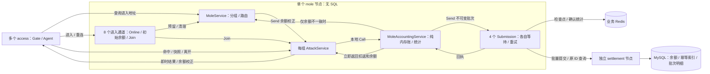

# 目标与逐节点计划

## 1. 目标和当前边界

首个 demo 完成持续运行的多人同组打地鼠：用户名密码登录 → 分组与座位 → 共享地鼠 → 每锤扣银子及返还 → 批量入账确认 → 按原 ID 查询已入账结果。用户始终只连接 access。游戏没有固定局长、满员开局或局末结算；旧的“60 秒一局、命中加 1 分”建议已废弃。首版只使用示例银子，不涉及真钱。

2026-10-26 收敛：多个 access、先单个 mole、独立 settlement 节点；组命名为 AttackService，mole 内保留业务记账 Service。settlement 以通用银子变化为主线，后续供斗地主复用，不计算地鼠回报。共享池子先用固定概率表实现 99% 的期望返还，仅统计已入账扣除和返还，不做实时余额控奖。mole 方案与节点内首版实现见第 8 节，通用 settlement 实现见第 9 节，客户端尚未接入。

2026-10-27 补充确认：AttackService 本地 Call MoleAccountingService，同步返回内存扣返和余额；独立 MoleSubmissionService 等待远端结算，结果不一致时只校正余额。mole 整个节点不处理 SQL，所有持久化归 settlement；未提交的内存操作不承诺崩溃恢复，替代此前源端待提交表方案。最终银子入账合法性仍由 settlement 裁决。

2026-10-24 用户明确：实际同时在线目标约 12,000 人，100,000 人用于系统容量余量，约为实际目标的 8.3 倍。两档分别验证，容量估算不作为已完成验收；Online 的后续测试计划见第 6 节。

三人斗地主后续单独确认，优先参考 nbgameserver 的 gameofhlddz/；多人分组和共享目标可参考 GoServerActorFsm。参考代码提供知识，不作为兼容目标。

当前 access 已具备 MAC Gate/Agent 连接基础，login 已实现内部用户名密码认证与管理命令，online 已实现内部位置目录；mole 已完成节点内玩法和记账/提交边界，settlement 已实现通用结算与 MySQL 持久化，TypeScript 保持骨架。尚无客户端登录协议、access 到 Online 的业务接入或真实客户端钱包闭环。旧实现和旧方案已移除，不能当作已确认设计继续扩展。

每个节点角色一个独立 Go module，源码默认放该项目根目录；common 仅包含共享配置代码。没有调用者的通用框架、协议目录和业务包不提前建立。

## 2. 推进顺序

| 顺序 | 节点 | 先审查并确认的范围 |
| --- | --- | --- |
| 1 | access | Gate/Agent 的职责和生命周期、连接拥有的数据、最少状态、客户端协议准入及 GSR 接入方式 |
| 2 | login | 最小认证能力、账号来源、输入输出、认证 Service 的职责与调用边界 |
| 3 | online | 是否需要独立节点，位置数据由谁拥有，哪些协调和状态确有必要 |
| 4 | mole | AttackService 分组、共享时间线、每锤扣返、业务记账、统计池及批量提交边界 |
| 5 | settlement | 通用银子变化、余额校验、幂等、批量事务和结果查询，预留斗地主原子结算 |

每次只推进一个节点：

1. 只读核对现有骨架、实际依赖版本和 GSR 文档/示例。
2. 展示简短方案：职责、数据 owner、最少状态、必要协议与调用链、失败与生命周期边界、修改范围和验证方式。
3. 用户确认后实现当前节点。common、协议和 TypeScript 只配套加入该节点必需的内容；其他节点的依赖问题先列出，不自动扩展实现。
4. 展示改动和实际验证，等待用户决定是否提交及推进下一节点。

access 连接基础、login 内部认证、online 目录和 mole/settlement 方案已提交；mole 实现已提交；本轮按确认实现独立 settlement，客户端接入另行确认。业务状态尽量少，行为相同的状态优先合并；不为调用、重试和存储步骤增加状态。业务契约见 [PROTOCOL.md](PROTOCOL.md)，按使用范围决定是否需要 .proto。

完成五个节点后再联调打地鼠全流程。三人斗地主、access 多实例和第三方登录分别先确认方案，不提前开工。

## 3. access 第一步（已确认）

- MainService 通过 self.Node().OpenCluster/CreateGate 组装 Cluster 和独立 GateService；每条连接由 Gate 创建一个 Agent。采用 SecurityModeMAC，本机仍使用 WS；先完成 33 字节 X25519 握手，上行使用 seq/Envelope/MAC，下行使用 Envelope，不接受 Plain 降级。监听地址及连接数、帧大小、出站队列上限放在 access 的私有 YAML 配置中，握手等待沿用 GSR 默认 5 秒。
- Gate 拥有连接和 I/O；Agent 只持有 ClientSession 与具名协议 Dispatcher，不接触 socket 或连接表，不持有业务状态，也不增加状态机。
- 调用链为客户端 → Gate → Agent.HandleClientMessage → protocol.Dispatcher。只使用 GSR 通用目录和空业务 Handler 表，错误处理沿用框架规则；没有本项目的协议编号、.proto、生成工具或跨节点业务调用。
- Gate 的断线通知进入 Agent.Handle，Agent 调用 self.Exit 后立即返回；OnStop 调用幂等的 ClientSession.Close。MainService 完成组装后退出，Gate 和 Agent 继续由 Runtime 管理；进程停机由 gsr.Run 收尾。任一步启动失败都向宿主返回错误。
- 修改范围是 access 的入口、MainService、根目录 agent.go 和相关测试/配置；common 仅拆出已有的 YAML 读取和宿主配置解析，角色私有字段留在节点中。其他节点和 TypeScript 保持骨架。
- 验证配置边界、断线清理、真实 MAC 握手与递增序号的消息往返、未握手客户端拒绝、单连接故障隔离、停机关闭连接/监听，以及 Gate 启动失败后的 Cluster 释放；对 access 运行 race。密码学和完整攻击向量沿用 GSR 的验证，不在业务项目复制整套测试。

## 4. GSR 与参考边界

- 节点固定 GSR v1.0.2，tag commit 为 6710a766ca40c06a068e52c52456b39f8b3fe78e；节点仅对本仓库 common 使用本地 replace。
- 本轮只读源码与文档 revision 同该 tag；公开 API 以实际依赖版本为准。升级依据为 [v1.0.2 发布说明](https://github.com/cnooljaw/gsr/releases/tag/v1.0.2)、[ADR 0012](https://github.com/cnooljaw/gsr/blob/v1.0.2/docs/adr/0012-node-capabilities-and-service-logging.md)、[ADR 0013](https://github.com/cnooljaw/gsr/blob/v1.0.2/docs/adr/0013-client-protocol-boundaries.md)和业务 AGENTS 模板。
- 接入参考 [独立业务项目开发指南](https://github.com/cnooljaw/gsr/blob/v1.0.2/docs/APPLICATION-DEVELOPMENT.md)；Cluster 调用优先看 [CLUSTER-CALL-TUTORIAL.md](https://github.com/cnooljaw/gsr/blob/v1.0.2/docs/CLUSTER-CALL-TUTORIAL.md)，直接使用框架已有的参数与调用能力。
- Service、状态所有权、消息快照和资源关闭的工作约束见 [AGENTS.md](../AGENTS.md)，编码规则见 [GO-CODE-STYLE.md](GO-CODE-STYLE.md)。
- ../gsr、../../skynet_bt/nbgameserver 和 ../GoServerActorFsm 均只读，不在其中生成、安装、格式化或验证。

### v1.0.2 接入知识

- Gate 的 Protocol/ProtocolMAC/ProtocolPlain 及配置字段 Protocol 改名为 SecurityMode/SecurityModeMAC/SecurityModePlain 与 SecurityMode，不提供旧名别名；握手、seq/MAC、TLS、wire 和生命周期不变。
- 安全模式与业务协议独立，Agent 选择具体 Dispatcher。本项目继续使用 Protobuf `protocol` 包和原 Envelope；新增的 `protocol/sproto` 保留自己的协议与每连接会话，不在此次升级中接入，也不增加统一 Codec。
- `self.Node()` 借用当前 Run 的唯一节点对象，仅在当前回调内使用。名称发布用 RegisterService，监听用 OpenCluster/OpenHTTP，Gate 创建用 CreateGate，ClusterListenAddress 只用于观测；Node 不提供 Close、业务通信或内部资源 getter。
- `self.Cluster()` 仅提供来源绑定的 Send/Call。应用配置使用 `gsr.RuntimeConfig` / `gsr.ClusterConfig`；`self.Logger()` 返回只有 Info/Error 的 `ServiceLogger`，共享 Logger 由 Run 关闭。
- MainService 完成组装后可以 Exit；节点监听和已创建的 Service 继续运行。CreateGate 创建独立 GateService，由 Runtime 管理；CreateService/CreateGate 的 ctx 仅用于启动，不是所创建 Service 的长期生命周期。名称归目标 Service，注册者退出不撤销。
- MainService 启动失败由 Run 统一收尾；普通 Service 启动失败只清理自身，不自动停止已经创建的其他 Service。消息、Source、wire、ValueCodec 与关闭顺序没有变化。
- 远程 Handler 使用 `int64` / `uint64` / `float64` / `[]any` / `map[string]any` 等规范参数；Dispatcher 不做隐式类型转换，集合的 nil/空状态不作为远程业务语义。本地 Args 浅拷贝不隔离内部集合，参数和结果仍须独立快照。
- 节点表 host 为访问地址，OpenCluster 取 port 绑定 `0.0.0.0`，访问限制归部署网络；端口零仅用于动态监听测试，不作为出站路由。本项目集中维护 YAML 节点表，不额外拆分监听配置。

框架升级只更新五个节点的依赖、启动/测试接线及文档，不保留旧入口兼容包装；login 的业务增量单独记录在下节。

2026-10-14 验证：`./scripts/dev.sh check`、`./scripts/dev.sh build` 和 access 的 `go test -race ./... -timeout=2m` 通过，包含真实 WebSocket 接入、停机及启动失败清理。其余节点只验证骨架编译/静态检查，未验收跨节点业务或 MySQL。

2026-10-23 升级 v1.0.2：五个节点的 go.mod/go.sum 已更新，access 迁移为 `SecurityMode: gate.SecurityModeMAC`。统一 check/build 与 access race 通过，覆盖真实 MAC WebSocket、连接隔离、启动失败清理及 login 的 TCP Cluster 认证；五个构建产物均确认依赖正式 v1.0.2。此轮未重跑真实 MySQL 验收。

## 5. login 第一步（已确认）

- 单个 LoginService 负责用户名密码验证，MySQL `gsrdemo_login.accounts` 保存稳定 UserID、唯一用户名和密码摘要；没有账号缓存、Token、LoginID、在线状态或额外状态机。
- 按用户确认采用标准库无盐 SHA-256，仅用于示例；不引入 Argon2id。账号由本节点 `-create-user` 管理命令创建，密码从标准输入读取；不增加远程注册接口。
- 宿主通过 GSR mysqlclient.Open 创建原生数据库池，Run 返回后关闭。MainService 创建并命名 LoginService、打开 Cluster 后退出；Service 仅借用数据库池，每次 SQL 最多等待 2 秒。
- Cluster 命令接收两个 string，返回 uint64；命令、名称及错误定义与 LoginService 放在 loginservice.go，文档契约集中在 PROTOCOL.md。当前没有其他节点消费者，不提前抽共享包。MySQL 驱动沿用 GSR 示例的 v1.10.1；sqlmock v1.5.2 仅用于测试，标准库没有对应模拟驱动。
- YAML 的 mysql_dsn 为 login 私有字段，公开模板不含凭据；本机凭据保存在被忽略的 login-01.local.yaml。schema.sql 只初始化本项目专用库，不修改 GSR 示例库，节点启动不自动建表。
- 默认测试使用 SQL mock 和两个真实 Runtime 的 TCP Cluster 链路，覆盖正确/错误凭据、重复认证、非法输入、数据库错误与账号损坏。真实 MySQL 验收显式开启，使用独占测试账号并清理；未运行时不声称数据库验收完成。
- 本轮不修改 access 或 TypeScript 的业务逻辑，不推进 online；下一节点或客户端登录接入另行确认。

2026-10-14：统一 check（Go test/vet、TS 类型检查）、login race 与 login 构建通过。GSR 的本机 MySQL 凭据已只读复用到本项目私密 YAML；管理员已初始化专用库。`GSRDEMO_MYSQL_INTEGRATION=1 go test -run '^TestLoginLiveMySQL$' -timeout=30s -v` 通过：真实 MySQL 创建账号、拒绝重复覆盖，通过 TCP Cluster 两次认证返回同一 UserID，错误密码/不存在账号均拒绝，测试账号清理成功。此验收不包含 access 客户端登录或跨进程业务联调。

## 6. Online 容量估算与待测计划

- 客户端连接、握手与重连由多个 access 承担；Online 保存位置目录，承受节点间 Bind/Lookup/Unbind 等调用压力。游戏操作直接到房间，不逐次查询 Online，也不把客户端心跳转发给 Online。
- 按单 Online 节点、单 OnlineService 起步，是否分片依据真实业务压测决定。以下是估算与测试目标，不直接代表容量已验收，实际测试证据在本节末尾记录。
- 常态估算假设平均在线 30 分钟，每次上线/下线各一次目录调用，另按平均每 10 分钟一次房间位置更新预留：`人数 ÷ 1800 × 2 + 人数 ÷ 600`。额外查询另计；房间更新接口尚未实现。
- 集中重连估算按每人一次 Bind 加一次 Lookup，即 `人数 ÷ 重连秒数 × 2`。这是 Online 的业务 RPC/s，不是客户端连接数；全用 Call 时请求和回复报文数约为其两倍，不等同于 TCP 包数。

| 档位 | 目录记录数 | 常态估算 | 全量用户 60 秒重连 | 全量用户 10 秒重连 |
| --- | ---: | ---: | ---: | ---: |
| 实际在线目标 | 12,000 | 约 33 RPC/s | 400 RPC/s | 2,400 RPC/s |
| 系统容量余量 | 100,000 | 约 278 RPC/s | 约 3,333 RPC/s | 20,000 RPC/s |

Online 实现后，先验证 12,000 条记录下的持续混合调用和上述两档重连峰值；再验证 100,000 条记录、1,000 RPC/s 持续负载，以及约 3,333～5,000 RPC/s 的重连峰值。100,000 人十秒重连的 20,000 RPC/s 作为边界探索，不预先承诺通过。测试使用多个调用方经真实 TCP 汇聚到同一个 OnlineService，覆盖 Bind/Lookup/Unbind 的真实状态变化与 LoginID 竞争；测量前明确持续时长、延迟和拒绝率门槛，记录实际输入/完成速率、P99/最大延迟、MailboxFull、超时、CPU、GC、堆/RSS、排空时间及最终目录正确性。节点调用压测与 access 长连接压测分别报告。

参考证据：[GSR 性能基线](../../gsr/docs/PERFORMANCE-BASELINE.md)、[混合负载](../../gsr/docs/MIXED-LOAD-VALIDATION.md)。历史测试为单热点 Service 本地 Send 约 9,861/s，以及三分钟总量约 9,800/s（含跨节点 Send 约 1,960/s）；均非吞吐上限，也不直接证明当前版本的单热点跨节点 Call 容量。2026-10-24 独立内存估算程序在 Go 1.24.13/arm64 下使用 `map[uint64]location`，location 含 36 字节 LoginID、9 字节 AccessNode、40 字节 AgentName，字符串分别分配；100,000 条记录 GC 后堆增量约 18.7 MiB。此结果不包含完整节点、队列和网络缓冲，不替代业务实现后的内存测量。

2026-10-24 首轮 Online 容量样本通过（GSR v1.0.2、Go 1.24.13、darwin/arm64）；命令与负载构成见第 7 节，非 race 采样，总耗时约 125 秒。

| 预装记录 | 目标 RPC/s | 实际完成 RPC/s | 60 秒完成数 | P50 | P99 | 最大调用延迟 | 发生器最大迟到 |
| ---: | ---: | ---: | ---: | ---: | ---: | ---: | ---: |
| 12,000 | 2,400 | 2,399.92 | 144,000 | 40.334 μs | 219.458 μs | 84.578 ms | 187.764 ms |
| 100,000 | 5,000 | 4,999.83 | 300,000 | 38.291 μs | 163.750 μs | 40.962 ms | 38.626 ms |

两档调用无错误，所有期望结果、最终逐条位置与清理核对通过，未观察到 Call 返回 MailboxFull 或超时。发生器按绝对时间追赶批次，平均速率达标不表示均匀输入；延迟包括调用端结果核对开销。开发机未做 CPU 隔离，首档采样期间还执行了一次局部 check/build；保留原始尾延迟，不据此归因或宣称生产 SLA。此结果支持单节点方案的初步容量选择，不代表多个真实 access 进程、客户端重连、实际业务流量比例或长期稳定性已验收；第 6 节的完整联调计划仍待执行。

## 7. online 第一步（已确认）

- 一个 OnlineService 独占 `map[uint64]onlineLocation`，按 UserID 保存 LoginID、AccessNode、AgentName。仅提供 Bind/Lookup/Unbind，不保存额外在线布尔值、房间状态、历史登录或墓碑，不访问 MySQL/Redis，不启动业务 goroutine。
- AccessNode 与 AgentName 共同定位连接，支持多个 access 使用相同 Agent 名称。未来各 access 使用独立 Cluster 路由名；当前 access 的多实例配置、客户端认证与路由接线仍是后续范围，不在本轮修改 common、access 或 TypeScript。
- 新 LoginID 替换当前绑定，返回旧位置；相同当前 LoginID 只接受完全相同的地址。Unbind 仅匹配 LoginID，不按接入节点批量清理。命令使用规范标量参数，结果为独立快照或 nil，具体错误与超时/重试约束见 [PROTOCOL.md](PROTOCOL.md#online-位置目录)。
- 沿用 GSR v1.0.2 的 Cluster 教程和双节点示例：MainService 创建并命名 OnlineService，OpenCluster 后退出；Runtime 管理 Service，Run 管理节点。Online 不同步调用其他节点；重启清空目录，后续接入重新绑定，不承诺异常时目录实时准确。
- 代码与命令定义放 onlineservice.go；没有真实业务消费者时不提前提取 common 契约。普通测试覆盖跨节点替换、同 ID 冲突、独立快照、非法输入、两接入节点竞争、旧连接迟到清理、真实 TCP 及重启空目录。
- 容量测试使用 `GSRDEMO_ONLINE_LOAD=1 go test -run '^TestOnlineClusterLoad$' -v -timeout=3m` 显式开启；四个测试接入节点在同一测试进程内各运行一个 Runtime/Cluster，经 TCP 汇聚到实际 Online MainService。两档分别预装 12,000/100,000 条记录，定速 60 秒，目标 2,400/5,000 RPC/s。等量混合 Bind 替换、Lookup、旧 LoginID Unbind；计时后逐条核对最终位置、成功解绑与重复解绑。它是有界四路并发的目录压力样本，不是客户端重连或跨进程部署验收。
- 容量样本不增大队列、不重试失败调用；任何调用/结果错误失败，并检查实际完成速率达到目标的 98%。P99、最大延迟和发生器最大迟到如实报告，不预设生产 SLA；堆/GC 是同进程客户端、服务端与夹具聚合采样，后采样还包含最终核对和清理，不等于 Online 独占 RSS 或精确稳态内存。CPU/RSS、长时间稳定性、实际 access 多实例和全量重连恢复仍需后续联调验收。

2026-10-24 实现验证：`./scripts/dev.sh check online`（common/online test 与 vet）、`./scripts/dev.sh build online`、online 的 `go test -race ./... -timeout=2m` 及上述容量样本均通过。真实 TCP 用例运行多个独立 Runtime/Cluster，并未启动多个 OS 进程；重启测试为有序停止节点后创建新的空目录，不等于强杀恢复演练。没有新增依赖或修改其他节点业务。

## 8. mole 方案与首版实现

### 8.1 已确认边界与参考

- 首版单个 mole、多个 access、独立 settlement；一个进程一个 Runtime/Cluster。mole 不访问 SQL；源批次和确认统计持久化到业务 Redis，权威余额和账务归 Settlement。
- 一个 AttackService 管一个组，最多 3 人、9 洞，有人即可玩、空位可补、随时退出，无固定局长。每秒产生一个目标、有效 2 秒；每锤扣 100，返 0 或 198 各 50%，规则版本 demo-99-v1。期望返还 99，长期收益期望 1%，不动态控奖。
- 不引入通用 FSM、PlayerService、技能、资金冻结或任务框架。只读参考 GoServerActorFsm 的分组、共享时间线、SpawnSeq/命中窗口和快照，不复制其 Actor/FSM 层次。GSR 接线依据 v1.0.2 的 Service owner、Call/Send/Timer 约定。

### 8.2 Service 和状态所有权

| 类型/角色 | 唯一拥有的数据 | 职责 |
| --- | --- | --- |
| MainService | 启动参数 | 创建并命名 Service、OpenCluster 后退出，资源由 Run 管理 |
| MoleService（mole） | UserID → AttackName/登录/成员实例路由、组人数 | 返回进入地址、短回调预留分组、条件清理、转发余额校正；不等待 Online/SQL/Join |
| MoleEntryService（固定 8 个） | 通道编号，无权威业务状态 | 核对 Online、加载缓存缺失的余额、请求目录预留并 Join；UserID 固定分配，慢请求限制在一个进入通道 |
| AttackService（每组一个） | 成员/座位/连接地址、地鼠时间线、有限请求记录 | 校验命中、固定扣返、本地 Call 内存记账、立即完成目标、快照与推送 |
| MoleAccountingService（唯一） | 确认余额/版本、内存修订号、待确认扣返、4 条通道各自的缓冲/在途批次/序号/统计 | 纯内存预检查与接纳、同步返回结果、归批、应用结算回执；不执行 SQL 或远端 Call |
| MoleSubmissionService（固定 4 个） | 各自 Redis 检查点、一个不可变批次及回执 | 保存源批次、结算重试、持久统计；不处理 SQL，通道之间不共享等待队列 |
| MolePulse（私有） | 目标 ServiceID、周期、失败边界 | 只接收自身 Timer；非阻塞唤醒 owner，满队列跳过一次而不停止后续推进 |

统计池是 mole 的业务值对象：Redis 保存确认统计，Accounting 持有本地视图，累计唯一已入账锤数、扣除、返还及净留存。等待中或被拒绝的操作不计入；它不是可支出的资金账户，也不决定回报。

### 8.3 命中、余额与 UI

1. 调用方先向 mole / 1 获取 entry_name，再向该进入通道 / 1 调用 Enter；进入通道核对 Online 当前绑定，先由 Accounting 复用本地余额视图并取消延迟回收，仅缓存缺失时才直接向 Settlement 查询确认余额进行初始化，不与 Submission 排队。错误不当作缓存缺失，未知余额不放行。查询结果实际应用时再次检查该用户的待确认操作：有 pending 就保留确认基线，只有带明确操作结果的回执可推进，防止已入账但回执未到的命中被重复计算。Join 前保留路由，超时重试仍进入同一组；热点直达 AttackName，不逐锤查询 Online。
2. 优先补足人数较多的未满组，分配真实空座位；同用户重连保留组/座位、替换连接。旧 LoginID 不得操作新成员；退出还匹配成员实例，隔离同 LoginID 离开后重进的迟到清理。空组退出，异常组在下次 Enter 时清理目录。
3. 每个需要周期推进的 owner 配一个未命名 MolePulse，只有它自己向自己的 Mailbox 投递 Timer，无业务请求争用。唤醒 owner 失败仍继续下一周期，owner 不再自续约。命中和快照按服务端截止时间校验，Timer 迟到不延长窗口。客户端只传 ActionID、SpawnSeq 和洞位，不决定成本/奖励。
4. AttackService 校验登录、目标实例、窗口和占用，生成 HitID（随机组实例 + 单调候选序号），固定抽样一次，然后有限本地 Call Accounting。Accounting 只做内存计算，返回 accepted、Debit、Credit、显示余额、可用额和修订号。命中流程始终处理同一条请求记录，事件只保存在该记录的结果中，不按 HitID 再遍历查找。目标当即完成，客户端直接展示结果，不等待远端回执。
5. 相同 LoginID/ActionID 和内容返回原结果，冲突拒绝；同目标只允许一锤。明确的内存拒绝可释放仍有效的原目标；Call 超时表示未知，保留 HitID/占用，按原请求重试，不重抽样、不当作失败撤销。重试缓存缺失返回 operation_unknown，查询原操作而不重新扣款。
6. 显示余额 = 确认余额 + 全部待确认操作的净变化；可用银子 = 确认余额 − 全部待确认 Debit。待确认返还可显示但不可支付下一锤，按完整 Debit 检查，不只检查净额。金额使用 int64，校验非负成本/返还及溢出。
7. 回执在同一 Accounting 回调中更新较新确认版本、移除已处理待扣、重算显示余额。后续尚未结算的操作继续保留，不能盲目用确认余额覆盖预测，也不能把已包含的扣款再减一次。结果一致不再推一次奖励；不一致只向当前连接推送余额校正，不复活目标、不改变已完成命中，不提交反向财务操作。
8. UI 使用绝对余额和本地 revision 收敛，重复响应不重复加减；accepted 表示内存接纳，committed/rejected 是财务终局状态。修订号仅在当前节点缓存生命周期内有效，重进/重启从新快照建立基线。客户端协议尚未实现，具体前端接线后再验收。

### 8.4 跨组归批、退出与恢复边界

- 固定 4 条提交通道，按 `UserID % 4` 分配，同用户始终有序；每条通道各有序号、一个在途批次、缓冲和最多 4,096 项待确认操作。每 100ms 归批，500 操作或约 256KiB 提前封存；一条通道积压不占用其他通道的额度。确认结果缓存共最多 4,096 项，目录/账户缓存最多 100,000 条，每组请求最多 1,024 条，不建无界队列。
- Accounting 仍是一个纯内存 owner，但余额计算只遍历本用户的待确认 HitID 索引，不扫描全局 pending；账户索引和通道容量计数在接纳/回执同一回调内更新。各通道仅 Send 不可变批次给对应 Submission，不等待外部 I/O。Send 未接纳保留缓冲，未知结果不撤销已返回的内存奖励。
- Submission 按原 BatchID、内容与顺序调用 SettleBatch，不做 GetBatch 前置查询、不重新抽奖。临时错误按 100ms～2s 有界退避重试；身份冲突、非法回执、损坏检查点等确定性错误保留原批次并暂停该通道，停止自动冲击后端，状态入口可查询 blocked/batch_id。修复数据或协议后重启恢复，不提供丢弃、换 ID 或强行清零接口。回执未被 Accounting 接纳仍保留重发。
- hitEvent 只含 HitID/UserID/ActionID/AttackName/Sequence/Hole/Debit/Credit/Rule；LoginID 和接入地址仅归成员/连接状态。OperationID=HitID；封存后不再改变身份、内容或操作顺序。
- 退出释放成员而不取消已接纳操作；无待扣即可回收余额缓存，有待扣则等回执。校正按当前路由和 LoginID 投递。Join 超时保留预留组；只有明确房间已退出才清理并重新分配。慢 Join 只阻塞一个进入通道，不阻塞全局目录、其他进入通道和余额校正。
- 每条 Submission 独立恢复 Redis 原批次及统计，完成后只开放对应 Accounting 通道。Redis 根 key 保留原统计及通道 0，其他通道使用 `:lane:1`～`:lane:3`；统计池是各通道已确认统计的合计，不是跨通道原子快照。任一通道未就绪时汇总查询报不可用，其他已就绪通道仍可玩。
- 升级需先停止旧 mole，再执行 `-init-accounting`。该入口 NX 创建缺失键，不重置余额、统计或序号；旧根检查点仅在无 Pending 时添加 routing=4 标记。若旧版仍有跨用户待处理批次，拒绝迁移，先使用旧版按原批次恢复，不能一边运行新通道一边补旧账。通道数固定，不能随部署任意修改；不支持两个活跃 mole 共用这些键。
- **尚未保存到 Redis 的内存命中可丢失；已保存批次按原 ID、内容与序号恢复。** 每个检查点的统计/最后序号/待处理批次由 Lua CAS 整体替换，Lua 不做数值运算。统计保存成功才交付回执；旧跨批操作和拒绝不重复累计。Redis 故障不越过检查点调用 SQL。键无 TTL，需部署持久化、备份及 noeviction；严重数据丢失由业务离线重建，不承诺 Redis/MySQL 跨库事务。
- 私有 Pulse 在 owner 满队列时继续推进；提交 owner 退出只暂停其通道，房间退出只影响当前组。全局 Accounting 或目录退出则宿主返回失败，由外部进程管理器重启，避免端口存活但业务失效。应用不在 Service 回调中同步写 stderr；日志队列失败不扩大业务阻塞。进程 CPU/内存耗尽、共享 Redis/MySQL 不可用仍是共同故障，不能靠业务通道消除。

### 8.5 文件与实施范围

源码按职责命名：moleservice.go、moleentryservice.go、molepulse.go、attackservice.go、attackservice_game.go、moleaccountingservice.go、molesubmissionservice.go、moleaccountingservice_wire.go、molesubmissionservice_redis.go、molepool.go 及对应测试，沿用 main.go/main_service.go。mole 不含 SQL 适配、schema.sql、MySQL 配置或驱动依赖；此前初始化的源端库不自动删除。

仅本节点使用的命令和 DTO 留在具体 Service 文件中；本地值对象不走远程 ValueCodec，远程契约使用规范 uint64/int64/map/列表，见 PROTOCOL.md。不新增通用 FSM、公共 GameService 或内部 Protobuf。后续按已确认阶段实现短 ID、日期表和归档，再接 access 多实例与 TypeScript。

### 8.6 验证与后续验收

规则和节点用例覆盖目标实例/时间窗口、同目标争抢、请求重复/冲突、完整 Debit 预检查、待确认返还不可消费、同 ID 重试不重复扣返、批次/载荷上限和队列拒绝保留内存操作。

多 Runtime 在同一测试进程中经真实 TCP 验证分组补位、跨接入地址重连、旧登录/成员清理隔离、Join 超时沿用原路由、退出继续提交、Online 不可用及单组 panic 隔离。结算测试 Service 覆盖丢回复后原批次幂等重提、mole 重启重新加载已处理结果、慢提交不阻塞其他组的内存结果、一致时不重复奖励、拒绝时向当前连接校正余额且不复活目标。另覆盖已入账但回执缺失时重连不再查询或重复计算；查询发出后新增命中不被普通快照重设基线，旧批次回执保留后续命中。这里没有真实 MySQL，也不代表多个独立 OS 节点或客户端闭环。

2026-10-27：旧源端 SQL 方案已移除。`./scripts/dev.sh check`（全部 Go test/vet 和 TS 类型检查）、`./scripts/dev.sh build mole`、mole 的 `GOWORK=off go test -race ./... -timeout=2m` 通过。实际 bin/mole 使用公开 YAML、无数据库配置启动监听，经 SIGTERM 正常退出，只回收本次子进程。该次检查时 settlement 仍是骨架；后续独立结算实现见第 9 节。慢客户端出站积压、Timer admission 丢失、12,000/100,000 在线业务负载、真实结算吞吐与约 0.5～1 秒入账目标仍待后续实测。

2026-10-29 局部隔离验证：最终源码通过统一 `./scripts/dev.sh check`（全部 Go test/vet、TS 类型检查）；Mole 全量 race 通过。故障用例覆盖三个周期 owner 满队列后继续推进、慢 Join 不阻塞其他进入通道、单通道 4,096 项积压不占其他通道额度、永久冲突停止自动重试且保留原批次、单 Submission panic/损坏检查点不影响其他通道入账、全局目录/Accounting panic 使宿主明确退出，以及旧检查点无损迁移与在途批次迁移拒绝。重建 online/mole/settlement 后，独立进程用例实际通过：两步进入 → 内存命中结果 → MySQL 入账 → 对应通道 Redis 统计/序号确认；仅创建和清理独占样本及临时 Redis。未重跑大数据负载，未验收端到端热点钱包隔离、实际客户端或生产进程自动拉起。

## 9. settlement 节点与结算实现

### 9.1 职责与接口

独立 settlement 节点唯一负责修改持久银子和账务；进程内固定 4 个 SettlementService 写入口、2 个 SettlementQueryService 只读入口，不持有游戏或内存钱包副本。宿主 mysqlclient.Open 后用 database/sql 将连接池上限设为 6，对应最多 4 个写事务和 2 个查询；MainService 创建并命名入口和私有监督 Service，OpenCluster 后退出，Run 停止后宿主关闭池。Service 仍使用有限 SQL context，不保存 self、不启动业务 goroutine。

入口选择只共享真实调用需要的 common/settlement 路由函数，不共享节点实现。写入按 BatchID 或 OperationID 的 FNV-1a 32 位哈希分到 settlement-write-00～03；查询按 BatchID/OperationID/UserID 分到 settlement-read-00～01。命令字段和 version=2 不变，Mole 与测试工具同步迁移；不保留同步中转或旧 settlement 服务别名。路由仅用于分摊负载，不替代钱包行锁或全局幂等键。

每个入口 Mailbox=4，6 个入口最多保留 6×(4+1)=30 个执行/排队 Call，低于 GSR v1.0.2 入站连接默认的 32 个并发槽位。队列满快速返回背压，调用方原 ID 退避重试，不通过大队列隐藏积压。私有 SettlementSupervisor 只接收自身 Timer，不等待 SQL 或 Call；入口已退出时重建同名无状态实例，不重放未知请求。一个慢入口仍影响其排队请求，但不占住整个节点的公共 Handler。

按场景分三个入口：SettleSingle 单用户一笔，SettleBatch 多笔独立单人操作，SettleGroup 多用户整体操作。接口共享金额校验、幂等和事务实现，调用方不必统一组装多用户结构。地鼠调用批量入口；棋牌一局可立即调用多人入口，批量周期由调用方决定。GetBatch/GetOperation/GetBalance 提供查询，具体字段和编号见 PROTOCOL.md。

OperationID 定义业务原子性，BatchID 定义传输身份：地鼠一锤是一项单人操作，棋牌一局是一项多人操作；一项多人操作不能拆成独立付款和收款。单人使用 UserID + Items，组操作使用 Changes；每项包含 Reason、非负 Debit/Credit，同用户可有手续费、输赢等多条变化。Reason 只校验格式，不解释含义。Business/BusinessRef/Detail 只用于归档与追溯，settlement 不解析地鼠/牌型/概率/输赢规则。Settlement 不提供业务统计或 Summary；地鼠在业务 Redis 中维护确认统计。

### 9.2 事务、幂等和最少状态

1. 校验规范参数、数量/字节上限、全局操作身份、参与用户/明细数量、非负金额和整数范围；规范化 JSON 后取 SHA-256。批次内操作保持顺序，所有变化按 UserID、Reason、Debit、Credit 排序，保留重复明细。分类或拆分改变即为内容变更。
2. 同 BatchID 已存在时核对摘要，返回原历史回执。同 OperationID 跨入口/跨批次存在时核对内容，沿用原终局结果和 origin_batch，不重新写操作索引或累计金额；冲突拒绝整次请求。
3. 一个批次一个 MySQL 事务，按稳定用户顺序使用 FOR UPDATE NOWAIT 锁定钱包；行锁冲突即回滚并返回可重试的 store_unavailable，不跳过锁定用户，不保存部分多人结果。要求 MySQL 8.0+ / InnoDB；参见 [官方锁定读说明](https://dev.mysql.com/doc/refman/8.0/en/innodb-locking-reads.html)。NOWAIT 只处理行锁，元数据锁、归档读写和磁盘等待仍受 2 秒 SQL 预算限制；复制使用行格式，当前验收环境为 ROW。使用事务内普通 map 工作副本，按操作顺序先汇总每名用户的多条分类明细，再检查完整 Debit 能力、余额/版本溢出，最后应用 Credit。每名用户每笔成功 Operation 只递增一次版本。多人先全部检查再一起修改；批量单人每笔分别判定。
4. 余额不足等业务拒绝保存为终局结果，同批其他操作可成功。只对新成功操作涉及用户批量更新余额/版本，再批量插入新操作索引和完整批次/回执，Commit 成功才返回。
5. SQL/连接/提交错误是未知或失败，不保存成余额不足、不假报入账；事务回滚或调用方用原 ID 重试，已提交但丢回复时返回已有结果。数据库唯一键与余额行锁同时保护重复写入；竞争导致 SQL 失败时按原身份重试。

写/读执行 Service 没有进度状态机、额外后台队列、归批 Timer 或镜像余额缓存；监督 Service 的 Timer 仅管理实例存活。事务临时数据归当前回调；持久终局状态归 MySQL。全局 OperationID 和 BatchID 的去重记录不自动过期。

### 9.3 三张表及初始化

| 表 | 用途 |
| --- | --- |
| silver_balances | UserID、amount、version；银子唯一持久余额 |
| settlement_operations | 全局 OperationID、请求摘要、原批次及位置、业务/终局状态、扣返汇总；支持幂等、定位及离线验收 |
| settlement_batches | BatchID、摘要、规范原始业务明细 JSON、完整回执 JSON；余额和记录同事务提交 |

完整 Reason 明细随批次归档，不丢失同用户的分类构成，不建独立逐锤分析表或明细节点。当前表仍保留金额和业务字段用于离线核对，下一阶段日表再精简；线上 Summary 已移除。保留记录便于按用户变化、操作和批次对账，不只比较净额。需要外移明细或优化大规模历史汇总时再单独确认，本版不做通用 Outbox、MQ 或分布式事务。

用户中心决定钱包创建和初始银子；Settlement 仅执行账务。Demo 的 -init-wallet UserID -silver Amount 模拟用户中心管理入口，不自动接入账号注册。普通 settle(ctx, batch) 不含创建分支；initialize(ctx, userID, amount) 单独开启事务，先查固定初始化凭据，再创建零余额钱包、执行 wallet_init/initial_balance 操作、保存索引/明细/回执并提交。OperationID=wallet-init-{UserID}，BatchID=derived(init, OperationID)。同金额重试返回历史结果，改金额或已有钱包缺少初始化凭据返回冲突。数据库唯一键保证不重复，业务核对摘要并定义返回语义；竞争导致 SQL 失败时回滚，调用方用原身份重试。GetBalance/普通结算遇到缺失钱包报 wallet_not_found；普通 RPC 禁用 wallet_init。

配置为 settlement 私有 YAML mysql_dsn；公开模板留空，私密配置权限 0600。专用库 gsrdemo_settlement，由管理员执行 schema.sql 初始化，应用不自动迁移。驱动与 SQL mock 沿用 login 固定版本（MySQL v1.10.1、go-sqlmock v1.5.2），分别用于真实驱动和可重复失败注入，标准库没有对应实现。mole 不增加 SQL，配套迁移为批量单人参数及通用汇总字段；access/login/online/TS 业务不变。

### 9.4 验证与边界

默认用例覆盖三个入口的参数差异、未知字段/非规范金额/明细上限、多人原子拒绝、完整 Debit、余额溢出、独立批次结果、SQL 写入失败回滚、Commit 失败不假报、双层幂等/跨入口去重及内容冲突。真实 TCP 检查规范类型、稳定错误及数据库诊断不外泄。

真实 MySQL 用例显式开启，使用专用本机库，创建独占随机测试钱包、操作/批次，完成后只删除自己创建的样本。覆盖三种入口、初始化重试、余额/明细/汇总对账及重启查询；独立进程用例另需构建 online/mole/settlement，验证绑定、进入、命中即时结果与真实 MySQL 入账查询。实际验证结果见下段；该链路使用测试钱包与内部 Cluster 调用，不包含真实 access/TypeScript 客户端。

2026-10-27 验证：统一 `./scripts/dev.sh check`、online/mole/settlement 构建、mole 与 settlement 全量 race 通过。2026-10-28 管理员初始化专用库后，`TestSettlementLiveMySQL` 与 `TestSettlementMoleProcessesLiveMySQL` 均通过：真实 MySQL 覆盖三个入口、跨入口/批次去重、内容冲突、多人整体拒绝、事务回滚、历史回执与重启查询、余额/明细/汇总对账；三个独立 OS 节点经 TCP 完成绑定、进入、命中即时结果及持久入账查询。两项测试清理了自己的钱包、操作和批次，独立进程均经 SIGTERM 正常退出，只回收本次子进程。这不是强杀恢复、客户端接入或负载验收。

2026-10-28 Reason 契约升级：实施前只读核对本机 silver_balances、settlement_operations、settlement_batches 均为 0 条，写协议直接升级 version=2，无存量迁移；没有清空账务或改写历史摘要。三张表结构不变，mole 逐锤拆成 hammer_cost/hammer_reward 两条 Items；每项操作最多 512 条分类变化，参与用户最多 64 名。新增验证覆盖同用户多条扣款合计不足、版本只递增一次、Reason 重排/变更身份、初始化异常回滚及无凭据钱包冲突；统一 check、mole/settlement race、真实 MySQL 分类明细/版本/初始化幂等及三个独立进程入账验证均通过。

2026-10-29 结算隔离验收：统一 `./scripts/dev.sh check`（全部 Go test/vet、TS 类型检查）、Settlement/Mole 全量 race 通过；Settlement race 同时启用真实 MySQL 用例，新增读入口 panic 恢复与冲突用例另做定向 race。默认故障用例覆盖慢写/慢查询不阻塞其他入口、读写入口互斥、单入口 panic 后同名恢复且健康入口不重建。同一来源节点共用 TCP 的用例在大队列下复现健康请求等待约 630ms；Mailbox=4 后通过健康请求 <300ms 及过载明确返回 MailboxFull 的断言。这是故障边界验证，不是 P99 或容量测量。

真实环境 MySQL 8.0.46、binlog_format=ROW：外部事务持续持锁时，4 个写入口的多人操作均快速返回未确认，未部分入账；无关钱包仍经所有写入口成功扣款，解锁后原 ID 重试只转账一次。跨 4 个入口并发 16 次同身份调用只保存 1 项操作、扣款一次；16 项独立扣款和多人转账在 1000 银子/每项扣 100 下均为 10 成功、6 拒绝，余额/版本及总额一致；同 ID 不同内容并发仅一个成功、另一个冲突。重建三个节点后，独立 online/mole/settlement 进程完成新路由进入、即时命中、MySQL 入账与 Redis 检查点确认。所有测试仅清理独占账务样本和临时进程；未改表结构、数据库全局配置或历史压测数据，未重测大库负载、CPU、长期稳定性及真实客户端链路。

本轮只完成通用银子结算，不实现斗地主牌局、资金冻结、匹配或外部明细导出。mole 崩溃可丢失尚未保存到 Redis 的内存操作；已保存批次可恢复，settlement 保证已提交财务事实与幂等结果。真实业务吞吐、12,000/100,000 在线下的结算积压及约 0.5～1 秒确认目标仍待负载测试。

### 9.5 结算层负载基线

以下为并行入口和 NOWAIT 改动前的历史基线，不作为新配置的容量通过依据。

压测只驱动 Settlement 的公开 Cluster 接口，不改业务规则；地鼠模拟有效命中账务，棋牌模拟整体资金操作，不创建牌局。两套 GSR Runtime 在同一 Go 测试进程内经真实 TCP 通信，MySQL 为独立本机进程。16 个有界调用 Service、256 项发送缓冲，以固定时间表产生请求；落后时追赶原定时间表，缓冲满显式计丢弃，不因响应变慢自动降低目标流量。持续时长默认 30 秒，无独立预热阶段，钱包初始化和清理不计入负载区间。

| Case | 钱包/业务口径 | 目标操作速率 | 新事务提交速率 |
| --- | --- | --- | --- |
| A | 600 个地鼠钱包；每锤 hammer_cost / hammer_reward 两条明细 | 3000 hit/s | 约 10/s，每批 300 锤、100ms 周期 |
| B | 2500 桌、7500 个钱包；每桌三人，每人手续费与输赢两条明细 | 100 桌结算/s | 100/s，每桌一项多人操作 |
| C | A+B，8100 个钱包 | 3100 Operation/s | 约 110/s |
| D | C，地鼠每五锤之一、棋牌每五桌之一使用同一热点钱包 | 同 C | 同 C |

棋牌资金样本为一人扣 100、另外两人各返 50，每人再扣 1 手续费；只用于验证通用分类与多人事务。各钱包管理初始化为 10 亿银子，正常负载不混入余额不足；地鼠仍使用每锤扣 100、50% 返 198。B 平均每桌 25 秒结算一次，30 秒覆盖全部桌对应钱包。D 的热点参与约 620 笔操作/秒，跨两类业务共享一个余额；当前单 SettlementService 串行执行，因此本例验证热点顺序、汇总和跨业务对账，不代表多实例数据库行锁争用已验收。

记录计划/完成/丢弃 RPC 数、业务拒绝及 RPC 错误、成功操作速率、P50/P95/P99/最大计划到完成延迟、纯 RPC P99、地鼠/棋牌分别的 P99、排空时间。成功速率使用发送区间加排空时间计算；延迟包含压测端排队与首次连接，地鼠从批次计划发出计时，不含最早命中等待归批的最多 100ms。RPC 超时不自动重试、不假定没执行，结束对账会暴露结果不确定；已有故障用例另行覆盖幂等重试。

同时记录 Go 测试进程合计 CPU 秒、期末 HeapAlloc 和 GC 次数，包含发生器、调用方及结算 Runtime，不包含 MySQL 资源，也不是结算节点独立 CPU/RSS。逐钱包核对最终金额与版本，核对业务唯一成功操作数和完整扣返总额；错误、丢弃、拒绝或对账差异均判失败。原始 JSON 保存在项目根 `.cache/settlement-load.json`；后续独立进程资源采样、长稳压测、缓慢/失败数据库和多实例锁争用须分别验证，不从本组数据推导容量上限。

2026-10-28 实测（Go 1.24.13、darwin/arm64、本机真实 MySQL，每组 30 秒，未启用 race）：

| Case | 成功操作数 | 完成 Operation/s（含排空） | 地鼠批次 P99 | 棋牌 P99 | 排空时间 |
| --- | --- | --- | --- | --- | --- |
| A | 90,000 | 2996.8 | 56.9ms | — | 30.3ms |
| B | 3,000 | 100.0 | — | 10.5ms | 1.7ms |
| C | 93,000 | 3096.5 | 53.0ms | 32.6ms | 32.2ms |
| D | 93,000 | 3096.8 | 55.0ms | 28.2ms | 29.2ms |

四组各 1 秒的额外真实负载 race 检查、settlement 默认测试与 vet 也通过，race 数据不混入下列性能结论。四组计划请求分别为 300/3000/3300/3300 RPC，全部完成；RPC 错误、发送丢弃、业务拒绝均为零，余额/版本/索引总额全部对账一致，测试样本清理完成。C 的棋牌 P99 相比 B 增加约 22ms，符合单结算 Service 被大批次占用时的排队影响；此负载下尚未出现持续积压。D 未出现热点账务差异，但不能据此证明并行写同一钱包的行锁性能。

测试进程合计 CPU 为 A/B/C/D：5.36/4.74/6.59/6.67 秒；期末堆为 13.0/4.5/10.5/18.8MiB，GC 次数 703/231/508/510。期末堆不是峰值或长期存活量。原始本轮 30 秒结果另保留于 `.cache/settlement-load-30s.json`；这些数据仅代表当前本机结算层负载，不是完整游戏/接入容量或持续运行上限。

### 9.6 5000 桌四人及独立进程 CPU 测试

本轮按确认的结算层口径：600 个地鼠钱包，每人平均 5 hit/s；5000 桌四人、20,000 个棋牌钱包，沿用每桌平均 25 秒结算一次，因此棋牌为 200 桌结算/s。四人只是多人账务样本，不把斗地主改成四人玩法。地鼠每笔两条 Reason；棋牌每人手续费/输赢两条，共八条：一人扣 150、另外三人各返 50，每人再扣 1 手续费。各钱包仍由管理初始化为 10 亿银子，避免把余额不足混入正常吞吐测量。

环境：2026-10-28，Apple M2（Mac14,3），8 个物理/逻辑核、16GiB 内存，macOS 14.4.1，Go 1.24.13、GSR v1.0.2、MySQL 8.0.46。MySQL 本机 InnoDB，buffer pool 128MiB，max_connections=151；innodb_flush_log_at_trx_commit=1、sync_binlog=1、log_bin=ON，本轮没有调整持久化或数据库配置。

与 9.5 基线的区别：本轮 settlement 使用实际编译二进制，在独立 OS 进程中运行单 SettlementService；压力发生器另一个进程经 TCP loopback 调用，MySQL 也为独立进程。16 个调用 Service、256 项有界缓冲，固定时间表产生流量，不因响应变慢主动降低目标。初始化、启动、对账及清理不计入施压区间；无独立预热。每组施压 60 秒，持续采样覆盖发送和排空；采样不含数据库初始化。

CPU 每秒读取 `ps` 的进程累计 user+system CPU 时间，以差值/实际墙钟间隔计算；100% 表示用满一个逻辑核，而不是整台 8 核机器。平均值用总 CPU 秒/总采样秒计算；P95、峰值来自约 1 秒区间（末段不足 100ms 不参与，避免计时量化误差）；RSS 是采样峰值。MySQL 值是整个 mysqld 进程，可能包含本机其他业务，不能归为本 demo 独占成本。压力发生器 CPU 单独保留在原始报告，不算入 settlement。

| Case | 钱包 | 目标 Operation/s | 事务/s | Reason 明细/s |
| --- | --- | --- | --- | --- |
| A | 600 | 3000 地鼠 | 10 | 6000 |
| B | 20,000 | 200 桌整体结算 | 200 | 1600 |
| C | 20,600 | 3000+200 | 210 | 7600 |
| D | 20,600 | 同 C | 210 | 7600 |

D 每五锤之一和每五桌之一共享同一个钱包，该钱包约参与 640 笔 Operation/s；以最终金额和每笔成功操作只递增一次版本进行对账。当前仍是一个结算 Service 串行执行，未验证多个结算实例对同一行的并行锁竞争。

正式结果（各 60 秒，未启用 race；成功速率含排空）：

| Case | 成功 Operation | 完成 RPC | Operation/s | 总体 P50 | 总体 P95 | 总体 P99 | 最大延迟 | 排空 |
| --- | --- | --- | --- | --- | --- | --- | --- | --- |
| A | 180,000 | 600 | 2998.0 | 35.7ms | 65.7ms | 147.3ms | 263.0ms | 38.8ms |
| B | 12,000 | 12,000 | 200.0 | 3.8ms | 21.7ms | 76.3ms | 277.2ms | 2.8ms |
| C | 192,000 | 12,600 | 3198.6 | 2.8ms | 28.3ms | 122.8ms | 233.5ms | 22.8ms |
| D | 192,000 | 12,600 | 3198.6 | 2.9ms | 26.3ms | 66.6ms | 200.5ms | 24.1ms |

| Case | 地鼠批次 P99 | 棋牌 P99 | 纯 RPC P99 |
| --- | --- | --- | --- |
| A | 147.3ms | — | 128.2ms |
| B | — | 76.3ms | 59.7ms |
| C | 148.9ms | 122.3ms | 61.3ms |
| D | 92.1ms | 63.3ms | 46.9ms |

进程 CPU 与内存（CPU 100%=一个逻辑核，RSS 为 1 秒采样峰值）：

| Case | 进程 | 平均 CPU | CPU P95 | CPU 峰值 | 累计 CPU 秒 | RSS 峰值 |
| --- | --- | --- | --- | --- | --- | --- |
| A | settlement | 6.3% | 7.0% | 9.1% | 3.81s | 16.5MiB |
| A | mysqld | 31.0% | 33.0% | 33.8% | 18.61s | 184.7MiB |
| B | settlement | 12.3% | 13.0% | 14.1% | 7.36s | 15.4MiB |
| B | mysqld | 33.2% | 36.0% | 37.0% | 19.94s | 145.3MiB |
| C | settlement | 16.8% | 18.0% | 19.0% | 10.08s | 16.9MiB |
| C | mysqld | 31.9% | 34.9% | 35.9% | 19.13s | 193.2MiB |
| D | settlement | 16.5% | 17.0% | 19.9% | 9.88s | 16.5MiB |
| D | mysqld | 32.6% | 36.0% | 38.0% | 19.54s | 196.7MiB |

四组 RPC 错误、发生器丢弃、业务拒绝均为零，逐钱包金额/版本和唯一成功操作扣返汇总均一致。地鼠每锤独立身份与两条分类明细仍保留；四人多人操作只按一项 Operation 增加参与者版本。延迟从计划批次发出到提交回复，包含压力发生器排队和 TCP/SQL，但不含命中等待归批的最多 100ms，亦不包含真实客户端网络和游戏操作。

结论：当前本机环境可在上述频率下完成 20,600 个钱包的结算负载，60 秒内未观察到持续积压，热点钱包未出现账务差异。CPU 不是本次负载下的饱和点；服务串行等待 SQL 时 CPU 仍可很低，不能用剩余 CPU 百分比直接推导吞吐倍数。本轮不是 20,600 个真实长连接或完整游戏验收，也不是十分钟/长期稳定性或故障恢复验收。

原始结果：`.cache/settlement-load-four-60s.json`；运行日志：`.cache/settlement-load-four-60s.log`；逐秒 CPU/RSS：`.cache/settlement-load-four-cpu.csv`；CPU 图：`.cache/settlement-load-four-cpu.png`。这些文件含本机运行数据，保持 Git 忽略。

收尾验证：5000 桌四人配置的短程混合负载 race、settlement 默认测试与 vet 均通过；正式数据与 race 数据分开保存。测试结束只读复核专用库三张表均为 0 条，所有本次 settlement 子进程经正常 SIGTERM 退出。D 的延迟低于 C 不作为热点优化结论：本轮是单 Service 串行写账，热点减少每批不同钱包数量，缓存及本机 I/O 波动也可能影响结果，未单独做因果归因。基于本次频率和 60 秒窗口可确认负载通过，不能按 CPU 余量线性外推最大人数。

### 9.7 大数据历史压测

本节为 2026-10-28 优化前的测量记录。Summary 后续已移除，保留旧失败数据作为基线；其余写入容量结论不能因此自动视为通过。

用户确认以 100 万钱包、1 亿游戏操作为目标，先按真实批量比例造数，再测高批次数对照。独立库 gsrdemo_settlement_load 的业务三表从当前 schema 复制；额外的 load_seed_progress 仅是压测工具检查点，不进入 Settlement 业务实现。配置集中在 configs/settlement-history.yaml，DSN 放被忽略的 settlement-load.local.yaml，工具只接受本机该专用库。管理员已执行 load_schema.sql；不改原示例库、框架、索引、持久化配置或 buffer pool。

自然档位为 1,024,000 / 10,000,000 / 50,000,000 / 100,000,000 笔游戏操作，每档另有 1,000,000 条 wallet_init 操作及批次。每 3200 笔游戏操作含 3000 锤（每批 300）与 200 桌四人操作，共 210 个批次；1 亿游戏操作最终约 1.01 亿操作记录、756.25 万批次。初始化与游戏变化均保留通用 Reason 明细、规范摘要、原始请求、回执、版本及幂等索引；不是占位 JSON。离线事务一次写一组业务周期，所有记录、钱包变化和检查点一起提交；SQL 失败不推进内存钱包，重启读取已提交检查点。造数阶段使用批量 SQL，绕过的是网络逐笔调用，不绕过账务关联、唯一键和正常持久化。

ID 在 1024 个前缀间交错插入、前缀内按序号推进，近似多业务 owner 的序号地址；不会模拟所有生产碎片模式。演示地鼠按确定性 0/198 交替返还，保留全局 99% 返还比例，不检验玩家输赢分布。Stage 数是游戏操作数，不将初始化混入。表行数估计及 data_length/index_length 来自 information_schema，记录为估计值；精确提交数量由事务检查点和最终计数核对。

每档采用相同混合负载：3000 hit/s + 200 桌/s、20,600 个活跃席位、60 秒。固定模式复用一组钱包；分散模式按确定性互异映射落到百万用户空间，每 25 秒轮换一组席位（60 秒涉及至多 61,800 个预选钱包）。所有金额/版本按读取的原始基线核对，清理仅移除本次新增流量并恢复基线；历史保留。原始基线另保留忽略目录中的恢复快照，以便测试异常退出时取证。被强杀后的残留不能自动当成新的历史，继续造数前会检测 load- 业务记录并拒绝推进。

独立 Settlement 与 mysqld 每秒采样 CPU/RSS；历史负载还记录 MySQL 全局 buffer pool 请求/未命中及 InnoDB 读写字节差值。这些是数据库进程的全局计数，且 InnoDB 读取可能命中操作系统缓存，不等于设备实际 I/O。历史 GetBatch/GetOperation 抽取分布在全部已造范围的样本，分别测首遍与重复；测试不重启用户 MySQL、不清空缓存，因此不称严格冷启动。另测同批重试、同一原批次 300 项操作跨批重提、分类冲突，以及保留业务超时配置的全历史 Summary。新写入负载和历史查询是分开测量，不能据此声称两者混合并发的尾延迟已经验收。

已完成的校准与 1000 万档（2026-10-28）：100 万钱包初始化与 1,024,000 笔游戏操作耗时约 142 秒，information_schema 表/索引合计约 2.5GB；游戏造数约 1.3 万笔/秒，随着表增长速度会变化。1000 万游戏档检查点为 1100 万操作、165.625 万批次；总余额、版本及 64 个钱包的独立序号推导核验通过。固定用户/轮换分散用户均完成约 3198.6～3198.8 Operation/s、零写入 RPC 错误、零丢弃、零业务拒绝，余额/版本/扣返对账一致。地鼠 P99 分别 82.6/82.2ms，棋牌 P99 分别 60.5/53.2ms。

该档已暴露全历史 Summary 的容量边界：原 2 秒 SQL 超时下返回 settlement.store_unavailable，不能把整体方案视为已验收。历史首遍查询 P95 约 4.0ms，重复约 2.7ms；原批次重试约 4.7ms，同一原批次 300 项跨批重提约 180.2ms，分类冲突被正确拒绝。上述重提/冲突各一次，仅是路径探测，不是持续重试吞吐结论。后续档位保留业务 2 秒限制，另以最多 60 秒的直接 SQL 诊断记录扫描实际成本，不将诊断超时当成业务超时调整。

1000 万档固定/分散模式 InnoDB buffer pool 未命中读取分别为 18,747/76,717，InnoDB 读取字节约 308MB/1.26GB。分散访问的数据库读取增加，单看操作吞吐或 CPU 会遗漏这部分压力。计数为全局差值，可能包含后台刷写和其他本机连接，不能直接当成存储设备吞吐。

造数恢复已实际验证：在约 1300 万操作处中断造数，再从提交检查点恢复，总余额/版本/抽样钱包仍一致。离线客户端启用 interpolateParams 减少 prepare/execute 往返，JSON 参数明确用文本传入；业务结算子进程沿用原 DSN，未改变该业务基线。所有持久历史大数据入口使用 -count=1，因为数据库进度不属于 Go 测试缓存依赖；不清理全局测试缓存。

高批次数档通过同库新增小批次业务队列 history-v1-small（每锤单独一批）达到总批次数 1000 万/3000 万，不重写自然档位和旧摘要，也不以重复归档凑行数。检查点使用单独游标，但继续复用已有钱包，不再次发放初始银子；游标序号从自然档位末尾继续。每个周期仍为 3200 项操作/3200 批次，目标可能最多超出 3199 批，报告使用实际行数。本次精确 COUNT 已核对：分别为 103,438,400 / 123,438,400 条总操作、10,000,900 / 30,000,900 条总批次（包括初始化）。

体积采集修正：MySQL 的 information_schema 统计会缓存，1000 万档早期报告中的体积仍可能是旧样本，已在原始 JSON 标记 table_sizes_fresh=false，不作为该档实际大小。后续采集使用独立连接 `SET SESSION information_schema_stats_expiry=0`，不改变全局配置，再读取引擎统计；依据 [MySQL 8.0 统计说明](https://dev.mysql.com/doc/refman/8.0/en/information-schema-statistics-table.html)。即使绕过缓存，table_rows 仍为估计，批次表的估算可能严重偏离，因此最终数量以 COUNT(*) 与原子检查点核对。约 2359 万游戏操作时，最新引擎统计的表/索引总量约 20GB；这不是 1000 万档的回溯测量。

1 亿及后续高批次数档额外加入 spread_wallets_and_keys 对照：除轮换钱包外，地鼠新 OperationID 以确定性分散映射定位到已有自然历史键附近，再追加新的身份后缀，避免所有新键落在一段新前缀里。它是独立对照，不与较早仅轮换钱包的结果混比；所有新身份仍通过公开协议校验、归入本次独立 business 并在结束后清理。原始历史键和摘要不修改。该工具只支持同机单个历史任务，使用宿主文件锁排斥并发造数/基线恢复；这不是业务钱包锁或分布式租约。

5000 万档已完成并精确核验（2026-10-28）：钱包 1,000,000、操作 51,000,000、批次 4,281,250；核对总金额/版本及 64 个独立推导的钱包均一致。固定用户模式约 3198.8 Operation/s、地鼠/棋牌 P99 83.4/70.0ms；轮换分散模式同样约 3198.8 Operation/s，但 P99 升至 541.5/546.6ms。两组写账均零 RPC 错误、零丢弃、零业务拒绝，对账一致；这说明吞吐达标不等于尾延迟不随规模和访问分布变化。

该档固定/分散模式的结算进程平均 CPU 为 15.4%/15.7%，MySQL 平均 29.8%/42.1%（100%=一个逻辑核），MySQL 采样峰值 35.2%/135.3%。buffer pool 未命中读取为 27,772/98,668，InnoDB 读取约 466MB/1.62GB。引擎表/索引估计 43.89GiB，三个 `.ibd` 逻辑长度合计 52.88GiB；文件长度可能含已清理压力流量留下的空闲空间，不等于物理已分配字节或包括 binlog/undo 的总磁盘占用。

历史首遍/重复查询 P95 约 6.3/2.7ms，原批次重试约 4.3ms，跨批 300 项重提约 204.7ms，分类冲突按预期拒绝。业务 Summary 仍在 2 秒返回不可用。单独的完整 SQL 诊断在 60 秒上限内仍未完成；原先诊断被 mysqlclient 默认 2 秒 socket 读超时截断，修正离线连接为足够的读超时后重新测量，旧日志和 preaudit 报告保留。业务子进程和其 2 秒限制没有放宽。离线精确 COUNT/核验连接的读超时为 10 分钟、写超时 30 秒，各查询仍由更具体的 Context 限时，避免把诊断连接限制误当作扫描成本。

Summary 失败的业务影响：当前 MoleSubmission.advance 在 ready=false 时先调用 Summary，成功后才通知 Accounting 初始化统计池；失败保留未就绪并后续重试。因而大历史下这不只是报表慢，还可能阻止游戏计费进入。上述压力发生器直接调用 Settlement，未启动真实 mole 的初始化/重试链，不能据此声称完整游戏闭环在大库已验收。后续应先单独确认通用业务汇总的有界读取方案，再改业务代码；本轮保持原实现以记录真实边界。

最终规模已达到（2026-10-28）：100 万钱包、123,438,400 条操作、30,000,900 个批次；总余额、版本及 64 个独立推导钱包核验一致。自然 1 亿游戏操作档另核对为 101,000,000 条总操作、7,562,500 批；高批次档追加真实单笔小批次。各档体积如下，均不包含 binlog、undo 和其他数据库：

| 档位 | 总操作 | 总批次 | 引擎表/索引估计 | 三张业务表 .ibd 逻辑长度 |
| --- | --- | --- | --- | --- |
| 5000 万游戏操作 | 51,000,000 | 4,281,250 | 43.89GiB | 52.88GiB |
| 1 亿游戏操作 | 101,000,000 | 7,562,500 | 96.60GiB | 101.68GiB |
| 1000 万批次 | 103,438,400 | 10,000,900 | 102.05GiB | 106.62GiB |
| 3000 万批次 | 123,438,400 | 30,000,900 | 127.27GiB | 135.77GiB |

1 亿档固定/分散钱包均约 3197.5 Operation/s、无错误或丢弃、对账一致，地鼠/棋牌 P99 分别为 306.8/293.3ms、458.5/461.7ms。加入分散操作索引后只完成 1535.5 Operation/s，12600 个计划 RPC 中丢弃 6899 个，P99 约 5.7 秒；已接纳账务对账一致。该组结算/MySQL 平均 CPU 仅 7.9%/39.9%，因此不能按 CPU 空闲推算吞吐余量。

1000 万批次档固定/分散钱包均约 3198.7 Operation/s，无错误、丢弃或拒绝，对账一致，P99 分别为 134.1/121.3ms、280.0/306.9ms。分散索引组收尾核验超过 10 秒，旧测试进程未保留该组完整指标，明确视为未完成核验。3000 万批次档固定钱包约 3198.8 Operation/s、零丢弃、P99 87.4/78.2ms；分散钱包约 3173.9 Operation/s，但有 209 个 RPC 在压测端队列被丢弃，P99 1764.0/1738.5ms；两组已接纳账务均对账一致。单次 60 秒窗口的波动不作为规模增长改善性能的证据。

超时清理边界也已实测：1000 万及 3000 万批次的查询探测结束后，分别观察到两条本次 Summary 扫描在客户端超时后继续执行超过两分钟；按专用库、连接 ID、查询类型校验后仅取消这些残留查询，再继续后续测量。Context/socket 超时不能当成服务端查询必然已终止。测试工具现将收尾核验错误记录为 verification_error，保留已采集的 CPU/延迟并判失败，不放宽业务超时。原始运行记录保留。3000 万批次分散索引单独补测：2450.8 Operation/s，丢弃 3227 RPC，地鼠/棋牌 P99 2534.1/2522.3ms，结算/MySQL 平均 CPU 12.3%/44.2%；余额回查未报告不一致，但本次 business 的汇总核验 10 秒超时，对账未完成，仍判失败。补测未清缓存，不与首次运行合并宣称一次性通过。

完整数据见本地 `.cache/settlement-history-*.json`、汇总 `.cache/settlement-history-summary.md` 与图表 `.cache/settlement-history-summary.png`；这些运行产物不提交。测试库保留供后续复测。本轮整体验收未通过：优先单独确认有界 Summary 及超时查询清理方案，再分析分散写入的瓶颈，并在真实部署的内存/磁盘配置下复测；当前仅 128MiB buffer pool 的本机结果不是最大在线人数证明。

### 9.8 压测优化实施状态

第一阶段：mole 使用 Redis 业务检查点恢复统计和一个源批次，Settlement 移除 Summary（CommandID=5 不复用）。go-redis 固定 v9.18.0，与 GSR 相同；客户端由宿主创建和关闭，带有限 I/O 超时及禁用透明重试，Redis I/O 仅在 Submission 回调。配置使用 redis_url/redis_key，认证 URL 只放私密配置；建议 AOF appendfsync always、noeviction、键无 TTL。离线验收按本次已知操作 ID、每块最多 500 条取账务结果，测试工具不再发起线上 Summary 或全历史汇总扫描。旧压测运行产物保留。

后续已确认计划尚未实施：16 字节 ID（4 字节结算日＋12 字节随机数，协议 22 字符 Base64URL、SQL BINARY(16)）；Asia/Shanghai 日表，批次不混结算日，跨日重试保持原日期；最近 7 日可写，关闭日只查已有结果；旧格式 ID 保留原表查询，钱包初始化走固定确定性记录。按约 320 Operation/s 为实际目标、不分桶，3200 Operation/s 作为余量测试。短 ID、归档和新配置的大库容量结论待对应阶段验收。

2026-10-29 第一阶段验证：统一 `./scripts/dev.sh check`（全部 Go test/vet、TS 类型检查）通过；mole、settlement 受影响包 race 及新增缺失检查点/大整数用例 race 通过。真实 MySQL 用例和独立 online/mole/settlement 进程用例通过，后者使用自己的 AOF always Redis，并核对最终统计、序号和待处理批次清除。覆盖 SQL 已提交但回执不可见后 mole 重启恢复、Redis 已更新但回复丢失、Redis 故障阻止 SQL、初始化不覆盖旧统计、缺失/损坏不当作零，以及大于 2^53 的整数精度。只清理本次测试钱包、账务和临时进程；未重跑大库负载，也未验证 Redis 宿主宕机后的持久化恢复或真实客户端链路。

2026-10-29 用户进一步确认优先处理局部故障隔离。Mole 已实施第 8 节的进入通道、独立周期驱动、按用户索引余额计算及 4 条提交通道；随后已推进 Settlement 隔离，具体实现见第 9 节。后续逐节点事项：

- Settlement：本轮实施 4 写/2 读入口、钱包锁冲突快速回滚、独立监督恢复及小 Mailbox 背压；详见第 9 节。数据库整体不可用、全部入口饱和、同入口排队、跨节点链路拥塞仍有共同影响，未建设逐钱包调度器或数据库高可用。
- Login：少量认证 Service，避免一个慢数据库查询拖住所有新登录。
- Access：接入实际业务后验证每连接等待、出站背压、多节点重连；Online 保持短回调，补节点恢复后的重新绑定。
- 基础可用性：生产进程拉起、健康检查、MySQL/Redis 部署冗余和资源隔离另行验收。本轮没有建设数据库高可用或通用监督框架。
