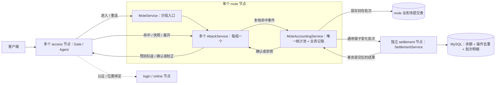

# 目标与逐节点计划

## 1. 目标和当前边界

首个 demo 完成持续运行的多人同组打地鼠：用户名密码登录 → 分组与座位 → 共享地鼠 → 每锤扣银子及返还 → 批量入账确认 → 已保存待提交批次的故障恢复。用户始终只连接 access。游戏没有固定局长、满员开局或局末结算；旧的“60 秒一局、命中加 1 分”建议已废弃。首版只使用示例银子，不涉及真钱。

2026-10-26 收敛：多个 access、先单个 mole、独立 settlement 节点；组命名为 AttackService，mole 内保留业务记账 Service。settlement 以通用银子变化为主线，后续供斗地主复用，不计算地鼠回报。共享池子先用固定概率表实现 99% 的期望返还，仅统计已入账扣除和返还，不做实时余额控奖。mole 完整方案见第 8 节，settlement 预案见第 9 节；均尚未实现。

补充确认：客户端立即播放敲击表现，可先显示服务端计算的预测扣返，拒绝后校正显示；AttackService 固定每锤扣返，MoleAccountingService 首次接纳该用户命中前加载余额、按结算结果更新缓存并做本地预检查，最终银子入账合法性仍由 settlement 裁决。

2026-10-24 用户明确：实际同时在线目标约 12,000 人，100,000 人用于系统容量余量，约为实际目标的 8.3 倍。两档分别验证，容量估算不作为已完成验收；Online 的后续测试计划见第 6 节。

三人斗地主后续单独确认，优先参考 nbgameserver 的 gameofhlddz/；多人分组和共享目标可参考 GoServerActorFsm。参考代码提供知识，不作为兼容目标。

当前 access 已具备 MAC Gate/Agent 连接基础，login 已实现内部用户名密码认证与管理命令，online 已实现内部位置目录；mole、settlement 和 TypeScript 保持骨架。尚无客户端登录协议、access 到 Online 的业务接入、游戏状态或游戏演示。旧实现和旧方案已移除，不能当作已确认设计继续扩展。

每个节点角色一个独立 Go module，源码默认放该项目根目录；common 仅包含共享配置代码。没有调用者的通用框架、协议目录和业务包不提前建立。

## 2. 推进顺序

| 顺序 | 节点 | 先审查并确认的范围 |
| --- | --- | --- |
| 1 | access | Gate/Agent 的职责和生命周期、连接拥有的数据、最少状态、客户端协议准入及 GSR 接入方式 |
| 2 | login | 最小认证能力、账号来源、输入输出、认证 Service 的职责与调用边界 |
| 3 | online | 是否需要独立节点，位置数据由谁拥有，哪些协调和状态确有必要 |
| 4 | mole | AttackService 分组、共享时间线、每锤扣返、业务记账、统计池及批量提交边界 |
| 5 | settlement | 通用银子变化、余额校验、幂等、批量事务和结果查询，预留斗地主原子结算 |

每次只推进一个节点：

1. 只读核对现有骨架、实际依赖版本和 GSR 文档/示例。
2. 展示简短方案：职责、数据 owner、最少状态、必要协议与调用链、失败与生命周期边界、修改范围和验证方式。
3. 用户确认后实现当前节点。common、协议和 TypeScript 只配套加入该节点必需的内容；其他节点的依赖问题先列出，不自动扩展实现。
4. 展示改动和实际验证，等待用户决定是否提交及推进下一节点。

access 连接基础、login 内部认证和 online 目录已提交；当前只整理 mole 实现方案和 settlement 预案，不写业务代码。业务状态尽量少，行为相同的状态优先合并；不为调用、重试和存储步骤增加状态。业务契约见 [PROTOCOL.md](PROTOCOL.md)，按使用范围决定是否需要 .proto。

完成五个节点后再联调打地鼠全流程。三人斗地主、access 多实例和第三方登录分别先确认方案，不提前开工。

## 3. access 第一步（已确认）

- MainService 通过 self.Node().OpenCluster/CreateGate 组装 Cluster 和独立 GateService；每条连接由 Gate 创建一个 Agent。采用 SecurityModeMAC，本机仍使用 WS；先完成 33 字节 X25519 握手，上行使用 seq/Envelope/MAC，下行使用 Envelope，不接受 Plain 降级。监听地址及连接数、帧大小、出站队列上限放在 access 的私有 YAML 配置中，握手等待沿用 GSR 默认 5 秒。
- Gate 拥有连接和 I/O；Agent 只持有 ClientSession 与具名协议 Dispatcher，不接触 socket 或连接表，不持有业务状态，也不增加状态机。
- 调用链为客户端 → Gate → Agent.HandleClientMessage → protocol.Dispatcher。只使用 GSR 通用目录和空业务 Handler 表，错误处理沿用框架规则；没有本项目的协议编号、.proto、生成工具或跨节点业务调用。
- Gate 的断线通知进入 Agent.Handle，Agent 调用 self.Exit 后立即返回；OnStop 调用幂等的 ClientSession.Close。MainService 完成组装后退出，Gate 和 Agent 继续由 Runtime 管理；进程停机由 gsr.Run 收尾。任一步启动失败都向宿主返回错误。
- 修改范围是 access 的入口、MainService、根目录 agent.go 和相关测试/配置；common 仅拆出已有的 YAML 读取和宿主配置解析，角色私有字段留在节点中。其他节点和 TypeScript 保持骨架。
- 验证配置边界、断线清理、真实 MAC 握手与递增序号的消息往返、未握手客户端拒绝、单连接故障隔离、停机关闭连接/监听，以及 Gate 启动失败后的 Cluster 释放；对 access 运行 race。密码学和完整攻击向量沿用 GSR 的验证，不在业务项目复制整套测试。

## 4. GSR 与参考边界

- 节点固定 GSR v1.0.2，tag commit 为 6710a766ca40c06a068e52c52456b39f8b3fe78e；节点仅对本仓库 common 使用本地 replace。
- 本轮只读源码与文档 revision 同该 tag；公开 API 以实际依赖版本为准。升级依据为 [v1.0.2 发布说明](https://github.com/cnooljaw/gsr/releases/tag/v1.0.2)、[ADR 0012](https://github.com/cnooljaw/gsr/blob/v1.0.2/docs/adr/0012-node-capabilities-and-service-logging.md)、[ADR 0013](https://github.com/cnooljaw/gsr/blob/v1.0.2/docs/adr/0013-client-protocol-boundaries.md)和业务 AGENTS 模板。
- 接入参考 [独立业务项目开发指南](https://github.com/cnooljaw/gsr/blob/v1.0.2/docs/APPLICATION-DEVELOPMENT.md)；Cluster 调用优先看 [CLUSTER-CALL-TUTORIAL.md](https://github.com/cnooljaw/gsr/blob/v1.0.2/docs/CLUSTER-CALL-TUTORIAL.md)，直接使用框架已有的参数与调用能力。
- Service、状态所有权、消息快照和资源关闭的工作约束见 [AGENTS.md](../AGENTS.md)，编码规则见 [GO-CODE-STYLE.md](GO-CODE-STYLE.md)。
- ../gsr、../../skynet_bt/nbgameserver 和 ../GoServerActorFsm 均只读，不在其中生成、安装、格式化或验证。

### v1.0.2 接入知识

- Gate 的 Protocol/ProtocolMAC/ProtocolPlain 及配置字段 Protocol 改名为 SecurityMode/SecurityModeMAC/SecurityModePlain 与 SecurityMode，不提供旧名别名；握手、seq/MAC、TLS、wire 和生命周期不变。
- 安全模式与业务协议独立，Agent 选择具体 Dispatcher。本项目继续使用 Protobuf `protocol` 包和原 Envelope；新增的 `protocol/sproto` 保留自己的协议与每连接会话，不在此次升级中接入，也不增加统一 Codec。
- `self.Node()` 借用当前 Run 的唯一节点对象，仅在当前回调内使用。名称发布用 RegisterService，监听用 OpenCluster/OpenHTTP，Gate 创建用 CreateGate，ClusterListenAddress 只用于观测；Node 不提供 Close、业务通信或内部资源 getter。
- `self.Cluster()` 仅提供来源绑定的 Send/Call。应用配置使用 `gsr.RuntimeConfig` / `gsr.ClusterConfig`；`self.Logger()` 返回只有 Info/Error 的 `ServiceLogger`，共享 Logger 由 Run 关闭。
- MainService 完成组装后可以 Exit；节点监听和已创建的 Service 继续运行。CreateGate 创建独立 GateService，由 Runtime 管理；CreateService/CreateGate 的 ctx 仅用于启动，不是所创建 Service 的长期生命周期。名称归目标 Service，注册者退出不撤销。
- MainService 启动失败由 Run 统一收尾；普通 Service 启动失败只清理自身，不自动停止已经创建的其他 Service。消息、Source、wire、ValueCodec 与关闭顺序没有变化。
- 远程 Handler 使用 `int64` / `uint64` / `float64` / `[]any` / `map[string]any` 等规范参数；Dispatcher 不做隐式类型转换，集合的 nil/空状态不作为远程业务语义。本地 Args 浅拷贝不隔离内部集合，参数和结果仍须独立快照。
- 节点表 host 为访问地址，OpenCluster 取 port 绑定 `0.0.0.0`，访问限制归部署网络；端口零仅用于动态监听测试，不作为出站路由。本项目集中维护 YAML 节点表，不额外拆分监听配置。

框架升级只更新五个节点的依赖、启动/测试接线及文档，不保留旧入口兼容包装；login 的业务增量单独记录在下节。

2026-10-14 验证：`./scripts/dev.sh check`、`./scripts/dev.sh build` 和 access 的 `go test -race ./... -timeout=2m` 通过，包含真实 WebSocket 接入、停机及启动失败清理。其余节点只验证骨架编译/静态检查，未验收跨节点业务或 MySQL。

2026-10-23 升级 v1.0.2：五个节点的 go.mod/go.sum 已更新，access 迁移为 `SecurityMode: gate.SecurityModeMAC`。统一 check/build 与 access race 通过，覆盖真实 MAC WebSocket、连接隔离、启动失败清理及 login 的 TCP Cluster 认证；五个构建产物均确认依赖正式 v1.0.2。此轮未重跑真实 MySQL 验收。

## 5. login 第一步（已确认）

- 单个 LoginService 负责用户名密码验证，MySQL `gsrdemo_login.accounts` 保存稳定 UserID、唯一用户名和密码摘要；没有账号缓存、Token、LoginID、在线状态或额外状态机。
- 按用户确认采用标准库无盐 SHA-256，仅用于示例；不引入 Argon2id。账号由本节点 `-create-user` 管理命令创建，密码从标准输入读取；不增加远程注册接口。
- 宿主通过 GSR mysqlclient.Open 创建原生数据库池，Run 返回后关闭。MainService 创建并命名 LoginService、打开 Cluster 后退出；Service 仅借用数据库池，每次 SQL 最多等待 2 秒。
- Cluster 命令接收两个 string，返回 uint64；命令、名称及错误定义与 LoginService 放在 loginservice.go，文档契约集中在 PROTOCOL.md。当前没有其他节点消费者，不提前抽共享包。MySQL 驱动沿用 GSR 示例的 v1.10.1；sqlmock v1.5.2 仅用于测试，标准库没有对应模拟驱动。
- YAML 的 mysql_dsn 为 login 私有字段，公开模板不含凭据；本机凭据保存在被忽略的 login-01.local.yaml。schema.sql 只初始化本项目专用库，不修改 GSR 示例库，节点启动不自动建表。
- 默认测试使用 SQL mock 和两个真实 Runtime 的 TCP Cluster 链路，覆盖正确/错误凭据、重复认证、非法输入、数据库错误与账号损坏。真实 MySQL 验收显式开启，使用独占测试账号并清理；未运行时不声称数据库验收完成。
- 本轮不修改 access 或 TypeScript 的业务逻辑，不推进 online；下一节点或客户端登录接入另行确认。

2026-10-14：统一 check（Go test/vet、TS 类型检查）、login race 与 login 构建通过。GSR 的本机 MySQL 凭据已只读复用到本项目私密 YAML；管理员已初始化专用库。`GSRDEMO_MYSQL_INTEGRATION=1 go test -run '^TestLoginLiveMySQL$' -timeout=30s -v` 通过：真实 MySQL 创建账号、拒绝重复覆盖，通过 TCP Cluster 两次认证返回同一 UserID，错误密码/不存在账号均拒绝，测试账号清理成功。此验收不包含 access 客户端登录或跨进程业务联调。

## 6. Online 容量估算与待测计划

- 客户端连接、握手与重连由多个 access 承担；Online 保存位置目录，承受节点间 Bind/Lookup/Unbind 等调用压力。游戏操作直接到房间，不逐次查询 Online，也不把客户端心跳转发给 Online。
- 按单 Online 节点、单 OnlineService 起步，是否分片依据真实业务压测决定。以下是估算与测试目标，不直接代表容量已验收，实际测试证据在本节末尾记录。
- 常态估算假设平均在线 30 分钟，每次上线/下线各一次目录调用，另按平均每 10 分钟一次房间位置更新预留：`人数 ÷ 1800 × 2 + 人数 ÷ 600`。额外查询另计；房间更新接口尚未实现。
- 集中重连估算按每人一次 Bind 加一次 Lookup，即 `人数 ÷ 重连秒数 × 2`。这是 Online 的业务 RPC/s，不是客户端连接数；全用 Call 时请求和回复报文数约为其两倍，不等同于 TCP 包数。

| 档位 | 目录记录数 | 常态估算 | 全量用户 60 秒重连 | 全量用户 10 秒重连 |
| --- | ---: | ---: | ---: | ---: |
| 实际在线目标 | 12,000 | 约 33 RPC/s | 400 RPC/s | 2,400 RPC/s |
| 系统容量余量 | 100,000 | 约 278 RPC/s | 约 3,333 RPC/s | 20,000 RPC/s |

Online 实现后，先验证 12,000 条记录下的持续混合调用和上述两档重连峰值；再验证 100,000 条记录、1,000 RPC/s 持续负载，以及约 3,333～5,000 RPC/s 的重连峰值。100,000 人十秒重连的 20,000 RPC/s 作为边界探索，不预先承诺通过。测试使用多个调用方经真实 TCP 汇聚到同一个 OnlineService，覆盖 Bind/Lookup/Unbind 的真实状态变化与 LoginID 竞争；测量前明确持续时长、延迟和拒绝率门槛，记录实际输入/完成速率、P99/最大延迟、MailboxFull、超时、CPU、GC、堆/RSS、排空时间及最终目录正确性。节点调用压测与 access 长连接压测分别报告。

参考证据：[GSR 性能基线](../../gsr/docs/PERFORMANCE-BASELINE.md)、[混合负载](../../gsr/docs/MIXED-LOAD-VALIDATION.md)。历史测试为单热点 Service 本地 Send 约 9,861/s，以及三分钟总量约 9,800/s（含跨节点 Send 约 1,960/s）；均非吞吐上限，也不直接证明当前版本的单热点跨节点 Call 容量。2026-10-24 独立内存估算程序在 Go 1.24.13/arm64 下使用 `map[uint64]location`，location 含 36 字节 LoginID、9 字节 AccessNode、40 字节 AgentName，字符串分别分配；100,000 条记录 GC 后堆增量约 18.7 MiB。此结果不包含完整节点、队列和网络缓冲，不替代业务实现后的内存测量。

2026-10-24 首轮 Online 容量样本通过（GSR v1.0.2、Go 1.24.13、darwin/arm64）；命令与负载构成见第 7 节，非 race 采样，总耗时约 125 秒。

| 预装记录 | 目标 RPC/s | 实际完成 RPC/s | 60 秒完成数 | P50 | P99 | 最大调用延迟 | 发生器最大迟到 |
| ---: | ---: | ---: | ---: | ---: | ---: | ---: | ---: |
| 12,000 | 2,400 | 2,399.92 | 144,000 | 40.334 μs | 219.458 μs | 84.578 ms | 187.764 ms |
| 100,000 | 5,000 | 4,999.83 | 300,000 | 38.291 μs | 163.750 μs | 40.962 ms | 38.626 ms |

两档调用无错误，所有期望结果、最终逐条位置与清理核对通过，未观察到 Call 返回 MailboxFull 或超时。发生器按绝对时间追赶批次，平均速率达标不表示均匀输入；延迟包括调用端结果核对开销。开发机未做 CPU 隔离，首档采样期间还执行了一次局部 check/build；保留原始尾延迟，不据此归因或宣称生产 SLA。此结果支持单节点方案的初步容量选择，不代表多个真实 access 进程、客户端重连、实际业务流量比例或长期稳定性已验收；第 6 节的完整联调计划仍待执行。

## 7. online 第一步（已确认）

- 一个 OnlineService 独占 `map[uint64]onlineLocation`，按 UserID 保存 LoginID、AccessNode、AgentName。仅提供 Bind/Lookup/Unbind，不保存额外在线布尔值、房间状态、历史登录或墓碑，不访问 MySQL/Redis，不启动业务 goroutine。
- AccessNode 与 AgentName 共同定位连接，支持多个 access 使用相同 Agent 名称。未来各 access 使用独立 Cluster 路由名；当前 access 的多实例配置、客户端认证与路由接线仍是后续范围，不在本轮修改 common、access 或 TypeScript。
- 新 LoginID 替换当前绑定，返回旧位置；相同当前 LoginID 只接受完全相同的地址。Unbind 仅匹配 LoginID，不按接入节点批量清理。命令使用规范标量参数，结果为独立快照或 nil，具体错误与超时/重试约束见 [PROTOCOL.md](PROTOCOL.md#online-位置目录)。
- 沿用 GSR v1.0.2 的 Cluster 教程和双节点示例：MainService 创建并命名 OnlineService，OpenCluster 后退出；Runtime 管理 Service，Run 管理节点。Online 不同步调用其他节点；重启清空目录，后续接入重新绑定，不承诺异常时目录实时准确。
- 代码与命令定义放 onlineservice.go；没有真实业务消费者时不提前提取 common 契约。普通测试覆盖跨节点替换、同 ID 冲突、独立快照、非法输入、两接入节点竞争、旧连接迟到清理、真实 TCP 及重启空目录。
- 容量测试使用 `GSRDEMO_ONLINE_LOAD=1 go test -run '^TestOnlineClusterLoad$' -v -timeout=3m` 显式开启；四个测试接入节点在同一测试进程内各运行一个 Runtime/Cluster，经 TCP 汇聚到实际 Online MainService。两档分别预装 12,000/100,000 条记录，定速 60 秒，目标 2,400/5,000 RPC/s。等量混合 Bind 替换、Lookup、旧 LoginID Unbind；计时后逐条核对最终位置、成功解绑与重复解绑。它是有界四路并发的目录压力样本，不是客户端重连或跨进程部署验收。
- 容量样本不增大队列、不重试失败调用；任何调用/结果错误失败，并检查实际完成速率达到目标的 98%。P99、最大延迟和发生器最大迟到如实报告，不预设生产 SLA；堆/GC 是同进程客户端、服务端与夹具聚合采样，后采样还包含最终核对和清理，不等于 Online 独占 RSS 或精确稳态内存。CPU/RSS、长时间稳定性、实际 access 多实例和全量重连恢复仍需后续联调验收。

2026-10-24 实现验证：`./scripts/dev.sh check online`（common/online test 与 vet）、`./scripts/dev.sh build online`、online 的 `go test -race ./... -timeout=2m` 及上述容量样本均通过。真实 TCP 用例运行多个独立 Runtime/Cluster，并未启动多个 OS 进程；重启测试为有序停止节点后创建新的空目录，不等于强杀恢复演练。没有新增依赖或修改其他节点业务。

## 8. mole 实现方案（草案，尚未实现）

### 8.1 已确认边界与参考

- 首版一个 mole 进程，多个 access 可接入；mole、settlement 保持独立节点。一个进程一个 Runtime/Cluster。
- 一个游戏组用一个 AttackService，最多 3 人、9 洞；有人即可玩、空位可补、随时退出，无固定局长。3 人/9 洞沿用前述最简方案，地鼠出现间隔和每锤成本在实现前固定演示参数。
- 不引入通用 FSM、PlayerService、锤子种类、连击、技能、动态控奖、预授权额度或通用任务框架。地鼠仍需要实例号、时间窗口、待确认命中等必要字段，不把“没有 FSM 框架”等同于没有业务状态。
- 只读参考 GoServerActorFsm 的 RoomActor 分组、AttackActor 共享时间线、ShrewTimeline 的 SpawnSeq/命中窗口和快照契约；不复制 PlayerActor/FSM 层次或其 Envelope。GSR 接线依据 v1.0.2 开发指南的 Service owner、Send/Call/Timer 边界。

### 8.2 Service 和状态所有权

| 类型/角色 | 唯一拥有的数据 | 职责 |
| --- | --- | --- |
| MainService | 启动参数，借用宿主数据库池 | 创建并命名业务 Service、OpenCluster 后退出；Run 关闭节点，宿主关闭数据库池 |
| MoleService（节点内名称 mole） | UserID → AttackName 路由、可加入组的目录 | 分组、重复进入与重连路由、按组实例匹配的退出/清理；不持有地鼠或银子余额 |
| AttackService（每组一个，具名 attack-随机实例ID） | 成员、座位、连接地址、地鼠实例/时间线、待确认 HitID | 命中校验、固定每锤扣返、快照、组内推送、连接替换与退出；不持有权威银子余额，不做 SQL 或等待远端记账 |
| MoleAccountingService（节点内唯一） | 私有统计池、用户余额/版本缓存、跨组待提交事件、封存批次及待扣记录 | 初始加载余额、本地预检查、持久保存批次，调用 settlement，更新缓存并确认给组；不直接修改持久余额 |

统计池是 MoleAccountingService 的普通私有值对象（molepool.go），不是新节点或独立 PoolService。它统计已入账锤数、累计扣除、累计返还、净留存；净留存可因波动暂为负数，不表示用户允许透支。等待中和被拒绝的锤不计入已入账统计。规则版本、单锤成本和返还表属于 mole；统计池不是持久化钱包或可分配资金账户。

### 8.3 最少玩法与命中流程

1. access 完成认证后，携带 UserID、LoginID、AccessNode、AgentName 调用 MoleService.Enter。入口负责同一用户只路由到一个组，并通过 MoleAccountingService 确保该用户余额缓存已加载；首次向 settlement 查询余额和版本，失败不能把未知当作零或允许扣款。成功后热点请求直接到 AttackName，不逐次查询 Online。重复进入或更换 access 不重置已有待扣记录。
2. AttackService 分配真实空座位；同用户重连保留组和座位、更新连接标识。旧 LoginID 的操作和断线通知不能修改新连接。非空组持续运行，空位可补；空组可退出并按实例号通知 MoleService 清理，不能清理新组的路由。
3. 使用 GSR 一次性 After 投递普通命令，Handler 完成后再登记下一次；按服务端截止时间检查命中，Timer 迟到不会延长有效窗口。Snapshot 同样按当前时间收敛。停机沿用 GSR 的 owner 清理；注册 Timer 失败需报错，不能默默宣称时间线正常。
4. 客户端提交目标实例和 ActionID，不提交银子数值。服务端按 AttackID、SpawnSeq、洞位、有效窗口及当前 LoginID 校验，生成 HitID（组随机实例 ID + 单调候选序号），不能只用目标实例作为 HitID。同一目标同时最多一个候选；同一 LoginID/ActionID 重试返回原结果，改内容则拒绝，不重新抽回报。目标有效期间保留请求去重记录，达到有界上限即拒绝新请求；过期清理后，旧目标请求仍因时间窗口被拒绝。终局拒绝后，新的 ActionID 可以产生新的 HitID。
5. AttackService 按 HitID 固定一次成本、返还与规则版本，将不可变事件 Send 给本地 MoleAccountingService；Send 接纳失败返回忙并撤销目标占用，不进入无界队列。客户端敲击动画立即播放，可根据服务端预测扣返更新显示，不必等待数据库；Send 成功不表示余额预检查通过或已经入账。记账 Service 预检查失败或结算明确拒绝时回推校正，重试不重新抽样。
6. 地鼠在该候选处理期间不可被第二人重复认领。银子不足等终局拒绝不产生有效扣返；目标仍是同一实例且未过期时可解除占用。已过期/已换新的目标不复活；迟到确认只完成对应 HitID，不能击中新地鼠。
7. 正常条件下目标为约 0.5～1 秒内确认；UI 无需显示等待态，但预测变化须按 HitID 跟踪，不能作为已持久化成功。明确拒绝时撤销该锤的预测扣除和返还；超时仅表示未知，查询原结果后处理，不能直接回退或另做一笔反向账。确认前的返还只参与 UI 预测，不计入服务端可用银子；客户端用权威余额版本及已覆盖操作标识收敛，重复通知不能重复加减。

候选演示数学表（仍需确认数值）：一锤扣 100 个最小银子单位，返 0 或 198，各 1/2；期望返还 99，长期收益期望 1%。它仅说明最简可测试模型，不是已确认赔率，不做动态补偿或短期强行保收益。金额使用 int64 最小单位，非负成本/返还及溢出都要校验。

### 8.4 业务记账、退出与恢复

- 余额缓存和预检查唯一归 MoleAccountingService：本地可用银子 = 最近确认余额 − 所有已接纳但未获终局结果操作的扣除总额，包含待封存和在途批次。按完整 Debit 检查，不将待确认 Credit 用于支付后续锤；同 HitID 重复事件不重复增加待扣。缓存未加载时先查询，加载失败拒绝新的银子操作；本地判不足可按需受限刷新，避免陈旧余额长期误挡。该缓存只是预检查，settlement 始终再次校验。
- 每次批次结果带本批涉及用户的确认余额和版本，以及已处理操作标识；在同一 Service 回调内移除对应终局操作的待扣，并按版本替换确认余额，不把已包含在返回余额中的扣款再减一次。拒绝操作同样释放对应待扣；重复/旧回复不能重复释放或覆盖新余额。超时保留待扣，待原 ID 的结果明确后处理。缓存不充当跨游戏资金冻结，也不改变 settlement 的唯一持久余额 owner。
- 在节点内跨组归批，不按每组/每用户单独提交小事务。起始建议“最老事件等 100ms、500 个操作、256KiB”任一先到即封存，参数必须通过实测调整；正常流量不叠加第二层一秒等待。
- 每次有效候选生成一个通用银子操作：OperationID=HitID、Business=mole、业务引用含 AttackID/SpawnSeq、扣除 Debit、返还 Credit、固定规则版本。另存回推地址，不把连接地址当钱包地址。多个操作包装成 BatchID；批次封存后内容和顺序不变。
- MoleAccountingService 先将封存批次写本节点的业务待提交表，再发有限等待的 Cluster.Call。主线程不保存 self/Node/context，不启动业务 goroutine；SQL/远程等待只阻塞该记账 Service，AttackService 继续处理其他组内消息。队列有界，积压达到上限停止接纳计分命中并返回忙。
- 一次仅推进一个在途封存批次，优先保证简单、顺序和可恢复；其余积压有界。具体超时/退避由业务决定，超时只表示结果未知；查询/重试原 BatchID，禁止改内容或重新抽样。收到终局结果后，先保存本地确认结果，再更新统计池投影并回推；通知丢失不改变已经入账的银子。
- 用户退出只释放连接/组成员，不取消已交给记账 Service 的操作；即使 AttackService 已退出，记账仍继续。重连以结算余额为准，可按 OperationID 查询结果；回推只发给匹配 LoginID 的 Agent，旧余额版本不能覆盖新版本。
- 启动时先恢复并确认所有已保存待提交批次，再读取结算中的 mole 历史入账汇总重建统计池；在恢复完成前不接纳新计分命中。统计池从去重后的已入账操作投影，不能在每次重试回复时再次累计。
- 可靠性边界：已保存批次必须可补交，已确认银子不能丢或重复；尚未封存/保存的内存候选在进程崩溃后可失败，立即反馈不等于可靠入账。本版不恢复崩溃前地鼠/座位。这里只用一张业务待提交表，不建通用 Outbox/MQ/CDC 平台。

### 8.5 协议、文件与实施顺序

- 内部业务边界按 PROTOCOL.md 草案使用 string/uint64/int64、规范列表/map，不做内部 Protobuf 二次封装。当前没有 access 游戏 Handler，本轮先用测试 Service 验证，客户端 .proto 在实际接线时才增加。
- 预计文件：moleservice.go、attackservice.go、attackservice_game.go、moleaccountingservice.go、moleaccountingservice_mysql.go、molepool.go 及同名前缀测试；沿用 main.go/main_service.go、私有 YAML 和 schema.sql。不提前建 cmd/internal 或公共 GameService。
- 第一步：纯规则、AttackService、MoleService；覆盖目标实例/时间窗口、重复命中/进入、补位、旧连接及旧确认隔离。
- 第二步：MoleAccountingService、初始余额加载/缓存预检查、统计池和业务待提交表；先用确定性扣返与 SQL mock 建失败用例，再做本地真实 Service 测试。
- 第三步：用测试结算 Service 经真实 TCP 检查跨组批次、余额不足拒绝、超时/丢回复、重复提交、退出和重启恢复；测试替身不代表真正 settlement/MySQL 已验收。
- 第四步：展示 mole 改动与实际验证，确认后再实现独立 settlement；最后接入真实 access 多实例和 TypeScript，不能提前宣称客户端闭环或 0.5～1 秒到账 SLA 已完成。

### 8.6 mole 验收重点

至少覆盖：两人抢同一目标只形成一锤；同 ActionID 不重新抽样、同目标拒绝后的新尝试不复用 HitID；旧 SpawnSeq/过期请求不命中新实例；待确认目标拒绝重复申领；银子不足拒绝不产生奖励；旧 LoginID/迟到结果不影响新连接；退出不取消已保存操作；空组回收/单组 panic 不拖住其他组；记账/数据库不可用有界拒绝且不假报到账；原批次恢复不重新抽样；已确认统计不会重复累计。受影响包运行 race，真实 SQL 与多进程门禁单独报告。后续按 12,000 在线和 100,000 余量验证计分事件率、归批、DB、尾延迟与恢复；此前 Online 吞吐不替代银子结算容量。

余额与 UI 补充用例：首次加载失败不接纳银子操作；连续命中会扣减本地可用额；待确认返还不可消费；本地预检查通过但 settlement 拒绝时正确校正；批次结果不重复扣减或释放待扣；旧余额不覆盖新版本；超时不提前释放；重连不清空待扣；预测 UI 的拒绝回退不产生反向财务操作。

## 9. settlement 节点预案（只记录，尚未实现）

### 9.1 以银子变化为主线

- 独立 settlement 进程，先一个 SettlementService；它唯一修改用户持久银子余额和记账记录。mole 和未来 landlord 都通过同一通用契约提交，不导入彼此实现。
- 输入是 Business、BusinessRef、OperationID 和一组用户银子变化；业务规则决定输赢/扣返，settlement 不认识地鼠洞位、地鼠 Timer、斗地主牌型或概率算法，也不维护 mole 的玩法池。
- 一锤是一项原子业务操作，单用户 Debit=成本、Credit=返还；斗地主一局的多个输赢用户是一项原子业务操作，不能因传输分片把它拆成互不关联的扣款和加款。斗地主何时确保输家付得起及收益规则留到该节点设计，不在这里提前建设资金冻结框架。
- 一个传输批次可携带多个互不相关的业务操作。原子性以 OperationID 为单位；银子不足拒绝整个业务操作，不把一个斗地主操作只执行一半，也不连带拒绝批次里无关的地鼠操作。

### 9.2 校验、批量事务和幂等

1. 校验固定版本契约、数量/字节上限、非零用户、非负 Debit/Credit、int64 范围、重复 OperationID 与内容摘要；业务细节只归档，不触发游戏回调。
2. 在同一 MySQL 事务中读取并锁定本批涉及的余额/必要去重记录，按稳定用户顺序访问。同一操作先检查每个付款用户的可用余额能覆盖 Debit，再应用 Credit；不能仅用净额检查。不同操作按封存顺序使用事务内工作副本推进。
3. 余额不足是终局业务结果：该操作所有用户都不变，保存拒绝结果。其他操作仍可处理。SQL/连接/提交失败则整笔数据库事务回滚或结果未知，不能当作终局业务拒绝。
4. 只汇总本次新成功操作的每用户 Debit/Credit，批量更新余额及版本；保存去重索引和完整批次结果。提交后才返回入账确认。所有集合化 SQL 保留有限批次，不在 Go 中逐用户发一条 SQL。
5. 同 OperationID、同内容返回已有终局结果；同 ID 不同内容拒绝。BatchID 同样绑定不可变内容，重试不再次扣返。不能只按 BatchID 去重而容许同一操作换批次重记；重复操作的历史变动不能再次加入本批汇总。

### 9.3 最小存储与明细策略

| 数据 | 首版用途 |
| --- | --- |
| 银子余额表 | UserID、余额、版本；不由 Agent/AttackService 写入 |
| 紧凑操作索引 | OperationID、请求摘要、所属批次/结果定位；保留必要去重，不复制全部游戏明细或建设分析索引 |
| 结算批次表 | BatchID、请求摘要、来源、顺序、逐操作终局结果和完整原始明细 JSON，以及扣返/成功拒绝汇总 |

完整逐锤明细先随批次 JSON 保存在同一事务中，不建独立逐锤分析表、明细节点或外部导出链。它仍写入完整事实和必要的逐操作去重索引，并非消除了每锤的存储成本。按 OperationID 查询可经索引定位批次结果；mole 启动可查询其已入账操作汇总来恢复统计池，汇总以唯一成功操作为准，不能将重复批次返回的历史结果再次计入流水。首版不为此另造缓存体系。

若未来确有必要将完整明细外移，再以同事务 Outbox 或等价可恢复记录保证余额与待导出内容原子提交，消费方去重后可靠保存再清理；本版 settlement 不提前实现导出 Outbox。扣除、返还、数量、业务引用、批次摘要和余额变化需可对账，不能只核对全局净额。批次 JSON 和去重索引不自动过期，保留/归档策略另行确定。

### 9.4 复用与未来验收

内部接口先预留 SubmitBatch、GetBatch、GetOperation、GetBalance 与按业务查询已入账汇总，具体命令编号和字段在实现时固定于 PROTOCOL.md；真正由两个节点消费后，再提取最小 common 契约，不搭万能结算框架。

未来需验证：地鼠扣返与斗地主多用户原子变动走同一入口；扣款能力按 Debit 而非净额校验；余额不足不部分执行操作；OperationID/BatchID 重试不重复，内容冲突拒绝；重复操作混入新批次不再累计；数据库回滚/超时/提交成功但回复丢失；重启后终局结果一致；明细与余额可对账。真实吞吐以 SQL/事务测试为准，目标正常约 0.5～1 秒确认，故障时允许延迟但不假报成功。

待最终固定的演示参数：一锤成本和返还概率表、地鼠产出频率与可命中窗口、批次/积压/超时上限。上述候选值均为建议，不能作为已实现能力或正式容量承诺。
