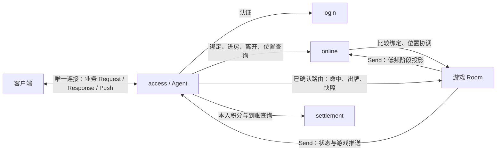

# 用户状态、位置与协议准入

本文细化 [DESIGN.md](DESIGN.md) 的用户契约，作为切片 B 起的实现依据。当前代码仍是切片 A 的诊断接线，尚未实现本文的登录、位置状态机和业务协议。

## 1. 用户始终连接 access

一个客户端连接对应一个 access Agent。登录、查询当前位置、进入游戏、游戏操作、查看结算和返回大厅都经过这个连接；进入游戏时不会改连 mole、landlord、online 或 settlement。所有客户端响应和推送也由该 Agent 写回。

客户端发送业务意图和操作参数。access 根据已认证身份及已确认位置选择内部目标，填入 UserID、LoginID 和房间绑定信息。客户端不能指定内部 Node/ServiceName，不能通过请求中的 UserID 或 RoomID 切换到别人的身份或任意房间。

## 2. 状态有明确 owner

用户状态分成连接、位置和房间阶段三个维度，各有一个写入 owner。每用户无需另建 PlayerService，也不共享可变 User 对象。

| owner | 自己推进的状态 | 持有的其他状态 |
| --- | --- | --- |
| access Agent | 本连接的认证、绑定等待、位置同步、关闭 | Online 确认的位置；Room 提供的本人可见阶段/快照 |
| OnlineService | 该用户当前接入、大厅/游戏位置、进行中的位置迁移、断线标记 | 当前 Room 的低频阶段投影及其版本 |
| RoomService | 成员、座位、游戏阶段、目标/手牌/回合、局末结果 | 当前玩家的 LoginID、Agent 地址和绑定令牌 |

Online 是位置协调的唯一 owner，Room 是游戏阶段的唯一 owner。access 和 Online 都能回答用户在哪个游戏/房间、已知处于什么阶段、适用哪组协议；房间阶段是有版本的观察值，消息在途或断线时可能滞后。每次游戏操作仍由 Room 检查当前绑定、阶段和具体条件。

Online 不保存每次命中、积分变化或私人手牌；access 不决定命中合法性、轮到谁出牌或是否到账。未认证连接尚无 UserID，只在 Agent 内管理，不创建 Online 用户记录。

## 3. 两处用户状态机和房间状态机

### 3.1 Agent 的连接状态机

| 状态 | 含义与允许的工作 | 迁移事件 |
| --- | --- | --- |
| unauthenticated | 尚未认证；只接收登录及连接级探活 | 登录请求 → authenticating |
| authenticating | 正在验证账号；排队到达的请求也要重新检查状态 | 失败 → unauthenticated；成功 → binding |
| binding | 已认证，但 Online 绑定尚未确认；禁止游戏操作 | 确认并安装位置快照 → active；明确拒绝 → 关闭连接；结果未知 → synchronizing |
| active | 身份、位置及路由已确认；按位置/阶段准入协议 | 发起进房/离开 → synchronizing；绑定失效 → 关闭连接 |
| synchronizing | 查询或推进一个未完成的位置操作；保留旧位置和目标，不把目标当作已生效 | 同一 OperationID 的确定结果 → active；仍未知 → 保持；绑定失效 → 关闭连接 |
| closed | 不再接收客户端业务，不再安装状态/推送 | 终态 |

任一活跃状态收到断线或被替换通知都可进入 closed；按 LoginID 做有界条件清理。登录后的用户换账号需建立新连接，首版不在同一个 Agent 中叠加另一轮身份绑定。

业务状态由 Agent Mailbox 中的 Handler 推进。Handler 等待 Call 时不会处理下一条消息；这不能替代检查，因为等待结束后排队请求仍可能处于另一个状态。协议不因“它曾经在正确状态下发送”而放行。

### 3.2 Online 的位置流程状态机

位置至少为 `lobby` 或 `room`；room 携带 GameKind、GameNode、RoomID 和 RoomName。另有流程状态：

| 状态 | 契约 |
| --- | --- |
| active | 已确认的 UserID/LoginID、Agent 和位置；可开始一次条件位置变更 |
| transitioning | 保存 OperationID、旧位置、目标位置；同用户不开始第二次变更 |
| uncertain | Call 超时或确认缺失；用原 OperationID 查询/条件重试，不能清空记录后另起操作 |
| disconnected | 当前连接已断开；房间位置和结算资格仍可保留，重连走比较绑定 |

绑定、进房、离开和重连都经过这套流程。只有成功结果才能安装新位置，明确拒绝保留旧位置；断线与迁移相交时必须保留未确认操作，并继续核对其结果，不能把 disconnected 当作迁移已取消。

### 3.3 房间阶段

打地鼠沿用 `filling → running → result_unsaved → settlement_pending → settled`。斗地主首版也区分等人/准备、进行中和局末结算；准备情况、当前回合等细节仍在斗地主 Room 内判断。两个游戏各自实现状态迁移。

同一连接的 active 表示可以按已知位置操作，不意味着游戏一直处于 running。断线也不意味着退房、结束本局或取消结算。

首个完整 demo 在 filling 及 settled 阶段允许通过 Online 离开；running、result_unsaved、settlement_pending 阶段保留本局位置，允许同步和查询，不开启另一局。以后若支持待结算时离房，需要先证明持久化任务不依赖房间/连接存活，并单独修订此契约。

## 4. 保存什么位置与版本

Online 用户记录的最小字段：

- 身份与接入：UserID、LoginID、AccessNode、AgentName、连接状态。
- 已确认位置：LocationKind、GameKind、GameNode、RoomID、RoomName、BindingToken、LocationVersion。
- 房间观察：RoundID、RoomPhase、RoomStateVersion、是否已有有效阶段观察。
- 进行中操作：OperationID、操作内容、旧位置、目标位置、流程状态和确定结果。

Agent 持有本连接状态、已认证 UserID/LoginID、同一份已确认位置快照及进行中 OperationID，不持有 Online 的可变记录。BindingToken 和内部节点地址不向客户端公开。客户端只获得本人可见位置、游戏/房间/局标识、阶段、版本及准入的 msg_id。

LocationVersion 由 Online 为该用户单调分配。准备一次位置变更时分配目标版本，拒绝后也不复用；只有确认成功才把该版本装入已确认位置。登录替换、进房、离开和重连都必须换版本，断线等已确认目录变化也推进版本。版本不会因为一次游戏命中增加；Online 重启沿用 DESIGN 的协调重启边界，不承诺跨该边界延续内存版本。

RoomStateVersion 由 Room 在同一 RoomID 内单调推进，不随新局重置；RoundID 单独标识局。access/Online 不能把它当作全用户的位置版本。内部状态消息须带 UserID、LoginID、RoomID、BindingToken 和相应房间版本，接收者先匹配当前已确认绑定，再比较版本。换房、返回大厅或被新连接替换后，旧房间的迟到状态不能重新把用户带回去。

Agent 安装 Online 位置结果时还要比较 LocationVersion：旧版本不覆盖新位置，同版本内容必须一致。QueryOperation 可以返回旧操作的历史结果，但只有匹配本连接当前待确认 OperationID 的确定结果才能结束同步并安装目标位置，历史查询不能再次执行一次状态迁移。

## 5. 哪些 proto 可以使用

生成的 Registry 回答“这个 msg_id 对应什么类型、方向和 Request/Response/Push”；用户状态策略回答“这个连接现在可以调用它吗”。Registry 和 Dispatcher 在启动时组装；状态变化时使用显式准入规则，保持协议解码表稳定。

下表的操作名称是业务语义，切片 B/C 在相应 proto 中固定实际消息名和编号。所有 Request 都有对应业务 Response；正常状态拒绝使用 `not_authenticated`、`state_mismatch`、`operation_pending`、`binding_replaced` 等明确业务结果。

| 连接/位置/阶段 | 可以发起的业务 Request | 内部目标 |
| --- | --- | --- |
| unauthenticated | PasswordLogin；第三方登录在对应切片加入 | Login → Online 绑定 |
| binding / synchronizing | QuerySession、QueryOperation；只查询本连接的绑定/迁移 | Agent / Online |
| active / lobby | QuerySession、EnterMole、本人 QueryBalance / QuerySettlement；EnterLandlord 在对应切片加入 | Online / Settlement |
| active / mole / filling | QuerySession、MoleSnapshot、LeaveRoom、本人结算查询 | Room / Online / Settlement |
| active / mole / running | QuerySession、MoleSnapshot、MoleHit、本人结算查询 | Room / Settlement |
| active / landlord / filling | QuerySession、LandlordSnapshot、LandlordReady、LeaveRoom、本人结算查询 | Room / Online / Settlement |
| active / landlord / running | QuerySession、LandlordSnapshot、LandlordPlay、LandlordPass、本人结算查询 | Room / Settlement |
| active / room / result_unsaved 或 settlement_pending | QuerySession、对应游戏 Snapshot、本人结算查询 | Room / Settlement |
| active / room / settled | QuerySession、对应游戏 Snapshot、本人结算查询、LeaveRoom | Room / Settlement / Online |
| active / room / 阶段未知 | QuerySession、对应游戏 Snapshot、本人结算查询；先取得阶段后开放游戏写操作 | Room / Settlement |
| closed | 无 | 无 |

连接级探活可在所有未关闭状态使用，不获得任何额外业务权限。MoleHit 不适用于大厅、等待组或斗地主；LandlordPlay 不适用于打地鼠。进入协议只在大厅开放，返回大厅仍由 Room 的移除确认和 Online 的位置确认决定。

准入采用默认拒绝的显式表/函数。access、Online 对同一已确认位置采用相同协议策略；Agent 的连接状态再收紧范围。Online 的阶段视图可用于展示和早期拒绝，进房/离开等写操作仍向 Room 核验。客户端收到的 allowed_msg_ids 用于交互提示，不能作为授权凭据。

Agent 在强类型协议 Handler 的业务调用前检查状态，拒绝时写对应 Response，不把状态错误交给通用 internal 错误转换。Room 再校验 UserID/LoginID/BindingToken、房间与局号、阶段、目标/回合及幂等键。access 放行不代表游戏操作已合法。

本阶段仅诊断用的 Probe 不参与这些业务准入；当前的私有探测令牌也不充当 LoginID。诊断接口的部署开关及业务登录接口随切片 B 明确分开。

## 6. 状态如何同步

### 登录、进入和离开

1. Agent 记录 OperationID，进入 binding 或 synchronizing；新目标尚不可用。
2. Online 保存条件操作并分配目标 LocationVersion，向 Room 发起有限预算的绑定/移除。
3. Room 确认业务操作，返回绑定令牌和当时的阶段快照；Online 确认位置，返回带 LocationVersion 的完整位置快照。
4. Agent 匹配 LoginID/OperationID 并安装确定结果，进入 active，再向客户端回复。返回大厅时同时移除旧游戏路由和阶段。
5. 结果未知时保留原操作，QueryOperation 核对结果；客户端不能通过再次 Enter 或 Login 绕开它。

客户端不因收到游戏推送而自行认定进房已确认。先于确认到达的目标房间消息不能激活新路由；首版忽略未匹配消息，确认响应中的快照及确认后的同步修复遗漏。

### 游戏阶段改变

Room 阶段变化后，向本组 Agent Send 带绑定条件和版本的完整可见状态；同时向 Online Send 精简的阶段投影，不在每次命中/出牌时更新目录。Online 只接受当前已确认绑定对应且版本更新的投影，Agent 也先检查绑定、后安装快照并向客户端 Push。Room 的主动消息不允许改写 Agent 的位置路由。

Send 成功不等于已经送达。Online 对已确认房间做有限预算、分批的阶段核对，也在需要刷新阶段的 QuerySession 中核对；已有 Agent 可直接向当前 Room 请求快照修复，不依赖 Online 每次在线。Room 不 Call Online/Agent，保留 `Agent → Online → Room` 和 `Agent → Room` 的有向等待链。

access 快照滞后可能提前拒绝一条已经可执行的消息，返回 state_mismatch 并允许同步快照后重试原业务操作；不能将旧操作改成新的局号/回合号。快照若尚无已确认阶段，只允许同步/查询。快照错误地仍显示 running 时，Room 的再次检查防止结束后的命中或出牌生效。

Online 不可用时，已确认连接继续使用原 Room 路由和 Room 快照进行游戏；新的位置迁移被拒绝。QuerySession 若不能取得新确认必须标注观察来源和是否刷新成功，不能将缓存包装成一次新的目录确认。

## 7. 实施与验收

先按业务切片实现枚举、显式迁移函数和协议策略，状态更新留在各 owner 的 Handler 中，外部 Call/Send 与迁移明确顺序。不引入通用 FSM 库，不用状态回调隐藏跨节点 I/O；common 仅提取 access 和 Online 实际共用的状态快照与准入规则。

协议按职责放在 common/proto 的 auth、session、mole、settlement 目录；landlord 随对应切片建立。session 定义客户端可见位置/状态、QuerySession/QueryOperation、状态 Push，以及内部位置和阶段同步载荷；内部命令号与客户端 msg_id 独立。只生成当前切片真正需要的消息，不能先铺设无人调用的整套协议。

关键失败用例先于实现建立：

- 未登录命中、大厅出牌、等待组命中、打地鼠连接发斗地主消息，均明确拒绝且无内部业务写入。
- 登录或迁移结果未知时，第二次进房不能创建另一位置操作；确认后才安装目标路由。
- 同用户重新登录后，旧 LoginID 的命中、断线和阶段消息不能改变新绑定。
- 已经返回大厅/进入另一房间后，迟到 Room Push 不能修改路由或恢复旧协议权限。
- 房间已开局而 Agent 仍显示 filling 时可同步恢复；房间已结束而 Agent 仍显示 running 时 Room 拒绝命中，不新增积分。
- 丢失阶段投影时 QuerySession/快照修复；Online 故障时已有 Room 操作继续，新进房失败。
- 房间结束仅开放结果同步/结算查询；未保存、待结算和已到账状态清楚区分，断线成员不漏结算。
- 多个客户端全部仅连 access；进入、游戏和返回大厅期间不建立直连业务节点的连接。

这些行为在切片 B/C 实施和真实进程验收前，不能以文档或单纯编译通过宣称已经完成。
